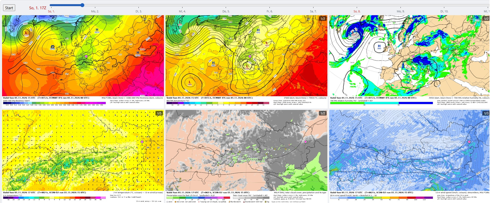

# Wetterkartenviewer



Zeigt selbst gerenderte Karten des ECMWF IFS und des DWD-Modells ICON-D2 (Österreich, stündlich
bis +48 h) mit einem Zeitslider und auf der Startseite drei ECMWF-ENS-Meteogramme.
Die Seite: https://schletz.github.io/wetterkartenviewer/

Der Skill `synop` (in `skills/synop`) erstellt aus denselben Daten synoptische Analysen. Installieren:

```
npx skills@latest add schletz/wetterkartenviewer --skill synop -g -y --copy
```

## Karten aktualisieren

```
download_data.cmd      (Windows)
./download_data.sh     (macOS, Linux)
```

Für den Dauerbetrieb (z. B. ein immer laufender Mac) setzt `./download_loop.sh` den Checkout alle
10 Minuten per `git fetch` und `git reset --hard origin/main` auf den Stand von GitHub und ruft
dann `download_data.sh` auf. Danach spiegelt es `data/` per `rsync --delete` nach
`$WETTER_MIRROR_DIR` (Standard `~/Downloads/wetterviewer_data`), sofern der Ordner existiert.
Nach dem Start fragt es einmal nach, `--yes` überspringt die Frage.

1. `scripts/update_maps.py` lädt den neuesten IFS-Lauf (GRIB mit abgeleiteten Feldern) und den
   neuesten ICON-D2-Lauf nach `data/` und rendert dort die Kartenfenster. Ältere Läufe werden
   gelöscht. Jedes Modell wird nur gerendert, wenn es einen neuen Lauf hat: ICON-D2 rechnet alle
   3 h, IFS alle 12 h; ein Aufruf alle 3 h aktualisiert also meist nur das ICON-Fenster. Jeden
   Layer der Kacheln kodiert es als AV1-Video `maps/<fenster>/<produkt>.mp4` (ein Frame pro Termin),
   `maps/manifest.json` listet Videos und Termine. Kodieren braucht ffmpeg mit libaom-av1.
2. `scripts/publish_maps.py` lädt die geänderten Videos als Assets in das Release `tile-videos`
   (ersetzt die des vorigen Laufs), committet nur `maps/manifest.json` als „Data update <lauf>z“
   (samt ICON-Lauf) und pusht.
   Dafür braucht es ein angemeldetes `gh`.
3. Der Push startet `.github/workflows/deploy.yml`. Es baut die App, holt die Videos, die das
   Manifest nennt, aus dem Release (`scripts/fetch_maps.py`) und veröffentlicht alles auf GitHub Pages.

`data/` ist in `.gitignore`, bis auf `data/charts.md`. `data/` dient auch dem Skill `synop` als
Datenordner, `data/charts.md` beschreibt ihm den Inhalt.

Am Ende spiegelt `scripts/blob_mirror.py` `data/` (ohne halbfertige Downloads) in den Azure-Blob-Container
`forecastdata`, damit der Skill ohne dieses Repo arbeiten kann. Lesen geht anonym über
`https://wetterkartenviewer.blob.core.windows.net/forecastdata/<pfad>`. Hochgeladen wird nur, was
sich geändert hat; Blobs ohne lokale Datei werden gelöscht, eine Historie gibt es nicht.
`current_run.json` nennt die Läufe und fehlt, solange ein Upload läuft: Nur mit ihr ist der
Container in sich stimmig. Zum
Hochladen braucht es `pip install azure-storage-blob` und eine `.env` im Repo-Root (nicht committet):

```
BLOB_STORAGE_ID=<account-name oder resource-id>
BLOB_STORAGE_KEY=<account-key>
```

Ohne `.env` wird der Schritt übersprungen; schlägt der Upload fehl, warnt das Skript nur, und der
nächste Aufruf holt ihn nach.

Von `maps/` ist nur `manifest.json` committet. Welche Videos nach `maps/` kommen, bestimmt allein
`src/config/viewer.config.json`. Nach einer Änderung dort genügt `download_data`: Gibt es
keinen neuen Lauf, kodiert es nur die Layer ohne Video nach. Videos entfernter Layer bleiben bis
zum nächsten Lauf liegen. Ein neuer Lauf leert die Fenster seines Modells in `maps/` und baut sie
neu, `--force` alle.

Codeänderungen kommen als normale Commits ins Repo; `publish_maps.py` pusht sie beim nächsten
Lauf mit. Die Historie enthält so nur Code und pro Lauf einen kleinen Manifest-Commit, die Videos
liegen nur im Release.

## Klimatologie

`t850_anomaly` und der Skill `synop` brauchen die ERA5-Klimatologie 1991–2020 (422 MB). Sie ist
nicht im Repo. Nach dem Klonen einmal von
[Google Drive](https://drive.google.com/open?id=1kwR15ysJSWGjBXqyzyteZSQCXaQPgVXa) laden und als
`data/era5_means/era5_means.grb2` ablegen. Ohne sie bricht `download_data` vor dem Download ab.

## Grenzen der Bundesländer

Das ICON-Fenster zeichnet die österreichischen Bundesländer aus `scripts/lib/borders_austria.geojson`
(committet). Erzeugt wird die Datei einmal mit `scripts/build_borders.py` aus den
Verwaltungsgrenzen des BEV (VGD 1:50 000, Shapefile) und den Ländergrenzen von
`world_countries.geojson`; dafür braucht es `pip install pyshp shapely pyproj`, die Pipeline
selbst nicht.

```
python scripts/build_borders.py <VGD_50_generalisiert.shp>
```

`scripts/make_icon_test_grib.py` schreibt eine Kopie einer ICON-Datei mit einem künstlichen
Sommergewitter, Hagel, Nebel und Sturmböen, um deren Symbole zu prüfen (nie veröffentlichen).

## Kacheln

`src/config/viewer.config.json`:

- `tiles`: pro Kachel die Layer als `fenster/produkt` (Ordner unter `maps/`). Linksklick schaltet
  zum nächsten Layer, Rechtsklick öffnet die Karte 1:1 in einem verschiebbaren Fenster.
  Ein Layer kann auch ein Array sein, etwa `["icon-d2/t2m_wind10m", "opencharts_central_europe/t2m_wind10m"]`:
  Zu jedem Termin zeigt die Kachel den ersten Pfad, der dafür eine Karte hat. So kommt ICON-D2 für
  seine 48 h und danach ECMWF, wie bei einem COALESCE.
- `meteograms`: Namen der ECMWF-Meteogramme der Startseite.

Den Ort für Meteogramme und Kartenmarker stellst du auf der Startseite ein (localStorage).

## Entwicklung

```
npm install
npm run dev
```

Der Dev-Server liefert `maps/` direkt aus. Die App lädt jedes Video ganz und springt per
`currentTime` zum Frame des Termins. Pfeiltasten springen zum vorigen/nächsten Termin, Esc schließt
die große Ansicht.

## Quellen

### ECMWF Open Data (GRIB)

- Portal: https://www.ecmwf.int/en/forecasts/datasets/open-data
- Download: https://data.ecmwf.int/forecasts/

Pro Lauf und Prognoseschritt gibt es eine globale GRIB2-Datei mit allen Feldern, etwa
`forecasts/20261101/00z/ifs/0p25/oper/20261101000000-0h-oper-fc.grib2` (Auflösung `0p25` bzw. `0p1`).
Daneben liegt eine gleichnamige `.index`-Datei mit einer JSON-Zeile pro Feld. Sie nennt Parameter,
Fläche und Schritt sowie die Byte-Position in der GRIB-Datei:

```
{"step": "0", "levtype": "sfc", "param": "2t", "_offset": 224, "_length": 312381, ...}
```

Damit lädt man per HTTP-Range-Request (`Range: bytes=224-312604`) nur die Felder, die man braucht,
statt der ganzen Datei. Genau das macht das Python-Paket `ecmwf-opendata` (`pip install ecmwf-opendata`),
das `scripts/download_ecmwf_data.py` verwendet: `Client.retrieve(param=..., levelist=..., step=...)`
liest den Index und holt die passenden Byte-Bereiche.

### ICON-D2 (GRIB)

- Download: https://opendata.dwd.de/weather/nwp/icon-d2/grib/

### ERA5-Klimatologie

- Portal: https://cds.climate.copernicus.eu/
- Dafür braucht es eine Registrierung und einen API-Key in `~/.cdsapirc` (Anleitung:
  https://cds.climate.copernicus.eu/how-to-api). Im Profil muss außerdem die Lizenz
  **„CC-BY licence“** akzeptiert sein, sonst antwortet der CDS mit *403 required licences not accepted*.
- Geladen wird über den Climate Data Store mit dem Python-Paket `cdsapi` (`pip install cdsapi`).
  Die Daten sind T850 und T2m 1991–2020, alle 3 h, im 0,25°-Gitter, zugeschnitten auf die Box
  des Europafensters plus 1° Rand. Pro Anfrage wurden 10 Jahre geladen:

```python
import cdsapi

client = cdsapi.Client()
common = {
    "product_type": ["reanalysis"],
    "year": [str(y) for y in range(1991, 2001)],  # likewise 2001-2010 and 2011-2020
    "month": [f"{m:02d}" for m in range(1, 13)],
    "day": [f"{d:02d}" for d in range(1, 32)],     # days a month lacks are ignored
    "time": [f"{h:02d}:00" for h in range(0, 24, 3)],
    "area": [75.25, -70.25, 11.75, 76.75],         # north, west, south, east
    "data_format": "grib",
    "download_format": "unarchived",
}
client.retrieve("reanalysis-era5-pressure-levels",
                {**common, "variable": ["temperature"], "pressure_level": ["850"]}, "t850_1991-2000.grib")
client.retrieve("reanalysis-era5-single-levels",
                {**common, "variable": ["2m_temperature"]}, "t2m_1991-2000.grib")
```

Aus diesen Rohdaten (rund 75 MB pro Monat und Variable) entstehen Mittel und Streuung pro
Kalendertag, Termin und Monat in `era5_means.grb2`. Das Skript dafür ist nicht in diesem Repo.

### Ländergrenzen (GeoJSON)

- Portal: https://hub.arcgis.com/datasets/esri::world-countries-generalized
- Daraus stammt `scripts/lib/world_countries.geojson`.

### Österreichische Bundesländer

- Portal: https://data.bev.gv.at/geonetwork/srv/api/records/6b225349-2bf6-4aa4-8a6c-3a012a79ddea
- Verwendet wird VGD 1:50 000 als Shapefile, die Eingabe von `scripts/build_borders.py`.
