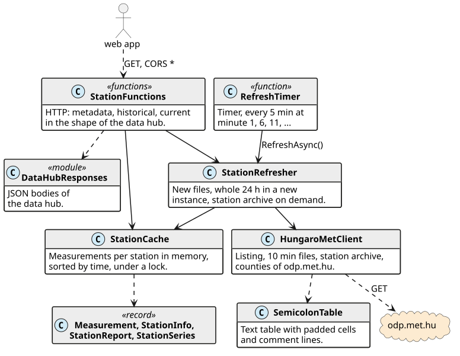
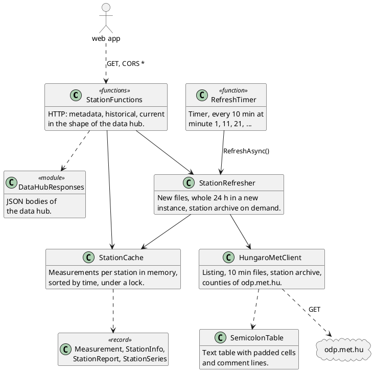

# wetterkartenviewer station proxy — agent reference

Reference for the Azure function in `api/` (C#, .NET 10, isolated worker with ASP.NET Core integration), so an agent can extend, debug or refactor it without reading all the code.
The web app that calls it is described in REFERENCE.webapp.md; both meet only in the HTTP API below.
Paths are relative to the repository root. All times are UTC. Code and comments are English.

Read the diagram first: it holds the architecture and every dependency.

## Purpose

- odp.met.hu (HungaroMet open data) sends no CORS header, so the browser cannot read it (`fetch` fails with a CORS error; checked 2026-11).
- The function fetches the 10 min station files, holds them in memory and answers in the shape of the GeoSphere Austria data hub, so the web app reads both networks with one client (`createDataHubSource`).
- Stateless by design: no database, a new instance fills itself from HungaroMet.

## Diagrams

Class diagram: solid arrow = holds an instance (constructor injection), dashed = creates or calls.

## Contracts

### HTTP API (`host.json` sets an empty route prefix)

Dataset `hungaromet-10min`; shapes in REFERENCE.webapp.md (*GeoSphere Austria data hub*). All anonymous, `Access-Control-Allow-Origin: *`.

| Request | Answer |
| --- | --- |
| `GET /v1/station/current/hungaromet-10min/metadata` | `stations[] {id, name, state (county), lat, lon, altitude, is_active: true}`; about 250 stations, those that have sent a temperature |
| `GET /v1/station/historical/hungaromet-10min?parameters=TL,TLMAX,TLMIN&station_ids=<id>&start=YYYY-MM-DDTHH:MM&end=…` | `timestamps[]` every 10 min, one feature per id, a slot without measurement is null; missing `start` or `end` → 400; `start` is clamped to `Retention`, `end` to now, both floored to 10 min |
| `GET /v1/station/current/hungaromet-10min?parameters=TL&station_ids=<id>,<id>` | one `timestamps` entry (the newest of the values), per id its newest temperature, null if older than `MaxCurrentAge` 1 h or unknown (unlike the hub, an unknown id is no 400) |

Parameters: `TL` = `t`, `TLMIN` = `tn`, `TLMAX` = `tx` of the HungaroMet tables (`ParameterValues`); others are ignored.

### odp.met.hu

Terms: https://odp.met.hu/ODP_General_Term_of_Use.pdf; use is free if the source is cited („Database: Meteorological Database, HungaroMet Nonprofit Zrt.“ plus the kind of processing; the app does this). Measured 2026-11:

| Path | Content |
| --- | --- |
| `weather/weather_reports/synoptic/hungary/10_minutes/csv/` | listing; `HABP_10M_SYNOP_<YYYYMMDDHHMMSS>.csv.zip`, one file per transmission of all 286 stations, ≈ 15 KB, kept 24 h (145 files), the seconds in the name vary. The file written at 17:30 UTC holds slot 17:20 of most stations and 17:10 of a few. `HABP_10M_SYNOP_LATEST.csv.zip` is the newest |
| `weather/…/10_minutes/station_meta_auto.csv` | `StationNumber;StartDate;EndDate;Latitude;Longitude;Elevation;StationName;RegioName`, one row per period of a station |
| `climate/observations_hungary/10_minutes/recent/HABP_10M_<id>_akt.zip` | one station since 1 January, ≈ 1.3 MB (14 MB as CSV), written once a day at about 09:50 UTC, ending the day before |
| `climate/observations_hungary/10_minutes/now/HABP_10M_<id>_now.zip` | one station, last 24 h, ≈ 8 KB, 10 min fresher than the file with all stations; not used |

Tables: semicolons, cells padded with spaces, UTF-8, `Time` = `YYYYMMDDHHMM`, -999 = missing, lines starting with `#` before the header in the station files. `t` is empty (-999) for about 40 stations, e.g. rain gauges.

## Hosting

Azure Functions on the **Windows Consumption plan with `functionAppScaleLimit` 1**. Both matter, because the data lives in the memory of one process:

- With several instances each would hold its own list. On the Flex Consumption plan timer functions scale apart from HTTP functions, so the timer would never fill the list the requests read.
- The timer calls every 10 min keep the instance alive, but the platform still restarts it now and then; see `StationRefresher`.
- Idle load on odp.met.hu: 288 requests and about 8 MB per day (144 listings of 41 KB, 144 files of 15 KB). A new file appears about 2 s after every full 10 minutes (17:30:02 seen), so the timer runs one minute later.

Runs on the free grant of the plan, apart from cents for the required storage account (`AzureWebJobsStorage`).

Deployed in subscription „Nutzungsbasierte Bezahlung“, resource group `wetterkartenviewer` (West Europe): Function App `wetterkartenviewer-stations` (https://wetterkartenviewer-stations.azurewebsites.net), storage account `wetterkartenstations`, no Application Insights.
A push to `main` does not deploy the function. By hand, from `api/`: `dotnet publish -c Release -o <dir>`, zip the content of `<dir>` (host.json at the top level), then `az functionapp deployment source config-zip --name wetterkartenviewer-stations --resource-group wetterkartenviewer --src <zip>`. A deployment restarts the instance, so the list refills itself.

Local test: Azure Functions Core Tools with Azurite, `func start --script-root api --port 7071`, and in `.env.local` of the web app `VITE_HUNGARIAN_STATIONS_URL=http://localhost:7071/v1/station`.
`api/local.settings.json` is not committed; it holds `"AzureWebJobsStorage": "UseDevelopmentStorage=true"` and `"FUNCTIONS_WORKER_RUNTIME": "dotnet-isolated"`.

## API: api/

### StationRefresher (StationRefresher.cs)

All work goes through one `SemaphoreSlim`, so concurrent requests to a new instance start one download, and it is not cancelled with a request, because it serves all others. Files are compared by name with `_lastFile`, whose order is that of time. All new files are downloaded before any is stored, so a failure leaves `_lastFile` and the next call retries them.

| Field | Meaning |
| --- | --- |
| `Retention` = 5 days | today, the three full days of the station viewer and one more around midnight |
| `SynopFilesCover` = 24 h | the span of the files with all stations; a request reaching further back loads the station archive |
| `ParallelDownloads` = 4 | new instance: 145 files in about 1 s |

| Method | Summary |
| --- | --- |
| `RefreshAsync()` | fetches what is new, drops what is older than `Retention` |
| `EnsureLoadedAsync()` | fills an empty cache before the first answer; returns at once afterwards |
| `EnsureHistoryAsync(id, start)` | loads the archive of a station once per instance; a failure logs, the request answers with what there is, the next one retries |

After a restart before about 09:50 UTC the archive ends two days back and the 24 h files reach only to the same time yesterday, so the slots between are null until the instance has lived through them, or for that request only.

### StationCache (StationCache.cs)

`SortedList<DateTime, Measurement>` per station under one lock. A station enters with its first row that has a temperature. A row without any value never replaces a slot; `AddHistory` never replaces a slot held already. `Prune` also removes stations left without measurements.

### HungaroMetClient (HungaroMetClient.cs)

Singleton that takes a client from `IHttpClientFactory` per call, so connections are renewed. Timeout 60 s (Program.cs).

### StationFunctions (StationFunctions.cs)

Thin: parses the query, makes sure the cache is loaded, builds the arrays. The clamps of `start` and `end` keep an absurd span from building millions of time stamps.

## Pitfalls

- **In-memory state**: any change of the hosting plan or scale limit must keep timer and HTTP in one process (see *Hosting*).
- **Dataset name** `hungaromet-10min`: `Dataset` in StationFunctions.cs and the config in src/services/stationSources.ts.
- **Function URL**: `HUNGARIAN_STATIONS_URL` in src/services/stationSources.ts names the deployed app.

## Extension recipes

- **Another parameter** (e.g. wind `fs`): a field in `Measurement` and in `MeasurementParser`, an entry in `ParameterValues`; then the web app (*Extension recipes* in REFERENCE.webapp.md).
