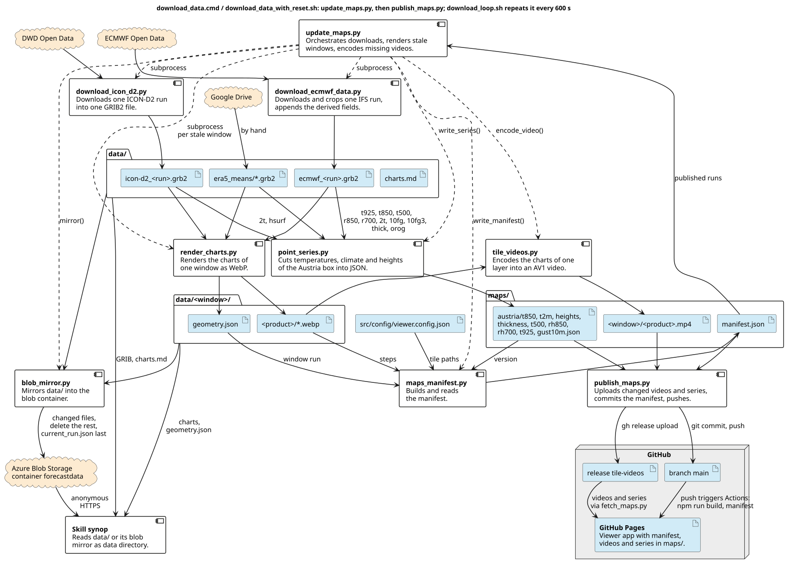
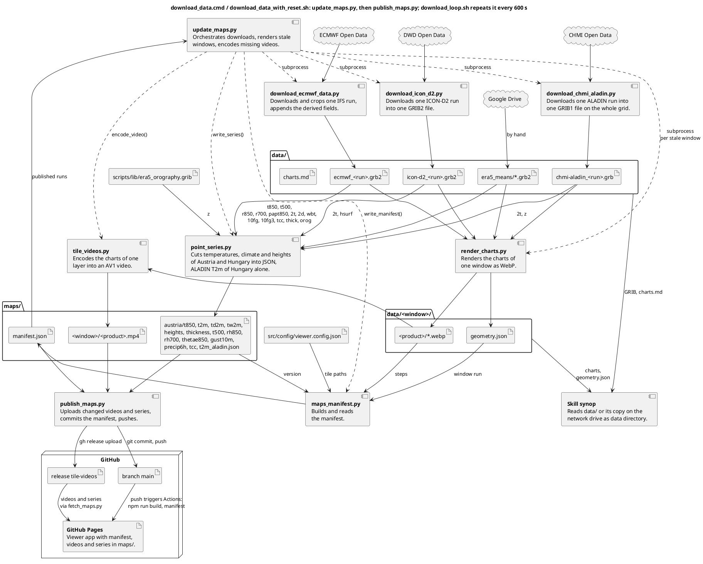
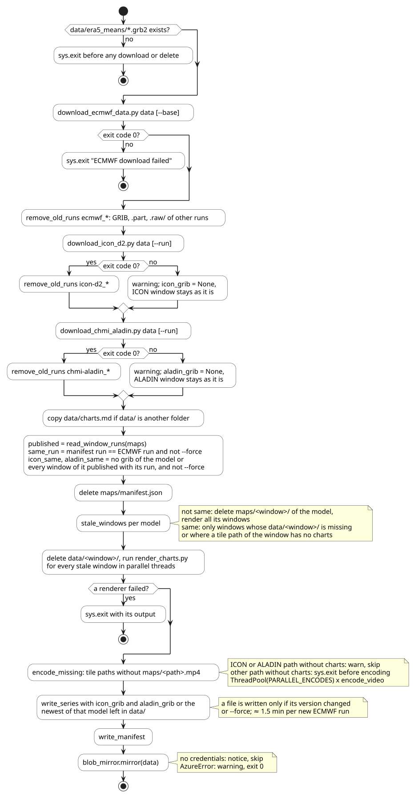
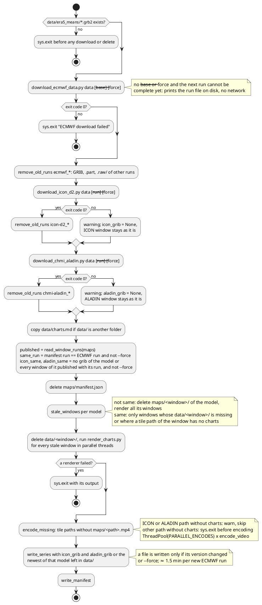
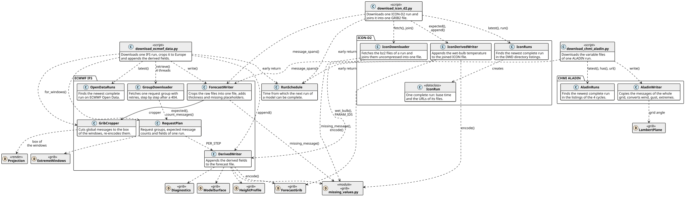
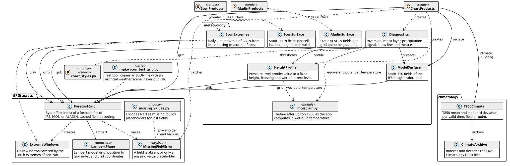
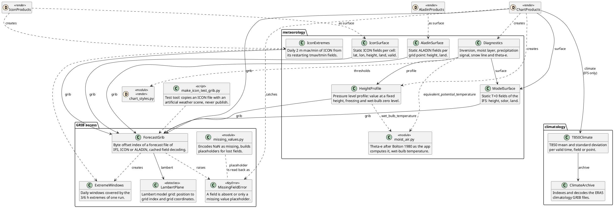
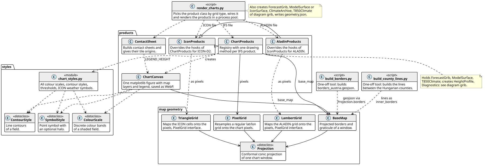
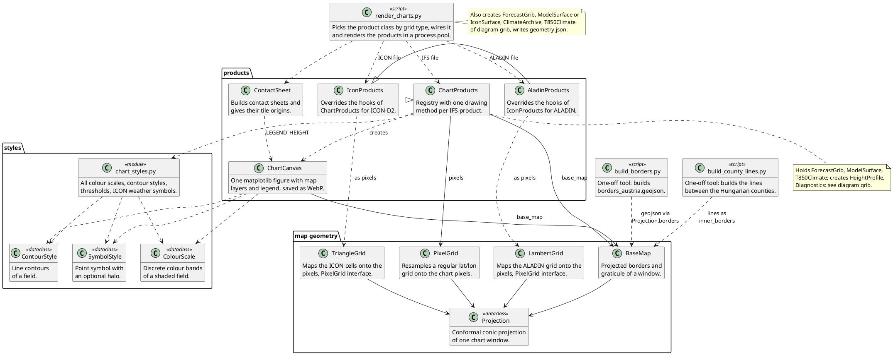

# wetterkartenviewer pipeline — agent reference

Reference for the Python data pipeline in `scripts/` (download, derived fields, charts, videos, publishing), so an agent can extend, debug or refactor it without reading all the code.
The web app that shows the result is described in REFERENCE.webapp.md; both meet only in `maps/manifest.json`, `maps/austria/*.json` and `src/config/viewer.config.json`.
Paths are relative to the repository root. Symbols are named so that a search finds them.
All times are UTC. A *step* is hours after the ECMWF run. Charts, messages, code and comments are English; data/charts.md is German.

Read the diagrams first: they hold the architecture and every dependency.
The API sections follow Javadoc: intro, fields, methods per module or class.

## Purpose

- Download one ECMWF IFS HRES run (0.1°, cropped to Europe, derived fields appended) and one DWD ICON-D2 run (icosahedral grid ≈ 2.2 km, whole domain, without compression, the 2 m wet-bulb temperature appended) into `data/`.
- Download one CHMI ALADIN run (Lambert grid 2.3 km, to T+72, whole model grid) into `data/`.
- Render WebP charts for four windows into `data/`, encode each tile layer of the viewer as `maps/<window>/<product>.mp4` (one frame per step), write `maps/manifest.json`.
- Cut T850, T500, RH850, RH700, θe850, the 10 m gusts, the precipitation per step, the total cloud cover, the 1000–500 hPa thickness, the 2 m dew point and wet-bulb temperature (ECMWF), T2m (ECMWF, ICON-D2), the ERA5 climatology and the ICON-D2 heights to Austria and Hungary (ICON-D2: Austria only; ALADIN T2m: Hungary only) as JSON in `maps/austria/` for the temperature diagram of the start page (`point_series.py`).
- Upload the videos and series files to a GitHub release, push a manifest commit; GitHub Actions builds and deploys the app with them.
- IFS updates every 12 h, ICON-D2 every 3 h, ALADIN every 6 h; `download_loop.sh` runs the whole chain every 10 min on an always-on machine; a downloader asks its server only from the time the next run can be complete (`RunSchedule`).
- `data/` is also the data directory of the skill synop (source in `skills/synop`, installed to `~/.claude/skills/synop`), see *Contract with the skill synop*; `download_loop.sh` mirrors it to a network drive (per user), from where the skill reads it without this repository.

## Diagrams

Stereotypes: `<<script>>` command line, `<<module>>` functions and constants only, a `D` spot names the diagram that describes the element.
Class diagrams: solid arrow = holds an instance (constructor injection), dashed = creates or calls, triangle = inherits.
Not drawn: the constant modules `constants.py`, `local_params.py`, `fonts.py`, and `progress.py` (used by every long step, see *Progress*).

### pipeline: data flow between scripts, files and external systems

Solid arrow: data, from writer to file and from file to reader. Dashed: calls.





### update_maps: decisions of one call (`main`, scripts/update_maps.py)





### download: IFS, ICON-D2 and CHMI ALADIN

```plantuml
@startuml download
hide empty members
class "download_ecmwf_data.py" as download_ecmwf <<script>> {
 Downloads one IFS run, crops it to Europe
 and appends the derived fields.
}
class "download_icon_d2.py" as download_icon <<script>> {
 Downloads one ICON-D2 run and
 joins it into one GRIB2 file.
}
class "download_chmi_aladin.py" as download_aladin <<script>> {
 Downloads the variable files
 of one ALADIN run.
}
class RunSchedule {
 Time from which the next run of
 a model can be complete.
}
package "CHMI ALADIN" {
 class AladinRuns {
 Finds the newest complete run
 in the listings of the 4 cycles.
 }
 class AladinWriter {
 Copies the messages of the whole
 grid, converts wind, gust, extremes.
 }
}
package "ECMWF IFS" {
 class OpenDataRuns {
 Finds the newest complete
 run on ECMWF Open Data.
 }
 class RequestPlan {
 Request groups, expected message
 counts and fields of one run.
 }
 class GroupDownloader {
 Fetches one request group with
 retries, step by step after a 404.
 }
 class GribCropper {
 Cuts global messages to the box
 of the windows, re-encodes them.
 }
 class ForecastWriter {
 Crops the raw files into one file, adds
 thickness and missing placeholders.
 }
 class DerivedWriter {
 Appends the derived fields
 to the forecast file.
 }
}
package "ICON-D2" {
 class IconRuns {
 Finds the newest complete run
 in the DWD directory listings.
 }
 class IconRun <<dataclass>> {
 One complete run: base time
 and the URLs of its files.
 }
 class IconDownloader {
 Fetches the bz2 files of a run and
 joins them uncompressed into one file.
 }
 class IconDerivedWriter {
 Appends the wet-bulb temperature
 to the joined ICON file.
 }
}
class "missing_values.py" as missing_values <<module>> << (D,#fdebd1) grib >>
class ExtremeWindows << (D,#fdebd1) grib >>
class ForecastGrib << (D,#fdebd1) grib >>
class ModelSurface << (D,#fdebd1) grib >>
class HeightProfile << (D,#fdebd1) grib >>
class Diagnostics << (D,#fdebd1) grib >>
class Projection << (D,#fdebd1) render >>
class LambertPlane << (D,#fdebd1) grib >>
download_aladin ..> AladinRuns : latest(), has(), url()
download_aladin ..> AladinWriter : write()
AladinWriter ..> LambertPlane : grid angle
download_ecmwf ..> RunSchedule : early return
download_icon ..> RunSchedule : early return
download_aladin ..> RunSchedule : early return
download_ecmwf ..> OpenDataRuns : latest()
download_ecmwf ..> RequestPlan
download_ecmwf ..> GroupDownloader : retrieve()\n4 threads
download_ecmwf ..> GribCropper : for_windows()
download_ecmwf ..> ForecastWriter : write()
download_ecmwf ..> DerivedWriter : append()
download_icon ..> IconRuns : latest(), run()
download_icon ..> IconDownloader : fetch(), join()
download_icon ..> IconDerivedWriter : expected(),\nappend()
IconDerivedWriter ..> DerivedWriter : wet_bulb(),\nPARAM_IDS
IconDerivedWriter ..> ForecastGrib
IconDerivedWriter ..> missing_values : encode()
download_icon ..> ForecastWriter : message_spans()
GroupDownloader ..> RequestPlan : expected(),\ncount_messages()
RequestPlan ..> ExtremeWindows
RequestPlan ..> DerivedWriter : PER_STEP
GribCropper ..> Projection : box of\nthe windows
ForecastWriter --> GribCropper : cropper
ForecastWriter ..> missing_values : missing_message()
DerivedWriter ..> ForecastGrib
DerivedWriter ..> ModelSurface
DerivedWriter ..> HeightProfile
DerivedWriter ..> Diagnostics
DerivedWriter ..> missing_values : encode()
IconRuns ..> IconRun : creates
IconDownloader ..> ForecastWriter : message_spans()
IconDownloader ..> missing_values : missing_message(),\nencode()
@enduml
```





### grib: reading the forecast file, meteorology, climatology





### render: the charts of one window





## Contracts and file formats

### maps/manifest.json — the only interface between pipeline and app

Written by `build_manifest` (scripts/maps_manifest.py), typed as `Manifest` (src/model/ChartIndex.ts).

```json
{ "run": "2026103012", "fps": 10,
 "charts": { "opencharts_europe/thickness_mslp":
 { "file": "opencharts_europe/thickness_mslp.mp4", "steps": [0, 3, 6, ..., 240],
 "run": "2026103012", "end": 240 },
 "icon-d2/weather_summary":
 { "file": "icon-d2/weather_summary.mp4", "steps": [22, 23, ..., 69],
 "run": "2026103109", "end": 69 } },
 "series": { "t850": { "file": "austria/t850.json", "version": "2026110112" },
 "t2m": { "file": "austria/t2m.json", "version": "2026110112-2026110206" },
 "td2m": { "file": "austria/td2m.json", "version": "2026110112" },
 "tw2m": { "file": "austria/tw2m.json", "version": "2026110112" },
 "heights": { "file": "austria/heights.json", "version": "2026110206-25344" },
 "thickness": { "file": "austria/thickness.json", "version": "2026110112" },
 "t500": { "file": "austria/t500.json", "version": "2026110112" },
 "rh850": { "file": "austria/rh850.json", "version": "2026110112" },
 "rh700": { "file": "austria/rh700.json", "version": "2026110112" },
 "thetae850": { "file": "austria/thetae850.json", "version": "2026110112" },
 "gust10m": { "file": "austria/gust10m.json", "version": "2026110112" },
 "precip6h": { "file": "austria/precip6h.json", "version": "2026110112" },
 "tcc": { "file": "austria/tcc.json", "version": "2026110112" },
 "t2m_aladin": { "file": "austria/t2m_aladin.json", "version": "2026110900-hu" } } }
```

- `run` (top): the ECMWF run. The slider and all `steps`, ICON ones included, count from it.
- `charts` keys: the paths of viewer.config.json (`window/product`, lists flattened), deduplicated in config order (`tile_chart_paths`). A path without a video in `maps/` is left out (warning); the app then says „keine Karten in diesem Lauf“.
- `file`: video relative to `maps/` (`<path>.mp4`).
- `steps[i]`: step of frame `i`, from the chart file names in `data/<path>/` (`file_step`): `YYYYMMDDHH` in hours from the ECMWF run, `YYYYMMDD` (tmax/tmin) from 00 UTC of the day, negatives clamped to 0, other names ignored. Sorted by step = frame order (`chart_frames`).
- `charts[…].run`: run of the model of the video (`window_run` from `data/<window>/geometry.json`, else the ECMWF run). Cache parameter of the video URL, and how update_maps.py recognises the ICON run. Optional in TS.
- `end`: step of the last frame, for a daily chart + 23 h, so a daily chart covers its day. `frame` returns null after `end`.
- `fps`: `FPS` (10), used for encoding too; the app only uses the manifest value.
- Steps are irregular: IFS 3-hourly to +144, then 6-hourly (65 frames; products start differently, `weather_summary` at +3, `dt850_24h` at +24). ICON hourly, 49 frames (48 for `weather_summary`), offset by the gap between the two runs (e.g. +21…+69); tmax/tmin one frame per day. ALADIN hourly, 73 frames (72 for `wind10m` and `weather_summary`), offset likewise (e.g. +12…+84).
- `series` (`series_entries`): the files of `SERIES_FILES` present in `maps/`, with the `version` read from each file; the app's cache parameter. Missing → the app shows no temperature diagram. Optional in TS.

### maps/austria/*.json — temperature series of the start page

Written by `write_series` (scripts/point_series.py), typed in src/model/seriesFiles.ts, read by `TemperatureSeries` (REFERENCE.webapp.md). Compact JSON; GitHub Pages serves it gzip'd.

Encoding of every series: whole multiples of `scale` (0.1 K, 0.1 dam for the thickness, 1 % for rh850, rh700 and tcc, 1 km/h for gust10m, 0.1 mm for precip6h), **time-major** (all points of time 0, then all of time 1 …), **deltas along time** (time 0 absolute). Measured: about a fifth of the raw size after gzip; time-major packs ≈ 20 % better than one series per point, binary Int16 is no smaller after gzip, 0.2 K would save another quarter of ICON. One file with all series gzips no smaller than the separate files (1 294 259 vs 1 293 013 B, run 2026110400), and separate files keep the browser cache of those whose version did not change (t2m changes with every ICON run).
Regular grids (`grid`: `lat0` northernmost row, `lon0`, `dlat` step southwards, `dlon`, `nj`, `ni`, `runs`) lie in `ECMWF_BOX` (45.7–49.1° N, 9.5–22.9° E) but hold only the points of `nearest_point_mask` (*country_mask*): `runs` gives per row the kept columns as `[start, length, start, length, ...]` (`[]` for an empty row), every series and `orog` number the kept points row by row. A file without `runs` holds every point of its grid. The ERA5 window is wider by half a grid step and its mask reaches `ERA5_BORDER_MARGIN` further, so every place an ECMWF point serves has its ERA5 point. ICON-D2 stays in Austria (`ICON_BOX`).
Run 2026110712, all 13 files: 9.3 MB, gzip 2.08 MB; 2329 of the 4725 ECMWF points, 479 of the 770 ERA5 points. The whole box as a rectangle would be 15.1 MB, gzip 3.26 MB.

| File, version | Content | Size (run 2026110112) |
| --- | --- | --- |
| `t850.json`, ECMWF run | `ecmwf`: `run`, `steps`, `grid` (0.1°, 35×135), `orog` (m, per point; every `ecmwf` block repeats it, ≈ 10 KB raw), `t850`; `climate`: ERA5 T850 | 566 KB, gzip 104 KB |
| `t2m.json`, `<ecmwf run>-<icon run or none>` | `ecmwf` with `t2m`; `climate`: ERA5 daily mean T2m (the app draws bars of the anomaly of the ECMWF daily mean against it where the ERA5 `orog` lies within 100 m of the ECMWF one); `icon` (only with an ICON file): `run`, `steps`, `cells`, `t2m` on the cells of heights.json | 3.9 MB, gzip 880 KB (runs 2026110500-2026110515) |
| `td2m.json`, ECMWF run | `ecmwf` with `td2m` (`2d`, °C); no ICON part (the ICON file has `2d` and `wbt`, but the app shows ECMWF only per user, an ICON part would add ≈ 750 KB gzip), no climate; written only if the IFS file has `2d` (else a message and no file); the app draws it blue in the T2m panel | 443 KB, gzip 105 KB (run 2026110612) |
| `tw2m.json`, ECMWF run | like td2m.json with `tw2m` from the derived field `wbt`; the app draws it green | 464 KB, gzip 120 KB (run 2026110612) |
| `thickness.json`, ECMWF run | `ecmwf` with `thickness` in dam (`thick` gpm × 0.1); no climate | 388 KB, gzip 77 KB |
| `t500.json`, ECMWF run | `ecmwf` with `t500` (°C); no climate; the app forms T850 − T500 | 396 KB, gzip 68 KB (run 2026103112) |
| `rh850.json`, ECMWF run | `ecmwf` with `rh850` (`r` at 850 hPa, %); `scale` 1 (whole percent: 1 % ≈ 0.15 K of dew point at 80 %); raw, unclipped (the IFS gives up to ≈ 107 %, the app clamps); IFS RH refers to water above 0 °C, ice below −23 °C, mixed in between; no climate; the app lifts a parcel from 850 hPa with it | 411 KB, gzip 95 KB (run 2026110300) |
| `rh700.json`, ECMWF run | `ecmwf` with `rh700` (`r` at 700 hPa, %), encoded like rh850; the app draws it as a line over the thickness axis (0–100 %) | 422 KB, gzip 98 KB (run 2026110400) |
| `thetae850.json`, ECMWF run | `ecmwf` with `thetae850` (`papt` at 850 hPa, **K**, not °C), scale 0.1; no climate; written only if the IFS file has `papt` (else a message and no file, the app draws no line); the app draws it as a line in the T850 panel without an axis of its own | 449 KB, gzip 118 KB (run 2026110600) |
| `gust10m.json`, ECMWF run | `ecmwf` with `gust10m` (km/h, `10fg`/`10fg3` × `KMH_PER_MS`, steps 3…240, none at T+0) and `hours` (per step the interval it covers: 1, 3 or 6), `scale` 1 (`WIND_SCALE`; the band limits are whole km/h); `colours`: the bands of `chart_styles.GUST10M` as `[lower, upper, "#rrggbb"]` (last upper 300), so the app colours its bar like the wind10m chart without a copy of the scale; no climate | ≈ 0.4 MB, gzip ≈ 80 KB |
| `precip6h.json`, ECMWF run | `ecmwf` with `precip6h` (mm since the previous step, the interval of `weather_summary`: `tp(step) − tp(previous_step("tp", step))`, ≥ 0; despite the name, steps 3…240, `hours` 3 to T+144, then 6, intervals do not overlap), `scale` 0.1 (`PRECIP_SCALE`); `colours`: the bands of `chart_styles.PRECIPITATION` (0.2…1000 mm), `transparent_below` 0.2 (drier stays uncoloured); `ptype` (scale 1, encoded like the values): class of the precipitation type per interval, 0 none, k ≥ 1 the k-th group of `chart_styles.PRECIP_TYPES` (1 snow `5`, 2 wet snow or rain and snow `6`/`7`, 3 freezing `3`/`8`/`12`). ptype is the instantaneous type at the step, as on the chart; intervals below 0.2 mm get 0, as the chart draws no symbol outside its shading. Run 2026110900, box points × steps: 1 snow 2982, 2 wet 1674, 3 freezing 226 of 149 056; no climate. Open Data packs `tp` with 12 bits over the whole cropped box, so accumulated values step by 2⁻¹³…2⁻¹² m (0.12–0.24 mm): a single quantum already reaches the first band | 0.67 MB, gzip 63 KB (run 2026110900) |
| `tcc.json`, ECMWF run | `ecmwf` with `tcc` (total cloud cover in %, GRIB fraction × `TCC_PERCENT`, instantaneous at each step 0…240, the field `weather_summary` shades), `scale` 1 (`CLOUD_SCALE`; the bands are 10 % wide); `colours`: the bands of `chart_styles.CLOUD_COVER` (40…101 %), `transparent_below` 40 (clearer stays uncoloured); ECMWF only (per user), no climate | 403 KB, gzip 99 KB (run 2026110712) |
| `t2m_aladin.json`, `<aladin run>-hu` | CHMI ALADIN grid points of Hungary within `BORDER_MARGIN` (21 731, file order): `run`, `steps` (0…72), `points`, `coord_scale`, `lat`, `lon` (deltas of 1e-4°), `hsurf` (m, from `z`), `t2m`; no ECMWF, climate or `box`. In its own file because t2m.json is rewritten with every ICON run and required by every location; the app draws it only where ICON-D2 has no cell | 4.1 MB, gzip 644 KB (run 2026110900) |
| `heights.json`, `<icon run>-<cells>` | ICON cells within `BORDER_MARGIN` of Austria in file order (25 344): `lat`, `lon` as deltas of `coord_scale` 1e-4°, `hsurf` (m) | 316 KB, gzip 78 KB |

`climate` (both levels): `period`, `grid` (0.25°, 14×55), `first_day` (00 UTC of the ECMWF run), `days` (to the last step, 11), `orog` (ERA5 orography per point, whole m, from `era5_orography`; ≈ 1.5 KB raw), then only the kind the app draws (`climate_block(…, kind)`): t850.json `hours` (00…21) and `term` (per day and hour, day-major), t2m.json `daily` (per day; its `std` is that of the daily means, ≈ 0.3 K below the mean term std, so it is the right σ for a daily mean anomaly); each `{mean (°C), std (K)}`. The ERA5 daily mean differs from the mean of the eight term means by < 0.09 K. The `monthly` kind is not written.
Values in °C (T) and K (std); `box` and `scale` at the top of t850/t2m.

### data/ layout

| Path | Writer | Content |
| --- | --- | --- |
| `ecmwf_<run>.grb2` | download_ecmwf_data.py | one IFS run, see *Forecast file (IFS)*; 1.5–1.6 GB |
| `icon-d2_<run>.grb2` | download_icon_d2.py | one ICON-D2 run without compression, 1277 messages, ≈ 1.43 GB |
| `chmi-aladin_<run>.grb` | download_chmi_aladin.py | one ALADIN run on the whole model grid, GRIB edition 1, 1834 messages, ≈ 2.8 GB; see *CHMI ALADIN file* |
| `era5_means/*.grb2` | by hand from Google Drive (link in README.md) | ERA5 1991–2020, 422 MB, 13 224 fields; `check_climate` requires it |
| `<window>/<product>/<YYYYMMDDHH>.webp` | render_charts.py | step charts named by valid time; daily products `<YYYYMMDD>.webp` |
| `<window>/orography.webp`, `sheets/<product>.webp`, `geometry.json` | render_charts.py | static chart (no folder), contact sheets, geometry |
| `<window>/weather_summary_24h/<YYYYMMDDHH>.webp` | render_charts.py | IFS only, 12 UTC of each day with 24 h of `tp` before it: the tiles of `sheets/weather_summary.webp`; no layer of the viewer |
| `charts.md` | by hand, committed | German description of files, GRIB fields, products for the skill |

Windows: `opencharts_europe` (all IFS products), `opencharts_central_europe` (IFS defaults), `icon-d2` (all ICON products), `chmi-aladin` (all ALADIN products).
`data/` is ignored by git except `charts.md`; `maps/` except `manifest.json` (so `maps/austria/` reaches Pages only through the release); `docs/` holds the diagram sources and PNGs.
Sizes (run 2026103000): europe 266 MB, central_europe 125 MB, `maps/` ≈ 67 MB with 14 videos of 2.2–7.3 MB.

### geometry.json

Written by `write_geometry` (scripts/render_charts.py): `window`, `model` (`ChartProducts.MODEL`: `ECMWF IFS` / `ICON-D2`), `run`, `image.width/height` (1200×600, map without legend), `projection.pole_x/pole_y/scale_k/cone/lon0/formula`, `sheets.scale`, `sheets.tiles.<product>` = list of `[x, y]` tile corners.
Entries of other products in an existing file are kept, so single-product runs add instead of overwrite.

### Contract with the skill synop

The skill reads `data/` (docstrings scripts/update_maps.py, scripts/lib/local_params.py), locally or as the copy `download_loop.sh` keeps on the network drive. Changing any of these breaks it until the skill is updated:
product names and the folder layout above, `geometry.json` keys, GRIB short names, levels, units and `stepRange` of the daily extremes, the local parameter numbers 0–5 in category 192, `charts.md`, the name and parameter numbers of the ALADIN file (`ALADIN_NAMES`) and the thresholds of `weather_summary` (`ALADIN_STORM_FLASHES_KM2`, `ALADIN_FOG_VISIBILITY_M`, `ALADIN_GRAUPEL`, `ALADIN_HAIL`), of which the skill has copies in `lib/constants.py`.
`chmi-aladin_<run>.grb` and `data/chmi-aladin/` are part of it: `location_table.py` of the skill takes the grid from the file, so it works on the whole model domain.
The skill has its own copies of `ForecastGrib` and `ClimateArchive`.
Its `ChartGeometry` (`skills/synop/scripts/lib/chart_geometry.py`) reads `cone`/`lon0` (defaults 1 and 0 for files without them), so a window's projection may change without touching the skill.

### Forecast file (IFS)

One GRIB2 file per run, 0.1° regular lat/lon, rows north → south.
Box from `GribCropper.for_windows`: image borders of all windows ± 1°, rounded to whole degrees → 11–76° N, 71° W–77° E, 651 × 1481 points.
Steps `STEPS`: 0…141 every 3 h (48) + 144…240 every 6 h (17) = 65.

| Group (raw file) / writer | Content | Messages |
| --- | --- | --- |
| t, gh, r | each × `PROFILE_LEVELS` 1000/925/850/700/600/500 × 65 | 3 × 390 |
| uvw700 | u, v, w at 700 × 65 | 195 |
| uv_low | u, v at 850/925/1000 × 65 | 390 |
| sfc | msl, 2t, 2d, sp, 10u, 10v × 65 (2d 9 bits like the temperatures, sp 12) | 390 |
| gust / gust3 | 10fg × 3…90 and 150…240 / 10fg3 × 93…144 (`IFS_HOURLY_LAST_STEP` 90) | 46 / 18 |
| static | z, sdor, lsm, T+0 only | 3 |
| minmax3 / minmax6 | mx2t3, mn2t3 × 3…144 / mx2t6, mn2t6 × 150…240 | 96 / 32 |
| weather | tcc, tp, ptype × 65 | 195 |
| ForecastWriter | `thick` = gh500 − gh1000, GRIB2 0/3/12, isobaricLayer 1000–500 | 65 |
| DerivedWriter per step (`PER_STEP` 23) | t, r, u, v at heightAboveSea 2000/2500/3000; `deg0l` (228024, ecCodes sets isothermal level 273); `inv`, `rhbl`, `psig`, `snowl` (local, surface); `uf`, `vf` at 1000/925 hPa (local); `papt` at 850 hPa (3014 = GRIB2 0/0/3 „pseudo-adiabatic potential temperature or equivalent potential temperature“, K; ecCodes names it `papt`, so the skill's TSV column is `papt850`); `wbt` at 2 m (261023 = GRIB2 0/0/27, K, from `2t`, `2d`, `sp`, template `2t`, 12 bits) | 1495 |
| DerivedWriter once | `orog` (228002, m) | 1 |
| DerivedWriter per complete day | `mx2t` (201) / `mn2t` (202), `stepRange` = whole window | 10 + 9 |
| **Total** (00z and 12z) | | **4115** |

`RequestPlan.expected_total` computes this total; `output_complete` compares it with the target file.
Local parameters (`LOCAL_NAMES`): discipline 0, category 192, number 0 `inv`, 1 `rhbl`, 2 `psig`, 3 `snowl`, 4 `uf`, 5 `vf`; ecCodes reads them as `unknown`, `ForecastGrib._name` renames them.
Missing values: NaN is written as bitmap missing; it occurs for `inv`/`rhbl`/`uf`/`vf` below the model ground, for heights outside the profile levels (wind at 3000 m where gh700 < 3000 m), for `deg0l` where 500 hPa is above 0 °C and for `snowl` where its wet bulb is. `snowl` is set everywhere, not only where `psig`.
Gusts (`IFS_GUST_NAMES`): Open Data publishes the maximum since the previous model output, so `10fg` covers the last hour to T+90 (hourly output; stepRange 2-3), `10fg3` the last 3 h from T+93 to T+144, `10fg` again the last 6 h from T+150 (checked run 2026110500). The 0.1° files have no `10fg` at T+93…144 and only a constant field at T+0, which is not requested. Readers pick the name per step (`ForecastGrib.pick`) and the window from the start step (`window_hours`).
`tp` accumulates from T+0 in m. `tcc`, `tp`, `ptype` (`WEATHER_PARAMS`) only feed `weather_summary`: a 9 km global model gets fog and its precipitation wrong.
Fields lost on the server get a placeholder: a copy of the same field at another step with every value missing (`missing_message`). The file then has the full message count and counts as complete; `ForecastGrib.field` raises `MissingFieldError`, `has()` stays true.

### ICON-D2 file

Source `https://opendata.dwd.de/weather/nwp/icon-d2/grib/<HH>/<folder>/`, one bz2 file per run, parameter, level and step, no auth.
A run every 3 h, hourly to T+48; each hour folder holds only its newest run, so ≈ 1 day is available.
Fields stay on the icosahedral grid (542 040 cells, 1-D arrays; boundary zone without values = NaN), in simple packing with DWD's 16 bits per value (see *IconDownloader*).

| DWD parameter | Index name (`ICON_NAMES` alias) | Content | Steps |
| --- | --- | --- | --- |
| clat, clon | `clat`, `clon` | cell centres (°) | 0 |
| hsurf, fr_land | `hsurf`, `lsm` | model orography (m), land fraction | 0 |
| clct | `tcc` | total cloud in **%** (IFS 0…1) | 0…48 |
| tot_prec | `tp` | precipitation from T+0 in **mm** (IFS m) | 0…48 |
| pmsl | `msl` | pressure (Pa) | 0…48 |
| vmax_10m | `gust` (level 10) | max 10 m gust of the last hour (m/s) | 0…48 |
| ww | `ww` | significant weather, WMO 4677 | 1…48 |
| t_2m, u_10m, v_10m | `2t`, `10u`, `10v` | | 0…48 |
| td_2m, ps | `2d`, `sp` | 2 m dew point (K), surface pressure (Pa); inputs of `wbt` | 0…48 |
| — (IconDerivedWriter) | `TW_2M` → `wbt` | 2 m wet-bulb temperature (K), derived, appended after the joined files; GRIB2 0/0/27 on the DWD template, which ecCodes names `TW_2M` | 0…48 |
| tmax_2m, tmin_2m | `tmax_2m`, `tmin_2m` | 2 m extreme since the last 6 h restart (K) | 0…48 |
| ceiling | `ceiling` | base of the lowest layer with > 50 % cover, m above sea; ≈ 20 km where none | 0…48 |
| u@1000, v@1000 | `u`, `v` level 1000 | only for the location tables of the synop skill (`skills/synop`); no chart uses them | 0…48 |
| t, relhum, fi, u, v @850 and @700 | `t`, `r`, `z`, `u`, `v` | profile for `mountain_2000`; no 925 hPa in ICON-D2 | 0…48 |

Total 4 + 24 × 49 + 48 = 1228 files, plus 49 `wbt` = 1277 messages. The aliases give ICON fields the IFS names, so `ChartProducts` methods work; units still differ and `IconProducts` handles them.

### CHMI ALADIN file

Source `https://opendata.chmi.cz/meteorology/weather/nwp_aladin/Lambert_2.3km/<HH>/ALADLAMB4opendata_<run>_<VARIABLE>.grb.bz2`, one bz2 file per variable with every step, no auth. Runs 00/06/12/18 UTC, all to T+72 hourly; the server keeps each cycle ≈ 3 days; files appear 3–4.5 h after the run start.
GRIB edition 1, centre 89, simple packing, rows from the south. The whole model grid: 1053 × 837 points, Lambert, tangent at 46.244° N, LoV 17° E, Dx 2325 m, R 6 367 470 m, 38.6–57.2° N and 4.65° W–34.35° E (corners 38.6/1.33, 39.04/29.5, 55.55/−4.65, 56.16/34.35; Rome, Paris, Berlin and Kyiv inside, Athens and Oslo outside). The server only offers whole files per variable, so a smaller area would save no download; principle (per user): download only what is needed, keep what had to be downloaded anyway.
`CZ_1km` on the same server covers only Czechia. Licence CC BY 4.0 (CHMI's general open data statement, which does not name model data); the app is private (per user).

| CHMI variable | Index name (`ALADIN_NAMES`, parameter number for files without shortName) | Content | Steps |
| --- | --- | --- | --- |
| SURFGEOPOTENTIEL, SURFIND_TERREMER | `z`, `lsm` | m²/s², 0…1 | 0 |
| CLSTEMPERATURE, MSLPRESSURE | `2t`, `msl` | K, Pa | 0…72 |
| SURFNEBUL_TOTALE | `tcc` (171) | **fraction** (ICON %) | 0…72 |
| CLS_VISICLD | `fog_visibility` (223) | lowest visibility due to cloud in the last hour, m | 0…72 |
| SURFPREC_TOTAL | `tp` (61) | from T+0 in mm; **no message at T+0** | 1…72 |
| SURFDIAG_FLASH | `flash` (236) | lightning density from T+0, per km² | 1…72 |
| PRECIP_TYPE, PRECIP_TYPESEV | `ptype` (230), `ptype_severe` (229) | most frequent / most dangerous type of the last hour; ECMWF ptype codes plus 193 (wet snow with rain), 201…213 (intermittent) | 1…72 |
| CLSWIND_SPEED + CLSWIND_DIREC | `10u`, `10v` (written as parameters 33, 34) | m/s east and north, `uvRelativeToGrid` 0 | 0…72 |
| CLSU_RAF_MOD_XFU + CLSV_RAF_MOD_XFU | `gust` (130) | speed of the maximum gust of the last hour, m/s, time range step−1…step | 1…72 |
| CLSDEW_P_TEMPER, CLSTPRIM_W | `2d`, `wbt` (234) | 2 m dew point and wet-bulb temperature, K | 0…72 |
| CLSMAXI_TEMPERAT, CLSMINI_TEMPERAT | `tmax_2m`, `tmin_2m` (aliases of `mx2t6`, `mn2t6`) | 2 m extremes of the last 12 h, K, time range step−12…step, the first of a run from T+0 | valid at 06 and 18 UTC: 12, 24 … 72 (runs of 06, 18 UTC), 6, 18 … 66 (runs of 00, 12 UTC) |
| P85000…, P70000… TEMPERATUR, HUMI_RELAT, GEOPOTENTI | `t`, `r`, `z` level 850, 700 | K, **fraction** 0…1 (ICON %), m²/s² | 0…72 |
| P00000, P85000, P70000 WIND_U_COM, WIND_V_COM | `u`, `v` level 1000, 850, 700 | m/s east and north, `uvRelativeToGrid` 0 | 0…72 |

ICON has fields ALADIN does not publish: `ww`, `ceiling`, `sp` (per user: every other ICON field is taken from ALADIN too). Names of the pressure levels are Pa, but 1000 hPa is `P00000`.
Meaning measured on the runs 2026110818, 00, 06 and 12 (one per cycle): the extremes equal the hourly `2t` of the 12 h before the step, or since T+0 for the first one of a run, within +0.05 K on average and never fall below it (24 h or the time since T+0 do not fit); CLSTPRIM_W differs by 0.1–0.2 K from `wbt` computed like ICON's, surface pressure estimated from `msl` and `z`, without a trend with height (so no potential temperature).

Wind frames (measured on run 2026110900, gust direction minus wind direction against longitude has the trend −sin LaD exactly): CLSWIND_DIREC refers to true north, the gust components to the grid. The gust is stored as a speed, so the frame does not matter; do not derive a gust direction without rotating by `sin(LaD) · (lon − LoV)`. The components on pressure levels refer to the grid as well (the flag is 1 on every field and says nothing; direction minus the direction of the geostrophic wind along the grid axes, 700 hPa, T+24…72: trend ≈ 0 against longitude, +0.72 expected for east/north); `AladinWriter` turns them.

## Command line

```
update_maps.py <data> <maps> [--base YYYYMMDDHH] [--icon-run YYYYMMDDHH] [--aladin-run YYYYMMDDHH] [--force]
maps_manifest.py <data> <maps> --run YYYYMMDDHH
point_series.py <data> <maps> [--force] (newest ecmwf_*/icon-d2_*.grb2/chmi-aladin_*.grb of data)
publish_maps.py <maps> [--force] (gh and git run in the repo root; other options ignored)
fetch_maps.py <maps> <target> --repository owner/name
download_ecmwf_data.py <out file|existing dir> [--base YYYYMMDDHH] [--max-step N] [--keep-raw] [--force]
download_icon_d2.py <out file|existing dir> [--run YYYYMMDDHH] [--keep-raw] [--force]
download_chmi_aladin.py <out file|existing dir> [--run YYYYMMDDHH] [--keep-raw] [--force]
render_charts.py <grib> <outdir> [--climate DIR] [--projection chmi-aladin|icon-d2|opencharts_central_europe|opencharts_europe]
 [--products a,b|all] [--workers N]
build_borders.py <VGD_50_generalisiert.shp> [target.geojson]
build_county_lines.py <NUTS level 3 GeoJSON> [target.geojson]
make_icon_test_grib.py <source.grb2> <target.grb2> [--step N] (default 12)
download_data.cmd | download_data_with_reset.sh [update_maps options] = update_maps.py data maps, then publish_maps.py maps,
 both with all options; the .sh first runs git fetch + reset --hard origin/main (the .cmd does not)
download_loop.sh [--yes] every 600 s: download_data_with_reset.sh,
 then rsync -a --delete data/ to $WETTER_MIRROR_DIR (default ~/Downloads/wetterviewer_data; skipped if the folder is missing)
```

Status on stdout, errors on stderr. Downloaders print the absolute GRIB path as their last stdout line and exit 0 with "already on disk" if the target is complete, or, without any request, with the newest run file on disk while the next run cannot be complete (`RunSchedule`).
Output is whole lines only, never `\r`, so a terminal, a log file and an agent reading redirected output see the same. update_maps.py prints `[HH:MM:SS] <phase>` before each phase (ECMWF download, ICON-D2 download, render, encode videos, temperature series, done) and passes its subprocesses' stdout on line by line; long steps print `Progress` lines (*Progress*). update_maps.py and publish_maps.py set `sys.stdout` to line buffering.
`download_ecmwf_data.py`, `download_icon_d2.py`, `download_chmi_aladin.py`, `render_charts.py`, `make_icon_test_grib.py` put their own folder on `sys.path` (work with `python -I`); `update_maps.py`, `maps_manifest.py`, `point_series.py`, `publish_maps.py`, `fetch_maps.py` import their sibling modules without `-I`; maps_manifest.py and fetch_maps.py need only the standard library (fetch_maps runs in the deploy workflow).
Python packages (no requirements file): `ecmwf-opendata`, `eccodes`, `numpy`, `scipy`, `matplotlib` (Agg), `Pillow`, `requests`; build_borders.py also `pyshp`, `shapely` ≥ 2.1, `pyproj`; build_county_lines.py also `shapely` ≥ 2.1. `ffmpeg` with `libaom-av1` must be on PATH.

## API: scripts/ (command line and modules)

### update_maps.py

Orchestrates one update; the flow is diagram *update_maps*.
Destructive by design: deletes other runs' GRIBs, `maps/manifest.json` on every call, `data/<window>/` before rendering and `maps/<window>/` of a model on a new run or `--force`, all before rendering.
"Same run" is decided per model, from the manifest only: the ECMWF run at the top, the ICON run at the `icon-d2` layers, the ALADIN run at the `chmi-aladin` layers. An interrupted call leaves no manifest, so the next one counts as a new run for every model.
An existing video is never checked for freshness. A layer added to the config takes effect without `--force` (its window is re-rendered because the path has no charts).
Without a new run a call takes ≈ 3.5 s. `--force` is passed on to the downloaders, which then ask their servers.

| Field | Meaning |
| --- | --- |
| `WINDOWS = {'opencharts_europe': 'all', 'opencharts_central_europe': None}` | IFS windows → `--products` (None = defaults) |
| `ICON_WINDOWS = {'icon-d2': None}`, `ALADIN_WINDOWS = {'chmi-aladin': None}` | regional windows; their paths without charts only warn in `encode_missing` |
| `ECMWF_PREFIX, ICON_PREFIX, ALADIN_PREFIX = 'ecmwf_', 'icon-d2_', 'chmi-aladin_'`, `ALADIN_SUFFIX = '.grb'` | run file name; must match `PREFIX`/`SUFFIX` of the downloaders |
| `PARALLEL_ENCODES = 3` | ffmpeg processes at once (libaom uses several threads each) |
| `CHARTS_DOC` | data/charts.md of the repo |

| Function | Summary |
| --- | --- |
| `stage(text)` | `[HH:MM:SS] text`, local time |
| `run_live(command, stderr=None) -> (code, last line)` | Popen with `PYTHONUNBUFFERED=1` (else the child writes the pipe in blocks), prints each stdout line as it arrives |
| `check_climate(data)` | exit if `data/era5_means` has no `*.grb2`, before any download or delete |
| `download(script, data, options) -> Path \| None` | `run_live`, stderr inherited; last non-empty line = GRIB path; None on exit ≠ 0 |
| `remove_old_runs(data, grib, prefix)` | delete `<prefix>*<suffix of grib>*` (file, `.part`, `.raw/`) of other runs |
| `render(grib, data, window)` | `run_live` of render_charts.py for one window, stdout live; stderr goes to a temp file (an unread pipe could block the renderer) and is shown only in the `sys.exit` on failure. Windows render in parallel threads, so their lines interleave; every renderer line names its window |
| `stale_windows(data, maps, windows, same_run, run) -> list` | windows to render; empties `maps/<window>/` unless same run; same run: window folder missing or a tile path without charts (incomplete product folders are not checked) |
| `encode_missing(data, maps, run)` | encode config paths without video; exits before the first encode if a non-ICON path has no charts; `Progress` line per finished video (`as_completed`) |

### point_series.py

Writes maps/austria/*.json (format: *maps/austria/*.json*). Called by update_maps.py after encoding, before the manifest; also standalone. Reads the IFS file through `ForecastGrib` (index ≈ 10 s, then only `t` 850 and 500, `r` 850 and 700, `2t`, `2d`, `wbt`, `10fg`, `10fg3`, `tp`, `ptype`, `tcc`, `thick`, `orog`), the ICON file with `ICON_NAMES` (`clat`, `clon`, `hsurf`, `2t`), the ALADIN file with `ALADIN_NAMES` (`z`, `2t`) and the climatology through `ClimateArchive` (term kinds from `term_hours` for T850, `daily` for T2m) with its orography through `era5_orography`.
A file is rewritten only when its version differs (or `--force`), so the release upload happens once per run: t850, thickness, t500, rh850, rh700, thetae850, gust10m, precip6h, tcc, td2m and tw2m per ECMWF run and `REGION`, t2m per ECMWF or ICON run and `REGION`, heights only when missing or its cell count changes, t2m_aladin per ALADIN run. A full write takes ≈ 1.5 min; an up-to-date call < 1 s. Writes go through `<file>.part`.
A step lost on the ECMWF server (`MissingFieldError`) is left out of `steps`. ICON cells with NaN `hsurf` (boundary zone) are dropped. Without any ICON file t2m.json has no `icon` and heights.json is not written; the app then draws the ECMWF series only.

| Field | Meaning |
| --- | --- |
| `ICON_BOX` | 46.3–49.1° N, 9.5–17.2° E: Austria plus ≈ 10 km; the ICON cells are searched in it |
| `HUNGARY_BOX` | 45.6–48.75° N, 16.0–23.1° E: Hungary plus ≈ 15 km; the ALADIN points are searched in it |
| `ALADIN_REGION = "hu"` | suffix of the version of t2m_aladin.json: another selection of points needs a new file and URL |
| `ECMWF_BOX` | 45.7–49.1° N, 9.5–22.9° E: around Austria and Hungary; the ECMWF and ERA5 points are searched in it |
| `REGION = "at-hu"` | suffix of the `version` of every file with ECMWF data (`<run>-at-hu`, `<ecmwf>-<icon>-at-hu`): another region gets new files and new URLs even within a run, since browsers keep a file by its version |
| `ERA5_BORDER_MARGIN = 0.1` | a place served by an ECMWF point lies at most one 0.1° grid step beyond the border and needs its ERA5 point |
| `BORDER_MARGIN = 0.15` | ICON cells farther from Austria and ALADIN points farther from Hungary (degrees of latitude, longitudes × cos of the box centre) are left out; outlines `austria_rings`, `hungary_rings`, `matplotlib.path`, distance by `cKDTree` |
| `SCALE = 0.1`, `COORD_SCALE = 1e-4` | value (K or dam) and coordinate units |
| `RH_SCALE = 1.0` | unit of rh850.json and rh700.json (%); its `scale` is set apart from `common`, since the document's `scale` must equal the encoding scale |
| `WIND_SCALE = 1.0` | unit of gust10m.json (km/h), set apart like `RH_SCALE` |
| `PRECIP_SCALE = 0.1` | unit of precip6h.json (mm); the lowest band starts at 0.2 mm |
| `CLOUD_SCALE = 1.0` | unit of tcc.json (%), set apart like `RH_SCALE` |
| `HUMIDITY_SERIES = {"td2m": "2d", "tw2m": "wbt"}` | file → shortName of the 2 m humidity series (°C, ECMWF only) |

| Function | Summary |
| --- | --- |
| `write_series(data, maps, ecmwf_grib, icon_grib, force=False, aladin_grib=None)` | write the stale files; `icon_grib` None → t2m without ICON; `aladin_grib` None → t2m_aladin stays as it is |
| `aladin_document(grib, version) -> dict` | t2m_aladin.json of one run |
| `time_major_deltas(fields, scale) -> list[int]` | the encoding |
| `box_window(grid, margin) -> (rows, cols, grid)` | part of a regular grid inside `ECMWF_BOX` ± margin |
| `region_window(grid, box_margin, border_margin) -> (select, grid)` | `select(field)` cuts the kept points out of a field as a flat array in the numbering of the returned grid's `runs` |
| `derived_block(grib, steps, key, field_of, scale=SCALE)` | `field_of(step)` at each of `steps`, cut to the kept points; a `MissingFieldError` inside drops the step |
| `gust_block(grib)` | gusts of both names in km/h plus `hours` per kept step |
| `precipitation_block(grib)` | precipitation since the previous `tp` step at each `tp` step > 0 in mm plus `hours` and `ptype` |
| `precipitation_class(grib, step) -> ndarray` | ptype class of the interval before `step` (see precip6h.json); a lost ptype gives 0 everywhere, so the list stays aligned with `steps` |
| `colour_bands(scale) -> list` | `ColourScale.bands` as `[lower, upper, "#rrggbb"]` |
| `ecmwf_block(grib, name, level, key, offset=-KELVIN, factor=1, scale=SCALE)` (via `derived_block`), `icon_block(grib, cells)`, `climate_block(archive, level, run, last_step, kind)` (`kind` "term" or "daily"), `heights_document(grib, cells)` | the parts of the files |
| `points_near(lat, lon, box, rings)`, `icon_cells(grib)` | point indices in file order |
| `newest(data, prefix, suffix='.grb2') -> Path \| None` | newest finished `<prefix>*<suffix>` (also used by update_maps.py when a regional download failed) |

### maps_manifest.py

Builds and reads the manifest (see *maps/manifest.json*). Frame order and manifest steps both come from `chart_frames`; the manifest re-reads the steps from `data/` on every call while a video may be older, so `len(steps)` must equal the video's frame count. This holds as long as only update_maps.py changes `data/`.
ICON steps count from the ECMWF run: with a new ECMWF run and the same ICON run the ICON video stays and only its steps move; charts before the ECMWF run clamp to step 0 (`frame` takes the last of equal steps).

| Field | Meaning |
| --- | --- |
| `CONFIG`, `MANIFEST = 'manifest.json'` | viewer config path, manifest name |
| `FPS = 10` | frame rate of every video and `fps` of the manifest; only a time base, videos are never played |
| `HOURS_PER_DAY = 24` | `end` of a daily chart = its step + 23 |

| Function | Summary |
| --- | --- |
| `tile_chart_paths(config=CONFIG) -> list[str]` | all layer paths, lists flattened, deduplicated, config order; the same list decides what is encoded |
| `file_step(stem, base) -> int \| None` | step of a chart file name (see manifest) |
| `chart_frames(data, path, run) -> list[(step, Path)]` | the frames of a layer's video, sorted by step |
| `video_file(path) -> str` | `<path>.mp4` |
| `window_run(data, window) -> str \| None` | `run` of `data/<window>/geometry.json`; missing → the next call re-renders an ICON window every time |
| `build_manifest(data, maps, run, paths) -> dict` | only paths with a video in `maps/` (else warning); `series` from `series_entries` |
| `read_run(maps)`, `read_window_runs(maps)`, `published_files(maps)` | read the manifest; None/empty if unreadable; `published_files` = videos + series files |
| `SERIES_FILES`, `read_version(path)`, `series_entries(maps) -> dict` | series name → `austria/<name>.json`; `version` of a file (None if missing/unreadable); the manifest's `series` |
| `write_manifest(data, maps, run) -> Path` | write it; prints the path |

### tile_videos.py

`encode_video(frames, target)` — open each chart with Pillow, convert to RGB, pipe `rawvideo rgb24` 1200×690 into ffmpeg (stdin), write `<target>.part`, then replace `target`. ffmpeg runs with `-loglevel error`; its stderr is read after the last frame. Exit ≠ 0 → `RuntimeError` with stderr, `.part` deleted.
Settings come from an encoder comparison on `z500_t850` (per user): libaom CRF 20 with screen tuning ≈ 7 MB at the PSNR of WebP q90 (17 MB). One video ≈ 27 s, all 14 ≈ 1:45 min with 3 in parallel.

| Field | Meaning |
| --- | --- |
| `WIDTH, HEIGHT = 1200, 690` | **must equal the chart size**: ffmpeg splits the byte stream only by this, a mismatch is silent |
| `KEYFRAME_INTERVAL = 8` | `-g`; a seek decodes at most 7 frames |
| `CODEC` | `libaom-av1 -crf 20 -b:v 0 -cpu-used 6`, `tune-content=screen` (palette mode, intra block copy for flat colours) |
| `COLOUR` | yuv420p, BT.709 matrix/primaries/transfer, TV range: the browser converts back exactly; MP4 `+faststart`, no audio |

### publish_maps.py

Uploads first, then pushes, so the deploy of the new manifest finds every video. Asset names carry no run; a deploy of an older manifest during an upload may fetch new videos, the next push redeploys (`cancel-in-progress`).
Pushes `HEAD` without asking, including local code commits; the commit holds only the manifest, other staged changes stay staged. History grows ≈ 20 KB per run. `gh` must be installed and logged in.
Aborts before any upload without manifest, without videos in it, or if one is missing.
**No deploy without a changed manifest** (per user): only the push of a new manifest commit starts the Pages workflow, which copies the videos from the release (fetch_maps.py). If the manifest stays the same, e.g. after `update_maps.py --force` re-rendered the same runs with a changed chart layout, the new videos land in the release, but the site keeps serving the old ones. `--force` therefore runs `gh workflow run deploy.yml` (`DEPLOY_WORKFLOW`; default branch, `workflow_dispatch`) when no manifest commit was made. Options it does not know are ignored (`parse_known_args`): download_data passes all its options to both scripts, and update_maps.py, which runs first, rejects typos.

| Field | Meaning |
| --- | --- |
| `PARALLEL_UPLOADS = 4` | gh processes at once, one video each |
| `DEPLOY_WORKFLOW = "deploy.yml"` | started by `--force` without a manifest commit |

| Function | Summary |
| --- | --- |
| `call(*command) -> str` | run in the repo root; `sys.exit` with stderr on failure (in an upload thread it surfaces via `future.result()`) |
| `ensure_release()` | create release `tile-videos` on first use, `--latest=false` |
| `changed_files(maps, files) -> list` | asset missing, other size, or `updatedAt` older than the file mtime; no hash, so equal size + older mtime from another machine goes unnoticed |
| `upload_files(maps, files)` | videos and series files alike; per file: copy under its asset name into a temp dir, `gh release upload --clobber` (deletes the old asset first); one gh call per file so `Progress` can report each |
| `prune_assets(files)` | delete assets the manifest does not list: videos of earlier runs exist nowhere afterwards |
| `commit_message(maps, run) -> str` | "Data update <run>z" + ", <window> <run>z" per window of another run |
| `commit_manifest(maps, run) -> bool` | `git add` + `git commit -- maps/manifest.json` if it changed; whether it committed |

### fetch_maps.py and maps_release.py

`fetch_maps.main` runs in the deploy workflow: copies `maps/manifest.json` to `<target>`, reads the asset list of the release from the REST API (`release_assets`), then downloads every listed video and series file from its API URL with `Accept: application/octet-stream`, `TIMEOUT_S = 60`, authenticated with `GITHUB_TOKEN` from the environment (set by the workflow; optional for a public repository). `DropAuthOnRedirect` removes the token on the redirect, since the pre-signed storage URL rejects an extra `Authorization` header. A file without asset → `sys.exit`. `with_retries` makes `ATTEMPTS = 3` tries, `RETRY_PAUSE_S = 10` apart, on 5xx and network failures, including a body shorter than `Content-Length` (`read` returns short without an error); a 4xx or the last failed try → `sys.exit` with the URL, the old site stays. Do not go back to the anonymous `github.com/.../releases/download/...` URLs: on 2026-11-08 they answered HTTP 504 to clients not logged in for over 30 min (first answer after ≈ 11 s, repeats within 0.1 s) while the authenticated API worked; three tries do not bridge that.
maps_release.py: `TAG = 'tile-videos'`; `asset_name(file)` replaces `/` with `.`; `release_api_url(repository)` is the REST URL of the release.
Workflow `.github/workflows/deploy.yml`: on push to `main` or manually; Node 24, `npm ci`, `npm run build`, `fetch_maps.py maps dist/maps`, deploy Pages; `concurrency: pages`, `cancel-in-progress`.

### download_ecmwf_data.py

`main`: early return with `SCHEDULE` (not with `--base`, `--force` or a shorter `--max-step`) → `OpenDataRuns.latest()` (or `--base`, 00/12 only) → `RequestPlan` → "already on disk" if `output_complete` → `GroupDownloader.retrieve` × 4 threads into `<out>.raw/` → `ForecastWriter.write` into `<out>.part` → `DerivedWriter.append` → rename → delete `.raw/` unless `--keep-raw`.
stderr is redirected to devnull during the group downloads (the client's progress bars cannot be switched off), so warnings go to stdout there; `Progress` counts finished groups via `add_done_callback`. The crop and derived-field steps print one line each when done.
`out` is treated as a folder only if it exists. `--max-step` with a folder target still writes `ecmwf_<run>.grb2`; a later full call sees another count and downloads again.

| Field | Meaning |
| --- | --- |
| `STEPS` | 0…141 every 3 h + 144…240 every 6 h |
| `PARALLEL_REQUESTS = 4` | groups at once |

### download_icon_d2.py

`main`: early return with `SCHEDULE` (not with `--run` or `--force`) → `IconRuns.latest()` (or `run(--run)`, only runs DWD still holds) → "already on disk" if the target has one message per URL (the listings are always queried, no offline mode) → `IconDownloader.fetch` × 8 threads → `join` into `<out>.part` → exit 1 if messages ≠ URLs (`.part`, `.raw/` stay) → rename → delete `.raw/`.
"Already on disk" compares with `len(urls) + IconDerivedWriter.expected(urls)`; after `join` the derived fields are appended to the `.part` file, then it is renamed.
Measured: 1228 files, 85 s for download and derived field (run 2026110706), less than 47 s for the repacking in `join` on the dev PC, 1.43 GB (run 2026110909); 1130 files took 43–138 s depending on the network. `Progress` counts files (every 10 %), the wrapper `fetch` advances it in the worker threads.

| Field | Meaning |
| --- | --- |
| `PROFILE_LEVELS = (850, 700)` | enclose 2000 m everywhere; separate from `constants.PROFILE_LEVELS` |
| `FORECAST_PARAMS`, `STATIC_PARAMS` | 25 DWD folder names, `<folder>@<hPa>` on pressure levels; `clat`, `clon`, `hsurf`, `fr_land` |
| `PARALLEL_REQUESTS = 8`, `PREFIX = 'icon-d2_'` | |

### download_chmi_aladin.py

`main`: early return with `SCHEDULE` (not with `--run` or `--force`) → `AladinRuns.latest()` (or `has(--run)`) → "already on disk" if the target has `expected_total` messages → `fetch` × `PARALLEL_REQUESTS` (4) unpacks each bz2 into `<out>.raw/` → `AladinWriter.write` into `<out>.part` → rename → delete `.raw/`.
Every `.grb` in `.raw/` went through `.part` and had the expected message count; a file with too few messages (CHMI still uploading) raises, exit 1, and update_maps only warns. There is no placeholder for lost fields: unlike ICON a run is all-or-nothing, because a file holds every step.
Measured: 30 files, 80 s download, 2.8 GB and 1834 messages after 37 s of joining and deriving (run 2026110906, dev PC).

| Field | Meaning |
| --- | --- |
| `PREFIX = 'chmi-aladin_'`, `SUFFIX = '.grb'` | `.grb`, not `.grb2`: the file is GRIB edition 1 |
| `PARALLEL_REQUESTS = 4`, `RETRIES = 3`, `RETRY_DELAY = 10`, `TIMEOUT_S = 300`, `CHUNK` | |

### render_charts.py

`main`: `parse_args` picks the class by `grid_type` and the default window (`icon-d2`, `chmi-aladin` or `opencharts_europe`) and products (`DEFAULTS[window]` of the class; `KeyError` if the window has no entry and no `--products`). `build_products` once in the main process (for `keys`, sheets, geometry), then a process pool (`init_worker` builds the products per process, chunksize 2) renders every `(product, key)`; then `write_sheets` (reads the written WebPs, so it must run after the workers) and `write_geometry`.
Measured ICON, all products: 199 charts + 6 sheets ≈ 43 s with a warm file cache, ≈ 148 s right after the download. ALADIN: 217 charts + 3 sheets ≈ 27 s.
Output: `run <run>, <window>: N products`, `Progress` lines `render <window>` per 10 % of the charts (from `pool.map` in task order, so a line can lag behind chunks that finished out of turn), `<window>: contact sheets and geometry`, summary.
On Windows the pool uses spawn; worker state lives in the module global `_products`.

| Function | Summary |
| --- | --- |
| `grid_type(grib_path) -> str` | `gridType` of the first message: `UNSTRUCTURED` = ICON, `LAMBERT` = ALADIN, else IFS |
| `build_products(grib_path, projection, climate_dir) -> ChartProducts` | ICON: `ForecastGrib(path, ICON_NAMES)`, `IconSurface`, `BaseMap`, `TriangleGrid` → `IconProducts`. ALADIN: `ForecastGrib(path, ALADIN_NAMES)`, `AladinSurface`, `BaseMap`, `LambertGrid(grib.lambert, …)` → `AladinProducts`. IFS: `ForecastGrib`, `ModelSurface`, `BaseMap`, `PixelGrid`, plus `ClimateArchive`/`T850Climate`/`PixelGrid(archive.grid)` only if a `CLIMATE` product is requested |
| `render(task) -> Path` | worker: `products.draw(...).save(path)` |
| `write_sheets(products, names, out_dir, sheet) -> dict` | one sheet per product: charts at `SHEET_HOURS` (of `SHEET_PRODUCTS[name]` if the product has one, rendered by `main` along with it), every day for DAY products, none for orography |
| `write_geometry(projection, products, sheet, sheets, out_dir)` | see *geometry.json* |

### build_county_lines.py

One-off, by hand. Input: NUTS level 3 of Eurostat GISCO, 2021, 1:1 million, EPSG:4326 (`https://gisco-services.ec.europa.eu/distribution/v2/nuts/geojson/NUTS_RG_01M_2021_4326_LEVL_3.geojson`, © EuroGeographics). Output `scripts/lib/borders_hungary_counties.geojson`: one MultiLineString, 41 lines, 56 KB, 19 counties and Budapest. Only borders between counties: the outer border comes from the base map, a second generalized outline would show as a double line. `SIMPLIFY_DEG` 0.002 (≈ 0.2 px at 1.1 km/px) with `coverage_simplify`, so a shared border stays one line.

### build_borders.py and make_icon_test_grib.py

build_borders.py (one-off, by hand): BEV VGD 1:50 000 cadastral communities (EPSG:31287) dissolved to states, slivers < `MIN_PART_KM2` (0.5) removed, simplified as one coverage (`SIMPLIFY_M` 150 m ≈ 0.2 px, shared borders stay identical), to WGS84; countries of world_countries.geojson within `KEEP_BOX` (71° W–77° E, 11–76° N); Austria's neighbours cut along the exact border, gaps given to the neighbour with the longest shared edge; properties `COUNTRY`, `ISO`, `LEVEL` (`country`/`state`), `NAME` for states; 5 decimals (`DECIMALS`).
make_icon_test_grib.py: copies an ICON file and from `--step` places a scene: thunderstorm line west of Munich (ww 95, 8–25 mm/h, gusts 90–125 km/h), hail core at its east end (ww 96, 45 mm/h), fog near Linz and in the Vienna basin (ww 45). Precipitation is added to `tp` at `--step` and all later steps. `CELLS`, `FOG`. Never write the output into `data/`, or update_maps.py renders and publishes it.

## API: scripts/lib/ — download

### RunSchedule (run_schedule.py)

`file_until_next_run(directory, now=None) -> Path | None`: the newest finished run file while `now < next_check(run)` = run + `interval` + `ready_after`, else None (no directory, no file, a name without a run, or the time has come). It only sets the earliest time to ask, so a late run is found by a later 10 min pass and a machine that was off asks at once. `ready_after` is the earliest time measured less a margin, not the average: a value above the earliest would hold back the runs that come early.
An idle pass otherwise costs about 35 listing requests (ICON-D2: 8 run folders and 22 parameter folders, ALADIN 4 cycles, ECMWF the index).

| Model | `interval` | `ready_after` | Complete after the start (read from the server listings, 2026-11-09) |
| --- | --- | --- | --- |
| ECMWF (`download_ecmwf_data.py`) | 12 h | 9:30 h | 0p1/ folder at 9:40 h, 7 of 7 runs; first published 9:49 h or later in 20 runs |
| ICON-D2 (`download_icon_d2.py`) | 3 h | 1:00 h | T+48 of t_2m at 1:08 to 1:09 h, 8 runs; first published 1:14 h or later in 75 runs |
| CHMI ALADIN (`download_chmi_aladin.py`) | 6 h | 3:00 h | last file at 3:14 to 3:36 h for 00 and 12 UTC, 4:26 to 4:34 h for 06 and 18 UTC, 11 runs |

### OpenDataRuns (open_data_runs.py)

Two `ecmwf.opendata.Client(source="ecmwf")`, `resol="0p1"` and `"0p25"`.
`MAX_STEP = 240` (asking for T+240 of t850 excludes 06z/18z, which end at +144); `LISTING_URL` (`https://data.ecmwf.int/forecasts/{YYYYMMDD}/{HH}z/ifs/`), `RUN_INTERVAL = 12 h`.

| Method | Summary |
| --- | --- |
| `latest(client=None) -> datetime` | newest run with T+240 |
| `pending_notice(run) -> str \| None` | notice if a newer run is only out at 0.25°; time stamp of `0p1/` + 12 h = expected arrival; any error → None |
| `folder_time(run)` (static) | time stamp of the run's `0p1/` folder (`requests`, timeout 30 s) |

### RequestPlan (request_plan.py)

Every request is a cartesian product param × levelist × step; `expected` relies on that because Open Data drops missing params silently. Groups without steps are dropped (`groups`).

| Method | Summary |
| --- | --- |
| `__init__(steps, base_time)` | groups t, gh, r, uvw700, uv_low, sfc, static, minmax3, minmax6, weather, gust, gust3 |
| `expected(request) -> int` (static) | messages a request must yield |
| `fields() -> set[(param, level, step)]` | every expected raw message, for placeholders |
| `expected_total() -> int` | groups + per step thickness and `PER_STEP` + `orog` + one extreme per complete day (via `ExtremeWindows`) |
| `output_complete(path) -> bool` | message count equals `expected_total` |
| `count_messages(path) -> int` (module) | 0 if missing |

### GroupDownloader (group_downloader.py)

`RETRIES = 3`, `RETRY_DELAY = 30` s × attempt.
A complete raw file is kept (resumable). A group with the wrong count stays with a warning; `ForecastWriter` fills the gaps.

| Method | Summary |
| --- | --- |
| `__init__(client, run, raw_dir)` | |
| `retrieve(name, request) -> Path` | whole group; on 404 step by step without the missing steps; all steps 404 → `RuntimeError` ("not published") |
| `_fetch`, `_fetch_steps` | one request with retries (404 raised at once) / group step by step |
| `not_found(error)` (module) | client error is a 404 |

### GribCropper (grib_cropper.py)

Computes rows/columns from the first message (`fit`) and reuses them; `grid` exists only after `fit`. `BOX_MARGIN_DEG = 1.0` for smoothing and interpolation up to the image border.
The cone apex lies above every image, so the extremes of `border_latlon` bound the box; `for_windows` gets all `PROJECTIONS` (icon-d2 lies inside Europe and changes nothing).

| Method | Summary |
| --- | --- |
| `for_windows(projections, margin)` (classmethod) | box covering every window, whole degrees |
| `fit(gid) -> (rows, cols)` | indices in the global grid, columns west → east across 0° |
| `crop(gid) -> (handle, values)` | caller releases the handle |
| `encode(template, values, keys=None) -> handle` | clone onto the box grid |

### ForecastWriter (forecast_writer.py)

Only the main process writes, in `pool.map` order, so the file is byte-identical to a run without pool; switching to `imap_unordered`/`as_completed` breaks this.
`thick` is written right after the second of gh500/gh1000 of a step. Placeholders of lost fields and missing `thick` go at the end; readers index by key.
`_fit` runs before the pool on the first decodable message so workers get a fitted cropper and the caller can read `cropper.grid`.
Memory: each worker decodes a global field (≈ 100 MB).

| Field | Meaning |
| --- | --- |
| `THICKNESS_KEYS` | 0/3/12, layer 100000/50000 Pa; also for missing `thick` |
| `INDICATOR_LENGTH = 16` | GRIB2 section 0; message length in bytes 8–15 big endian |
| `CHUNK_SIZE = 8` | messages per pool task |
| `MAX_WORKERS = 8` | 15.8 ms/message with 8, 14.3 with 20, 79.5 with 1: beyond 8 the writing main process limits |
| `SHOWN_FIELDS = 12` | lost fields named in the warning |

| Function / method | Summary |
| --- | --- |
| `message_spans(path) -> list[(path, offset, length)]` | intact edition 2 messages ending in "7777"; damaged bytes skipped to the next "GRIB". Damage inside the data section with intact header goes unnoticed |
| `read_message(span)`, `crop_message(span)` | worker reads and crops itself; None if ecCodes cannot decode it |
| `write(raw_files, target, expected) -> int` | crop all into `target`, thickness, then a placeholder per expected field without message (template = first message of that field); fields without template are left out with a warning (the file is then incomplete and rebuilt next time) |

### DerivedWriter (derived_writer.py)

Runs on the finished `.part` file: re-indexes it and needs every model field. Each derived field is computed through `or_missing`: if an input raises `MissingFieldError`, all its values are missing. Order of appended messages: all steps, then `orog`, then `mx2t` per day, then `mn2t` per day. Holds all derived messages in the main process before appending.
The same `Diagnostics`/`HeightProfile` code computes the GRIB fields and the charts (charts recompute, they do not read the derived fields).

| Field | Meaning |
| --- | --- |
| `MOUNTAIN_HEIGHTS = (2000, 2500, 3000)` | heightAboveSea; never a value equal to a pressure level number (500…1000): the index has no level type and would overwrite it |
| `PER_STEP` | 23; **must match the `jobs` of `step_messages` by hand**, else `output_complete` is never true; imported by `RequestPlan` |
| `THETA_E_LEVEL = 850` | level of `papt`; its template is `t` of that level, so the level keys stay |
| `PARAM_IDS` | deg0l 228024, papt 3014, wbt 261023, orog 228002, max 201, min 202 |
| `WET_BULB_KEYS` | `wbt` with 12 bits: with the 9 bits of the IFS temperature template (≈ 0.13 K steps over Europe) Tw fell up to 0.09 K below Td; 12 bits keep it within 0.016 K |
| `MAX_WORKERS = 8` | processes, each up to ≈ 250 MB cache |

| Function / method | Summary |
| --- | --- |
| `step_messages(step) -> list[bytes]` | worker: the 23 messages of one step, templates via `grib.message` |
| `wet_bulb(grib, step) -> ndarray` | `moist_air.wet_bulb_temperature(2t, 2d, sp)` of a step; also used by IconDerivedWriter |
| `append(path) -> int` | compute in a pool, append, return the count |
| `_extremes(grib)` | daily max/min as one message over the whole window |

### IconDerivedWriter (icon_derived_writer.py)

Appends one `wbt` per step of `2t` (template `2t`, keeps its 16-bit simple packing and level), computed by `derived_writer.wet_bulb`, so both models give the same field. Inputs lost → all values missing; the boundary zone stays missing. Sequential in the main process.

| Field / method | Summary |
| --- | --- |
| `SOURCE_FOLDER = "t_2m"` | `expected(urls)` counts its files: one derived message per `t_2m` file |
| `append(path) -> int` | index the joined file, append, return the count |

### IconRuns, IconRun (icon_runs.py, icon_run.py)

Hour folder time stamps never change, the parameter folders inside change with every run; their newest time stamp orders the hour folders by age (`_folder_time`, error → `datetime.min`).
A folder is complete if every parameter listing shows exactly one run and every forecast parameter has step 48 (DWD writes steps in order); else `latest` takes the next older folder.
Parameters are DWD folder names, `<folder>@<hPa>` on pressure levels; each folder is listed once per hour folder and its files filtered by the level token. A run costs 8 hour-folder listings + 20 parameter listings per checked folder.
`IconRun` (frozen dataclass): `run: str`, `urls: tuple[str, ...]` — static fields first, then by (step, parameter order).

| Field | Meaning |
| --- | --- |
| `BASE_URL`, `RUN_HOURS` (`00`…`21`), `MAX_STEP = 48`, `TIMEOUT_S = 30` | |
| `RETRIES = 3`, `RETRY_DELAY = 10` s × attempt | per listing; DWD now and then resets a connection (`ConnectionResetError`) |
| `FOLDER`, `FILE` | regexes on the nginx listing and on `…_icosahedral_…_<run>_<step>_<level>_….grib2.bz2`; a changed listing format means no run is found |
| `SINGLE_LEVEL, TIME_INVARIANT = '2d', '0'` | level token without `@` |

| Method | Summary |
| --- | --- |
| `latest() -> IconRun` | newest complete run |
| `run(run) -> IconRun` | given run if its folder still holds it complete, else `RuntimeError` |
| `complete_run(hour) -> IconRun \| None` | |
| `_every_step(run, listed)` | every step from the first listed to 48, also those missing in the listing (they end as 404 and placeholders) |
| `_split(param)`, `_files(hour, folder)` | `t@850` → (`t`, `850`); a listing still failing after the retries raises `requests.RequestException` |
| `_listing(url) -> str` | HTML of a listing with retries, used by `_files` and `_folder_time` |

### IconDownloader (icon_downloader.py)

Keeps only messages on whole hours (`endStep` in minutes divisible by 60): `tot_prec` files also hold quarter-hour sums that `ForecastGrib` could not tell apart in hours. After that every file yields exactly one message.
An existing raw file counts as complete (resume, not re-checked; `join` checks it).
Raw files stay as DWD delivers them (`grid_ccsds`); `join` writes every message in `grid_simple` with the same 16 bits (`_uncompressed`): 1.12 MB instead of ≈ 0.75 MB per message, 3.3 instead of 6.4 ms to decode, decoded values and missing points identical on all 1277 messages of run 2026110909. Setting `packingType` alone keeps the compressed bytes of the data section and gives a message that cannot be decoded, so the values are written again.

| Field | Meaning |
| --- | --- |
| `RETRIES = 3`, `RETRY_DELAY = 10` s × attempt, `TIMEOUT_S = 60` | then placeholder |
| `STEP` | regex `_<run>_<SSS>_`: step of a placeholder; the name without it identifies the field |

| Method | Summary |
| --- | --- |
| `fetch(url) -> Path \| None` | download, bz2 decompress, filter, write via `.part`; None after 404, network, bz2 or GRIB errors on the last attempt |
| `join(urls, raw_files, target) -> int` | concatenate in URL order, uncompressed; a None or damaged file becomes a placeholder from the same field at another step; without template it is left out (count mismatch → exit 1) |

### AladinRuns (aladin_runs.py)

`latest()` reads the listings of all four cycle folders and takes the newest run with a file of every variable. A file in the listing can still be growing; the message count in `fetch` catches that. `has(run)`, `url(run, variable)`.

### AladinWriter (aladin_writer.py)

Writes in the order STATIC, FROM_ZERO, FROM_ONE, wind, gust, level winds, extremes; `zip` pairs the two files of a wind by message order, so both must hold the same steps (the count check of `fetch` makes sure they do). STATIC comes first so that `z` at T+0 without a level is the ground; callers still pass level 0. STATIC, FROM_ZERO and FROM_ONE are copied byte for byte (`codes_write`). Computed: wind, gust and level winds (east = u·cos a + v·sin a, north = v·cos a − u·sin a, a = `sin(LaD) · (lon − LoV)`, cached per grid in `_grid_angle`); the extremes keep their values and get their 12 h as time range.

| Field | Meaning |
| --- | --- |
| `VARIABLES`, `STATIC`, `FROM_ZERO`, `FROM_ONE`, `WIND`, `GUST`, `LEVEL_WINDS`, `EXTREMES`, `EXTREME_HOURS = 12`, `STEPS = 73` | files of a run; `expected_messages(variable)`, `expected_total()` = 1834 |
| `LAST_STEP_IN_TIME_RANGE = 255` | P1 and P2 of GRIB 1 are one byte |

## API: scripts/lib/ — GRIB access and meteorology

### LambertPlane (lambert_plane.py)

Tangent Lambert on the sphere of GRIB 1 (`EARTH_RADIUS_M = 6367470`), without pyproj. Checked against the coordinates ecCodes gives for all 881 361 points of the grid: at most 1e-13° apart. `skills/synop/scripts/lib/lambert_plane.py` is an identical copy. `from_message(gid)`, `indices(lat, lon) -> (row, col)` (fractional, row 0 south), `latlon() -> (lat, lon)` (flat, field order).

### ForecastGrib (forecast_grib.py)

For ALADIN (GRIB edition 1): `aliases` also takes int keys, the GRIB 1 parameter numbers of messages whose shortName is `unknown`; `lambert` holds the `LambertPlane`, `grid` is None and fields are flat like ICON's. Ground and pressure levels share the name `z`: read the ground with level 0.
On Windows ecCodes reports the offset 0 for a message beyond 2 GiB, so the index takes the end of the previous message (`totalLength`) there; a file must have no gaps beyond 2 GiB (ALADIN is 2.8 GB). Checked: all 1834 fields read through the index equal a sequential read.

Index key `(name, level, endStep)` → `(startStep, byte offset)`, **without typeOfLevel**: `t` at 850 hPa and at 2000 m differ only by level. Name = local name (category 192), else `aliases.get(shortName, shortName)`. `stepUnits` is set to hours (ICON gives static fields as "0m").
Base time and grid come from the first message; `grid` is None unless `regular_ll`, fields are then 1-D.
Arrays are float32 and **read-only** (shared via `lru_cache`); never modify them in place. `CACHED_FIELDS = 64` per instance ≈ 250 MB, per process.
`level=None` returns the first match in file order (safe for single-level parameters only).

| Field | Meaning |
| --- | --- |
| `path`, `base_time` | |
| `grid` | `lat0, lon0 (-180…180), dlat, dlon, ni, nj`, shared with `ClimateArchive.grid`; None on unstructured grids |

| Method | Summary |
| --- | --- |
| `__init__(path, aliases=None)` | index the file |
| `parameters()`, `steps(name)` | (shortName, level, typeOfLevel) in file order / end steps ascending |
| `previous_step(name, step) -> int` | last step of the parameter before `step`, 0 if none; the start of a precipitation interval (a step that is only a placeholder counts, its field raises `MissingFieldError`) |
| `has(name, step, level=None) -> bool` | true for placeholders too |
| `pick(names, step, level=None) -> str` | first of `names` with a message at the step, else `names[0]` (its `field` then raises); for `IFS_GUST_NAMES` |
| `window_hours(name, step, level=None) -> int` | end − start step of the message, e.g. 1/3/6 for the IFS gusts, 1 for ICON `gust`; `MissingFieldError` if absent |
| `field(name, step, level=None) -> ndarray` | `MissingFieldError` if absent or all values NaN (placeholder, remembered in `_empty`) |
| `message(name, step, level=None) -> bytes` | encoded message, e.g. as template |
| `valid_time(step)` | |
| `daily_extreme(kind, day)`, `extreme_days(kind)` | IFS daily max/min from `mx2t*`/`mn2t*`; useless for ICON |
| `extreme_windows` (property) | `ExtremeWindows` of the file's intervals |

### ExtremeWindows (extreme_windows.py)

`EXTREME_WINDOWS = {'max': (6, 18), 'min': (-6, 6)}`: max 06–18 UTC, min 18 UTC previous day – 06 UTC (also used for ICON). `EXTREME_PARAMS`.
A day counts only if its 3/6 h intervals exactly tile the window. Days are UTC calendar days; the `endStep` of the `mx2t`/`mn2t` message lies on the day itself. Serves `ForecastGrib` (existing file) and `RequestPlan` (counting before download).

| Method | Summary |
| --- | --- |
| `parts(kind, day) -> list[(name, end)] \| None` | intervals tiling the window |
| `days(kind, last_step) -> list[date]` | complete days |
| `window(kind, day) -> (start, end)` | in steps |

### MissingFieldError (missing_field_error.py) and missing_values.py

`MissingFieldError(KeyError)`: field absent, or only a placeholder. `ChartProducts.draw` turns it into a "No data available" chart; code that tests for presence with `has()` must still catch it.
missing_values.py: `encode(template, values, keys) -> bytes` (NaN → bitmap missing); `step_keys(template, end_step)` (instantaneous `step`, accumulation `stepRange 0-N`, fixed interval same length); `missing_message(template, end_step, keys=None)` (placeholder).
A file with placeholders is complete: the next call says "already on disk" and never fetches a file the server delivers later; only the next run or deleting the GRIB does. The skill reads placeholders as NaN.

### ModelSurface, IconSurface (model_surface.py, icon_surface.py)

`ModelSurface(grib)`: `height` = z/g (m), `sdor`, `land` (lsm), T+0 on the model grid.
`IconSurface(grib)`: `lat` (clat), `lon` (clon), `height` (hsurf), `sdor = None` (no rough-terrain hatching), `land` (fraction), `valid` (height not NaN).
`AladinSurface(grib)` (aladin_surface.py): `height` (z / g), `sdor = None`, `land` (lsm).
Lost static fields raise `MissingFieldError` while the products are built: rendering fails, every chart needs them.

### HeightProfile (height_profile.py)

`LEVELS` = `constants.PROFILE_LEVELS` descending; an ICON level not in this list is ignored, so keep both profile lists in sync.

| Method | Summary |
| --- | --- |
| `__init__(grib, step, height='gh', height_factor=1.0)` | IFS `gh` in gpm; ICON `z` × 1/g |
| `_stack(name)` | levels holding the parameter **and** the height field |
| `at_height(name, height) -> ndarray` | linear in height between neighbour levels; NaN outside |
| `_levels(*names)`, `_wet_bulb_stack()` | levels holding all names and the height; Tw per level from `t`, `r` via `vapour_pressure` → `dew_point` → `wet_bulb_temperature` at the level pressure |
| `freezing_level(ground)`, `wet_bulb_zero(ground) -> ndarray` | `zero_crossing` of the T or Tw profile; Tw ≤ T, so the wet-bulb zero never lies above the freezing level (equal in saturated air). At the crossing T ≥ 0 °C, where IFS RH refers to water like `dew_point` |
| `zero_crossing(heights, temperatures, ground)` (static) | 0 °C crossing searched from the top (top of a warm layer above a cold pool); all frozen or crossing below ground → ground height; top level (500 hPa) > 0 °C → NaN. Below-ground levels are used unmasked: they can only give a crossing below ground, which is clamped |

### Diagnostics (diagnostics.py)

Pressure levels only; a level counts where its geopotential is more than `ABOVE_GROUND_MARGIN = 20` gpm above the model ground, else NaN. `OMEGA_SIGMA = 4` grid points smoothing of w700 (noisy over mountains). Thresholds `PRECIP_RH`, `SNOW_LINE_BELOW_WET_BULB_ZERO_M` live in chart_styles.py and act on charts and GRIB at once.

| Method | Definition |
| --- | --- |
| `above_ground(level)`, `free(name, level)` | mask / masked field |
| `inversion()` | `fmax(t925 − t1000, t850 − t925)`, lower levels masked; > 0 = inversion (`inv`) |
| `moist_boundary_layer()` | `fmax(r925, r1000)`, masked (`rhbl`) |
| `precipitation_signal()` | `max(r850, r700) ≥ PRECIP_RH` (90) and smoothed `w700 < 0`; unmasked (`psig`) |
| `freezing_level()` | `HeightProfile.freezing_level` (`deg0l`) |
| `wet_bulb_zero()` | `HeightProfile.wet_bulb_zero` (not written to GRIB) |
| `snow_line()` | `max(wet_bulb_zero − 350 m, ground)` (`snowl`). Run 2026110612: never above the old freezing level − 350 m; where `psig`, 100–150 m lower on average, 200–450 m at the 10th percentile (dry air under the cloud, edges of precipitation areas) |
| `equivalent_potential_temperature(level)` | `moist_air.equivalent_potential_temperature(t, r, level)`, unmasked like `t` of the level (`papt`) |

### moist_air.py

θe after Bolton (1980) and the wet-bulb temperature. θe: vapour pressure from the IFS RH (mixed phase: water above 273.16 K, ice below 250.16 K, weight α² between; RH clamped to 1…100 %), dew point by the inverse of Bolton's saturation formula, LCL temperature eq. 15, θe eq. 43 (exponent 0.2854, mixing ratio in g/kg). Dry air gives θ. **Same formulas as `equivalentPotentialTemperature850` in src/model/moistAdiabat.ts** (checked equal to 4 decimals): the app scales its θe line with θ of dry and θe of saturated air from there, so a change on one side shifts the line on the other.

| Function | Summary |
| --- | --- |
| `ifs_saturation_vapour_pressure(t)`, `vapour_pressure(t, rh)`, `dew_point(e)` | hPa, hPa, K; arrays |
| `equivalent_potential_temperature(t, rh, p) -> ndarray` | K, float64; T in K, RH in %, p in hPa. Checked at 850 hPa: 5.1 °C 77 % → 306.08 K, 0.5 °C 99 % → 299.96 K, 14 °C 100 % → 335.98 K |
| `saturation_vapour_pressure(t)` | hPa over water after Bolton eq. 10, also below 0 °C; the inverse of `dew_point` |
| `wet_bulb_temperature(t, td, p) -> ndarray` | K, float64; T and Td in K, **p in Pa**. Isobaric (psychrometric) wet bulb: root of (c_pd + r c_pv)(T − Tw) = L(Tw)(r_s(Tw) − r) (`CP_DRY` 1005.7, `CP_VAPOUR` 1875, L = 2.501e6 − 2370·(Tw − 0 °C)), saturation over water also below 0 °C (no ice bulb), by `WET_BULB_ITERATIONS` 20 bisections between Td and T (< 1e-4 K). Td > T counts as T, NaN stays. Checked at 1013 hPa against a psychrometric table: 30/20 °C → 22.94, 35/10 → 19.38, 2/−3 → 0.09, 5/−10 → 0.01 °C. Pressure matters: ±33 hPa change Tw by up to 0.17 K in warm dry air, hence the model `sp` |

### IconExtremes (icon_extremes.py)

ICON's `max_2t`/`min_2t` restart every `RESTART_HOURS = 6` h from the run start although the header says `stepRange 0-N` (checked on data). `field` reduces every step in `(start, end]` of the window with `fmax`/`fmin`: `tmax_2m`/`tmin_2m` where the last restart before the step is ≥ window start, else hourly `2t`.
00/06/12/18z runs: restarts fall on window borders (exact). 03/09/15/21z: the first 3 h use hourly values and miss peaks between full hours. Typically 1 maximum and 2 minima per run. Rebuilt on every call.

| Method | Summary |
| --- | --- |
| `days(kind) -> list[date]` | days whose window lies within 0…last `2t` step |
| `field(kind, day) -> ndarray \| None` | K per cell; None outside the run |
| `_restart(step)` | last restart before a step |

### ClimateArchive, T850Climate (climate_archive.py, t850_climate.py)

`ClimateArchive(directory, period=PERIOD)` indexes **every** `<dir>/*.grb2` on first access without ecCodes, from the bytes of each header (`_headers`, `_key`): section 1 month/day/hour (year ignored), template 4.8 first surface (type 100 Pa → hPa, 103 m), number of time ranges (1 = term, 2 = `daily`, 3 = `monthly`) and statistic of the **outermost** range (0 mean, 6 std). ecCodes needs ≈ 4.8 s for the 13 224 headers, the bytes ≈ 0.09 s, and every render worker builds its own archive. Do not use shortName: ecCodes calls the std `avg_t` too. Another template or a header beyond `HEADER_BYTES = 512` → `ValueError`. No archive → `FileNotFoundError`.
Keys `(kind, statistic, level, month, day)`: kind `HHz` (term hours present), `daily`, `monthly`; statistic `mean`/`std`; level 850 (T850) or 2 (T2m); day None for monthly; values in K. Fields are decoded on demand, cache unbounded. `PERIOD = '1991–2020'` (label only), `DIRECTORY = 'era5_means'`.
`T850Climate(archive)`: needs an `HHz` kind for **every** hour of the valid times, else `ValueError` from `term_kind`. Only `t850_anomaly` uses it (`period` in its title). point_series.py reads `ClimateArchive` directly (term kinds of 850, `daily` of 2 m).

| Method | Summary |
| --- | --- |
| `ClimateArchive.kinds`, `term_hours`, `term_kind(hour)` | |
| `ClimateArchive.keys(kind)` | (statistic, level, month, day), used by the skill |
| `ClimateArchive.field(kind, statistic, level, month, day) -> ndarray` | flat float32 in K, rows north → south |
| `ClimateArchive.grid`, `nearest(lat, lng)` | grid as `ForecastGrib.grid` plus `lat`/`lon` arrays |
| `T850Climate.at_point(valid_times, lat, lng)`, `field(valid)` | (mean °C, std K) |

### era5_orography (era5_orography.py)

`era5_orography(grid, path=FILE) -> ndarray` (nj, ni) in m: the single message of `scripts/lib/era5_orography.grib` (committed, 440 KB, GRIB1) / `GRAVITY`. The file is the invariant ERA5 surface geopotential `z` from the CDS (`reanalysis-era5-single-levels`, variable `geopotential`, one date, area of era5_means.grb2 75.25° N −70.25° E to 11.75° N 76.75° E, 589×255); a copy lies with the ERA5 sources in D:\ERA5\geopotential.grib (per user). Another grid than `grid` (sizes, scan direction, first point, increments within `TOLERANCE` 1e-6) → `ValueError`, so a new era5_means.grb2 on another grid needs a new file. ERA5 smooths the Alps: at the box points its height differs from the ECMWF `orog` by > 100 m at about half the points above 500 m (Innsbruck 1626 vs 1313 m). Only point_series.py reads it, not the skill or render_charts.py.

## API: scripts/lib/ — rendering

### ChartProducts (chart_products.py)

Product registry: a product is a method with its name, `(self, step)` for STEP products, `(self)` for STATIC; DAY maps a name to `"max"`/`"min"` and draws `daily_extreme`.
`draw` turns a `MissingFieldError` into a "No data available" chart (title = product, time line from `key_label`, note = the field from the error).
Hooks for subclasses (data sources only): `profile`, `summit_cloud`, `extreme_days`, `daily_extreme_field`, `cloud_cover`, `precipitation`, `precipitation_type`.
Empirical literals in the product methods (per user): Z500/Z700/Z850 centres L window 121 px, H 181 px, `min_depth` 2 dam, 60 km pre-smoothing; MSLP centres (`isobars`) 81/161 px, 2 hPa, 60 km; arrows `rh700_wind700` 30 px, 1.2 px per m/s, reference 20 m/s; `t2m_wind10m` 30 px, 2.5, 10 m/s, grey; `mountain_2000` 30 px, 1.5, 20 m/s.

| Field | Meaning |
| --- | --- |
| `GUST_NAMES = IFS_GUST_NAMES` | names of the 10 m gust, tried per step; ICON `("gust",)` |
| `STEP` | `z500_t850`, `t500`, `z700_t700`, `z850_rh700`, `z850_thetae850`, `thickness_mslp`, `t850_mslp`, `t850_anomaly`, `rh700_wind700`, `vt_rh700`, `dt850_24h`, `t2m_wind10m`, `wind10m`, `inversion`, `mountain_2000`, `freezing_level`, `snow_line`, `weather_summary` |
| `DAY = {'tmax': 'max', 'tmin': 'min'}`, `STATIC = ('orography',)`, `ALL` | |
| `CLIMATE = ('t850_anomaly',)` | products that need `climate` |
| `MODEL = 'ECMWF IFS'` | legend and `geometry.json` |
| `SHEET_HOURS = (12,)` | valid hours on contact sheets |
| `SHEET_PRODUCTS` | `weather_summary` → `weather_summary_24h`: a product drawn only for the tiles of the sheet of the first; neither in `STEP` nor `ALL` |
| `DEFAULTS` | europe: `z500_t850`, `t500`, `z700_t700`, `z850_rh700`, `z850_thetae850`, `thickness_mslp`, `dt850_24h`; central_europe: `t850_mslp`, `z850_thetae850`, `t850_anomaly`, `rh700_wind700`, `vt_rh700`, `t2m_wind10m`, `wind10m`, `inversion`, `mountain_2000`, `freezing_level`, `snow_line`, `tmax`, `tmin`, `orography`, `weather_summary`; no `icon-d2` entry |
| `CHANGE_HOURS = 24`, `TCC_PERCENT = 100.0` | `dt850_24h`; tcc 0–1 → % |
| `detail` (instance) | `km_per_px(50)` smaller than Europe (central_europe, icon-d2): denser isobars, printed values |
| `height`, `land` (instance) | model height and land ≥ 0.5 on the pixels |

| Method | Summary |
| --- | --- |
| `__init__(grib, surface, base_map, pixels, climate=None, climate_pixels=None)` | |
| `keys(product) -> list` | STEP: `t` steps; `weather_summary`: `tp` steps > 0; `weather_summary_24h`: `tp` steps ≥ 24 at `SHEET_HOURS` (complete days only, the sheet has one legend, so a 00 UTC run has 9 tiles instead of 10); `wind10m`: steps > 0 of `GUST_NAMES` (IFS from T+3, ICON from T+1); `dt850_24h`: steps with `step − 24`; DAY: `extreme_days`; STATIC: `[None]` |
| `path(out_dir, product, key) -> Path` | `<window>/<product>/<YYYYMMDDHH>.webp`, `<YYYYMMDD>.webp`, `orography.webp` |
| `draw(product, key) -> ChartCanvas` | |
| `field(name, step, level=None, smooth_km=0, offset=0, factor=1)` | `(value + offset) * factor` on the pixels |
| `wind_arrows`, `speed`, `profile(step)`, `diagnostics(step)` | |
| `key_label`, `day_label`, `step_label`, `_run` | legend lines; "<MODEL> run DD.MM.YYYY HH UTC" |
| `print_values` | only on `detail` windows, default over land; no white halo (per user: the colours stay visible, 9 pt bold stays legible even on 28–32 °C) |
| `isobars(canvas, step, isobars=None)` | `MSLP_DETAIL` (2 hPa) on detail windows, else `MSLP` (5 hPa) |
| `mountain_2000(step)` | hatches `summit_cloud(profile, step, height)` after 10 km smoothing; IFS: RH at height ≥ `SUMMIT_CLOUD_RH` |
| `weather_summary(step)` | `summary_canvas` with the hours since `grib.previous_step("tp", step)`: IFS 3 up to T+144, 6 after, ICON and ALADIN 1 |
| `weather_summary_24h(step)` | `summary_canvas` with `SHEET_PRECIP_HOURS` = 24 |
| `summary_canvas(step, hours)` | precipitation = `tp(step) − tp(step − hours)`, ≥ 0, mm, `hours` in the legend; ptype symbols where ptype fits and ≥ 0.2 mm |
| `cloud_cover`, `precipitation`, `precipitation_type`, `extreme_days`, `daily_extreme_field` | hooks |
| `orography()` | rough terrain hatched only if `surface.sdor` |
| `wind10m(step)` | gusts of `GUST_NAMES` shaded in `GUST10M` (km/h, Beaufort bands), window from `window_hours` in the title; streamlines of the mean 10 m wind, `MSLP_SUMMARY` isobars |
| `z850_lines(canvas, step, shaded)` | model ground line `ABOVE_850HPA_M`, Z850 contours, L/H; shared by `z850_rh700` and `z850_thetae850`, so switching between these layers of tile 3 keeps the lines |
| `z850_thetae850(step)` | `papt` 850 hPa (K) shaded in `THETAE850`, lines `THETAE850_LINES`, `z850_lines` (per user: Z850 rather than MSLP, it shows the advection of θe on its own level); no printed values on detail windows either (per user: the exact θe does not matter) |
| other products | one method each, see `STEP` |

### IconProducts (icon_products.py)

Wired with `IconSurface` and `TriangleGrid`. Only data sources and `draw` are overridden; drawing is `ChartProducts`'. Other IFS products need fields the ICON file lacks (gh, 925 hPa, w, ptype).
A run gives 3 × 49 + 48 step charts, usually 1 `tmax` and 2 `tmin`, `orography` = 199 charts and 6 sheets.
`summit_cloud` uses the cloud base because RH at 2000 m is interpolated over ≈ 1500 m between 850 and 700 hPa and reports cloud where the base is higher. Area share and 90 % because the 2 km model's clouds are patchy: the former variant (RH, 0 above the base, smoothed, 95 %) hatched nothing on 01.11.2026 12 UTC while the northern Alps were overcast with a base near 1300 m. `relhum` is over water; ice-saturated cloud has ≈ 95 % at −5 °C, ≈ 91 % at −10 °C. `clcl`/`clcm` do not help (border at 800 hPa near 2000 m; fog leaves summits free); `clc` exists only on model levels.

| Field | Meaning |
| --- | --- |
| `STEP = ('t2m_wind10m', 'wind10m', 'mountain_2000', 'weather_summary')`, `DAY`, `STATIC`, `CLIMATE = ()` | |
| `MODEL = 'ICON-D2'` | |
| `SHEET_HOURS = (3, 9, 15, 21)` | 15 UTC for afternoon storms, 03/09 for fog |
| `SHEET_PRODUCTS = {}` | four charts per day already show the course of the rain |
| `DEFAULTS = {'icon-d2': ALL}` | |

| Method | Difference from IFS |
| --- | --- |
| `draw` | product, then `canvas.uncovered(pixels.covered, OUTSIDE_RGB, …)`: grey outside the model domain on every chart |
| `profile` | `HeightProfile(grib, step, "z", 1/GRAVITY)`, 850/700 hPa only |
| `summit_cloud` | cell in cloud (100) where `ceiling` ≤ height and RH ≥ `ICON_SUMMIT_CLOUD_RH` (90), else 0; hatched where the smoothed share ≥ `SUMMIT_CLOUD_AREA` (50 %) |
| `extreme_days`, `daily_extreme_field` | `IconExtremes` |
| `weather_summary` | plus `WW_SYMBOLS` (95 thunderstorm, 96 with hail, 45/48 fog) on a 20 px lattice regardless of precipitation, and gusts ≥ `STORM_GUST_KMH` (75 km/h) as km/h numbers on a 60 px lattice |
| `cloud_cover` | tcc already in %, NaN → 0 |
| `precipitation` | `tp` difference of the last hour, no ×1000 |
| `precipitation_type` | ww via `nearest`, mapped by `WW_PTYPE` to IFS ptype codes, so legend and symbols match IFS |

`significant_weather(step)` is the hook of ww for `weather_summary`.

### AladinProducts (aladin_products.py)

Subclass of IconProducts, wired with `AladinSurface` and `LambertGrid`: `t2m_wind10m`, `wind10m`, `weather_summary`, 73 + 72 + 72 = 217 charts. `MODEL = 'CHMI ALADIN'`, `DEFAULTS = {'chmi-aladin': ALL}`, no DAY or STATIC products (per user: three products).

| Method | Difference from ICON |
| --- | --- |
| `keys` | `t2m_wind10m` from the steps of `2t`: the file has no `t` |
| `last_hour(name, step)` | difference of a field accumulated from T+0; at T+1 the field itself, as there is no message at T+0 |
| `cloud_cover`, `precipitation` | fraction × `ALADIN_CLOUD_PERCENT`; `last_hour('tp')` |
| `precipitation_type` | `ptype` via `nearest`, mapped by `ALADIN_PTYPE` to the ptype codes of the legend |
| `significant_weather` | 45 fog (visibility < `ALADIN_FOG_VISIBILITY_M`), 95 storm (`last_hour('flash')` ≥ `ALADIN_STORM_FLASHES_KM2`), 96 hail (`ptype_severe` 10, or 9 with storm) |

### ChartCanvas (chart_canvas.py)

One matplotlib figure: map 1200×600 plus a legend strip of 90 px → 1200×690. Layers are drawn in call order within their zorder band (`Z_*`); `save` must come last because it lays out the notes column and the symbol row. Single charts lossless WebP, contact sheets quality 90. matplotlib uses Agg (forced at).

| Field | Meaning |
| --- | --- |
| `LEGEND_HEIGHT = 90` | |
| `BAR = (8, 760)`, `NOTES_X = 800` | colour bar x/width; notes column, one note per 13 px row |
| `NO_DATA_RGB = (225, 225, 225)`, `WEBP_QUALITY = 90` | |
| `EXTREMA_BORDER_PX = 20`, `STREAMLINE_GRID_PX = 4` | no L/H closer to the border; streamlines on every 4th pixel |

| Method | Summary |
| --- | --- |
| `__init__(base_map, title, time_label)` | |
| `background`, `shade(values, scale, mask=None, …)` | mask and NaN pixels get `mask_colour` |
| `uncovered(covered, colour, label)` | grey over every shading |
| `no_data(note)` | "No data available" chart |
| `outlines()` | coasts and borders (0.6 px black), states dashed `#303030` 0.4 px below them, graticule labels |
| `contours(values, style, …)`, `isolines`, `extrema`, `hatch` | |
| `arrows`, `streamlines`, `values`, `symbols` | `arrows(…, colour='black')` and `streamlines(…, colour='black', width=0.5, arrow_size=0.7)` below `values` (`Z_ARROW` < `Z_MARKER`); `values(…, start=None, halo=True)`: lattice from `start` (default half the spacing), white outline optional |
| `save(path)` | |

### ContactSheet (contact_sheet.py)

2 columns × 580 px (scale 0.4833), tile height 290, header 26 px, below the legend of the first chart without its first 26 px (62 px). Height = 26 + rows × 290 + 62: IFS 10 tiles → 1538 px, 11 (12z, T+0…T+240) → 1828 px; ICON 8 → 1248 px.
`COLUMNS`, `TILE_WIDTH` keep 10 tiles below 1568 px, the size beyond which models shrink images; a 3-hourly ICON sheet (16 tiles, 2408 px) would be shrunk.
Methods: `build(tiles, title, out)`, `origins(count)` (tile corners for `geometry.json`).

### country_mask (lib/country_mask.py)

Which points of a regular grid the series keep. Austria comes from `AUSTRIA_BORDERS`, Hungary from `WORLD_COUNTRIES` (generalized, so a place right at its border can fall a grid point short). The app takes the nearest grid point and does not interpolate, so a point counts as soon as the rectangle of half a grid step around it touches the region, also with its centre beyond the border; a mask of the points strictly inside would leave border places without a point.

| Function | Summary |
| --- | --- |
| `austria_rings()`, `hungary_rings()`, `region_rings()` | outer rings as (lon, lat) arrays; `hungary_rings` and `region_rings` (both countries) are cached, the world outlines are 8.7 MB of JSON |
| `nearest_point_mask(window, margin=0.0) -> ndarray` | nj × ni booleans; `margin` degrees widen the rectangle |
| `mask_runs(mask) -> list[list[int]]` | per row `[start, length, ...]`, the `runs` of a `grid` |

### Projection (projection.py)

Frozen dataclass of one window, same model as `ChartProjection` in TS: conformal conic on the sphere, central meridian `lon0` vertical through the cone apex (`pole_x`, `pole_y` = north pole), origin top left, y down, map 1200×600. `cone` 1 = polar stereographic (opencharts windows), 0 < cone < 1 Lambert.
`rho = scale_k * tan(45° − lat/2) ** cone; x = pole_x + rho·sin(cone·(lon − lon0)); y = pole_y + rho·cos(cone·(lon − lon0))`, `lon − lon0` brought to −180…180.

| Window | pole_x | pole_y | scale_k | cone | lon0 | graticule / labels (lon, lat) | borders |
| --- | --- | --- | --- | --- | --- | --- | --- |
| `EUROPE` `opencharts_europe` | 481.0 | −180.8 | 1320.8 | 1 | 0 | 10° / 0°, 40° | world_countries |
| `CENTRAL_EUROPE` `opencharts_central_europe` | 667.24… | −1029.52… | 3493.4 | 1 | 10 | 5° / 0°, 41° | world_countries |
| `ICON_D2` `icon-d2` | 733.24… | −7464.41… | 15611.89… | 0.73736… | 13.333… | 2° / 7°, 46° | borders_austria |
| `CHMI_ALADIN` `chmi-aladin` | 583.03… | −4974.46… | 10644.47… | 0.73736… | 14.5 | 2° / 7°, 46° | borders_austria, inner_borders Hungarian counties |

`EUROPE` is a least-squares fit to ECMWF opencharts control points (RMS 0.45 px) and will not change (per user). `CENTRAL_EUROPE` is the fitted opencharts window (pole 435.35/−1021.0, lon0 0, RMS 0.4 px) turned by `recentred` to lon0 10° E (per user: the meridian through Germany, near the image centre, stands upright), same scale and image centre 48.28° N 7.10° E; spans 36.5–57.2° N, 22.9° W–37.4° E, with Lisbon, Naples, Kyiv and Istanbul inside, Sicily and the north of Jutland outside. Meridian labels on 41° N, because 40° N runs below the image between 5° and 15° E. `icon-d2` comes from `lambert`: parallels 46°/49°, lon0 13° 20′ as Austria Lambert (EPSG:31287), centre 47.6° N 12.0° E, 0.75 km/px ≈ 8 px per model cell; west of Austria's centre because the model ends at ≈ 18.3° E; spans 5.72–18.19° E, 45.36–49.63° N, all inside ICON-D2. `chmi-aladin` comes from `lambert` too: same parallels, lon0 14.5° E (middle of the window), centre 47.8° N 14.75° E, 1.1 km/px, same area as 1760 × 880 at the 0.75 km/px of icon-d2 (per user: 1200 × 600, so the app needs no other image size). Spans ≈ 6–23.5° E, 44.8–50.8° N, margins around Austria and Hungary ≈ 265 km west (as icon-d2), 195 km north (north-westerly weather), 110 km south, 55 km east. Against 0.75 km/px the coarser scale moves 1.8 % of the T2m pixels and 2.3 % of the wet precipitation pixels into a neighbouring colour band, none further (run 2026110900): 2.1 px per grid length still sample the 2Δx wave.
Fields: `IMAGE_WIDTH = 1200`, `IMAGE_HEIGHT = 600`, `EARTH_RADIUS_KM = 6371`, `WORLD_COUNTRIES`, `AUSTRIA_BORDERS`, `HUNGARY_COUNTIES`, `PROJECTIONS`.

| Method | Summary |
| --- | --- |
| `lambert(name, parallels, lon0, centre, km_per_px, graticule_step, borders=, label_lon=, label_lat=)` | label positions must lie in the image |
| `recentred(lon0, **options)` | same window turned to another central meridian, scale and geographic image centre kept; options replace fields (labels) |
| `latlon_to_pixel(lat, lon)`, `pixel_to_latlon(x, y)` | the app has no inverse |
| `km_per_px(lat)` | 6371 · cos(lat) / (cone · rho) |
| `north_east()` | unit vectors north/east per pixel, shape (2, h, w), used to rotate u/v |
| `border_latlon()` | for the crop box |

### PixelGrid, TriangleGrid, LambertGrid (pixel_grid.py, triangle_grid.py, lambert_grid.py)

`LambertGrid(plane, projection)`: fields are flat and reshaped to (ny, nx); bilinear in the plane of the model, Gaussian smoothing in grid lengths, `covered` for pixels inside the grid.

`PixelGrid(grid, projection)`: `row = (lat0 − lat)/dlat`, `col = ((lon − lon0) % 360)/dlon`; bilinear (`map_coordinates` order 1, `mode="nearest"`), optional Gaussian smoothing in km (zonally exact at `SMOOTH_REF_LAT = 50`).
`TriangleGrid(lat, lon, projection, valid)`: cells within `MARGIN_PX = 20` of the image are triangulated in pixel space (Delaunay), barycentric weights once per process (also in the main process). `covered` = pixel inside a triangle with three valid corners, else NaN. Smoothing is a pixel-space Gaussian normalised by covered weight (the domain border does not pull values to 0), σ = smooth_km / km_per_px at the centre.

| Method (both) | Summary |
| --- | --- |
| `resample(values, smooth_km=0) -> (h, w)` | / |
| `nearest(values)` | /: codes that must not be blended (ptype, ww) |
| `wind_vectors(u, v) -> (dx, dy)` | /: rotated with `north_east()` |

### BaseMap (base_map.py)

`BaseMap(projection, borders=None)` reads `projection.borders` (GeoJSON EPSG:4326, Polygon/MultiPolygon, also LineString/MultiLineString). `LEVEL == "state"` → `state_rings`, others → `rings`; every line of `projection.inner_borders` joins `state_rings` (open lines are fine there, `rings` also fill land). Rings without a point within `MARGIN_PX = 50` of the image are dropped. Also `parallels`, `meridians`; labels along `label_lon`/`label_lat`. GeoJSON 8.7 MB (world) / 3.5 MB (Austria) per process.

### chart_styles.py, ColourScale, ContourStyle, SymbolStyle

Frozen dataclasses: `ColourScale(title, bands, legend_range=None, transparent_below=None)` with `bounds`; `ContourStyle(interval, bold_every, bold_base, label_every, smooth_km, colour='black', width=1.0, dashed_negative=True)` (negative contours dashed); `SymbolStyle(label, marker, size, colour, fill=None, width=1.0, halo=None)`, marker may be vertices or a matplotlib `Path`.
chart_styles.py holds every scale and threshold:

| Constant | Meaning |
| --- | --- |
| `T850`, `T700`, `THICKNESS`, `RH700` | copied from ECMWF opencharts legends; T700 jumps from green to blue at 0 °C (freezing level below ≈ 3000 m) |
| `THETAE850`, `THETAE850_LINES` | θe850 in K like the start page series: T850 bands shifted by +300 K (yellow ≈ 300 K), legend 260–340 K; lines = `ISOTHERM_850` (every 4 K at the band borders) |
| `T500` | the bands of T700, legend range −60…12 °C: both upper-level charts read alike (per user) |
| `T2M`, `MOUNTAIN_T` | bands of T850: one colour = one temperature on every chart |
| `T850_ANOMALY` | σ bands; ≥ 1 notable, ≥ 2 unusual |
| `ROUGH_TERRAIN_SDOR = 200` | real valley/summit heights differ by several 100 m |
| `HIGH_GROUND_M = 700`, `ABOVE_850HPA_M = 1300` | inversion chart grey, T850 areas masked or dashed line in `t850_mslp`/`z850_rh700`/`z850_thetae850`; `z500_t850`, `dt850_24h` colour T850 everywhere |
| `PRECIPITATION`, `CLOUD_COVER` | after ogimet surface charts; uncoloured below 0.2 mm / 40 %; "6 h" in the title is replaced with the real interval; `PRECIPITATION` also copied into precip6h.json, `CLOUD_COVER` into tcc.json |
| `PRECIP_TYPES` | ptype 5 snow; 6/7 wet snow, sleet; 3/8/12 freezing rain, ice pellets; rain without symbol; the order numbers the `ptype` classes of precip6h.json (app: `PRECIP_TYPE_MARKS`) |
| `OUTSIDE_RGB = (190, 190, 190)` | outside a limited area model |
| `WW_PTYPE` | 5 ← 70–75, 77, 85, 86; 7 ← 68, 69, 83, 84; 3 ← 56, 57, 66, 67; 8 ← 79 |
| `WW_SYMBOLS`, `WW_SYMBOL_SPACING_PX = 20` | lightning (yellow, dark red edge), hail triangle, fog three lines with halo |
| `ALADIN_PTYPE` | 3 ← 3; 5 ← 5, 205; 6 ← 6, 206; 7 ← 7, 193, 207, 213; 8 ← 8; 12 ← 12 |
| `ALADIN_FOG_VISIBILITY_M = 700` | same fog area as ICON-D2 ww 45/48 over Austria and Bavaria: 11.8 % against 11.4 %, mean of 48 h, run 2026110906; 1000 m gives 14.4 % |
| `ALADIN_STORM_FLASHES_KM2 = 0.1` | flashes per km² in the last hour (≈ 0.5 per 2.3 km cell), **not checked against observed storms**. Run 2026111000, T+68 (moist, near-neutral warm sector, embedded convection): 0.02 marked 7 % of the Alps and eastern Austria at 0.02–0.18, 0.1 marks 0.35 % and keeps the stronger cells (up to 2). Check it on a summer case and against ICON-D2 ww 95 |
| `ALADIN_GRAUPEL, ALADIN_HAIL = 9, 10`, `ALADIN_CLOUD_PERCENT = 100` | |
| `STORM_GUST_KMH = 75`, `GUST_SPACING_PX = 60` | Bft 9, DWD "Sturmböen" |
| `GUST10M` | gusts of wind10m in km/h, bands = Beaufort limits; also copied into gust10m.json |
| `STREAMLINE_SMOOTH_KM = 15`, `STREAMLINE_DENSITY = 3` | streamlines only; chosen by eye |
| `STREAMLINE_GREY = '#5a5a5a'`, `STREAMLINE_WIDTH = 0.9`, `STREAMLINE_ARROW_SIZE = 1.0` | streamlines of `wind10m`, judged on the whole chart after AV1 encoding on an HD screen (per user); thinner lines blur into the gust bands |
| `Z500`, `Z700`, `Z850`, `MSLP`, `MSLP_DETAIL`, `MSLP_SUMMARY` | 4 dam (bold 528/552/576); 4 dam (bold 288/300/312); 4 dam (bold 140/152/164); 5 hPa; 2 hPa (weak gradients decide inversion/foehn); 4 hPa |
| `ISOTHERM_850`, `ISOTHERM_500` | 4 K isotherms at band borders; brown and thin under Z lines, black, solid, bold every 20 K on `t500` (no other lines there) |
| `MOIST_LAYER_RH = 90`, `WIND925_CALM = 5` | fog/stratus layer; below 5 m/s an inversion hardly clears |
| `ASCENT_LINES`, `SUBSIDENCE_LINES` | ω700 −0.6/−0.2 and +0.2 Pa/s |
| `PRECIP_RH = 90`, `SNOW_LINE_BELOW_WET_BULB_ZERO_M = 350` | also Diagnostics (`psig`, `snowl`) |
| `MOUNTAIN_HEIGHT_M = 2000`, `SUMMIT_CLOUD_RH = 95` | chart height (defined apart from `MOUNTAIN_HEIGHTS`), IFS in cloud |
| `ICON_SUMMIT_CLOUD_RH = 90`, `SUMMIT_CLOUD_AREA = 50` | ICON cell in cloud, hatched share |
| `VALUE_SPACING_PX = 40`, `VALUE_START_PX = 30` | lattice of the printed values (first row/column at 30 px), detail windows only: ≈ 130 km on central Europe, ≈ 30 km on icon-d2 |
| `ARROW_GREY = '#5a5a5a'` | arrows of `t2m_wind10m` (per user: the numbers above them stay distinguishable) |

## API: scripts/lib/ — shared

### Progress (progress.py)

Line-wise progress for every long step; used by update_maps.py (encode), render_charts.py, both downloaders, publish_maps.py (upload). Prints a first line on construction (the task's size before its first item), then whenever a step of `every` percent is passed, for the last item, and `HEARTBEAT_S` after the previous line. Plain ASCII, so a cp1252 console and the UTF-8 pipe of update_maps.py both work. Thread-safe (`threading.Lock`); time left = elapsed × remaining / done, so `amount` should reflect the work.
Line: `render opencharts_europe [######..............]  30 % 390/1300 charts, 0:45, 1:45 left[: <item>]`.

| Field | Meaning |
| --- | --- |
| `BAR_WIDTH = 20` | characters of the bar |
| `HEARTBEAT_S = 30` | a finished item prints a line at the latest after this, also within the same percent step |

| Method | Summary |
| --- | --- |
| `Progress(label, total, unit='', every=10)` | `every=0`: a line per item (videos, ECMWF groups); `total=0` prints 100 % at once |
| `advance(item='', amount=1)` | count done; `item` ends the line |
| `duration(seconds) -> str` (static) | `m:ss`, from one hour `h:mm:ss` |

## Errors

| Situation | Behaviour |
| --- | --- |
| IFS run not published (404) | every group whole, then step by step, all 404 → `RuntimeError`, exit 1, `.raw/` stays |
| IFS step file missing or message damaged | step left out / skipped; placeholder, warning; derived fields of the step missing; exit 0 |
| other download error | 3 attempts, then the original exception → traceback (only `RuntimeError` is caught) |
| aborted download | rerun skips complete raw groups / raw files |
| ICON: no complete run, `--run` too old, listing still failing after 3 attempts | `RuntimeError`/`RequestException` caught in `main`: one line on stderr, exit 1; in update_maps only a warning, the ICON window keeps its charts and video (steps recomputed) |
| ICON file lost after retries or damaged | placeholder, warning, exit 0; network down entirely → all placeholders or no templates (exit 1) |
| first ICON download ever failed | `encode_missing` warns and skips; layer missing in the manifest; the next call renders ICON |
| renderer fails | `sys.exit` with its output; no manifest; on a new run `maps/<window>/` is already empty (published videos stay in the release) |
| tile path whose product the window does not render (non-default on central_europe) | window re-rendered on every call, then `encode_missing` exits ("no charts in data for …"); ICON windows only warn |
| ffmpeg missing or without libaom-av1 | traceback after rendering (no pre-check); other layers still finish; no manifest |
| chart unreadable while encoding | traceback; `<layer>.mp4.part` stays; the next call counts as a new run |
| field lost or placeholder in a product | "No data available" chart, everything else as usual (stress test 31.10.2026: exit 0, 33 "No data" charts) |
| climatology missing | update_maps: exit 1 before anything; render_charts directly with a CLIMATE product: `FileNotFoundError` |
| ICON file with `--products` outside `IconProducts.ALL` | argparse error, exit 2 |
| upload breaks off | `sys.exit`; some assets replaced, manifest not committed; the next call uploads what `changed_files` detects |
| push rejected | `sys.exit`; local manifest commit stays (the next download_data_with_reset.sh discards it with its reset) |
| ICON download failed | `write_series` takes the newest `icon-d2_*.grb2` still in `data/`; none → t2m.json without `icon`, the app draws the ECMWF series only |
| ALADIN: no complete run, upload still running, a variable file with too few messages | one line on stderr, exit 1; update_maps only warns, the window keeps its charts and t2m_aladin.json stays; `.raw/` keeps the complete files for the next call |

No logging framework, no tests, no cleanup of `.part` files after an exception. The stress test (fake ECMWF server, ICON 404, random bytes) existed only in a session scratchpad.

## Pitfalls

- **Values that must stay in sync**: projection parameters (Python, TS); image size 1200×690 (chart_canvas.py, tile_videos.py, TS, CSS); `MOUNTAIN_HEIGHT_M` vs `MOUNTAIN_HEIGHTS`; `PER_STEP` vs `step_messages`; `ICON_NAMES` (with `TW_2M` → `wbt`) vs its copy in skills/synop/scripts/lib/constants.py; product names in the classes vs render_charts.py docstring (`--help`) and data/charts.md; window names in `PROJECTIONS`, `WINDOWS`/`ICON_WINDOWS`, `DEFAULTS`, TS `PROJECTIONS`; `PREFIX` vs `ICON_PREFIX`; `PREFIX` of download_chmi_aladin.py vs `ALADIN_PREFIX`; layer format TS vs Python; two profile level lists (IFS `constants.PROFILE_LEVELS`, ICON `PROFILE_LEVELS`).
- **θe formulas**: scripts/lib/moist_air.py (GRIB field `papt`) vs src/model/moistAdiabat.ts (axis of the θe line).
- **Series format** (point_series.py vs src/model/seriesFiles.ts, `TemperatureSeries`): encoding, key names, grid convention; `SERIES_FILES` names vs `REQUIRED`/`OPTIONAL` in src/hooks/useSeriesFiles.ts. t2m.json's ICON part must have the cells of heights.json (`cells` equal; the app drops ICON otherwise). Changing the format without changing the runs needs `point_series.py --force` (or `update_maps.py --force`), else the files stay.
- **Run schedule**: if a provider publishes earlier than `ready_after`, runs are delayed until that time without any error; compare the table under `RunSchedule` when a model seems late. A changed set of fields fetches the run on disk again only with `--force`, otherwise with the next run.
- **Video and steps can drift**: whoever changes `data/<window>/<product>/` outside update_maps.py must delete the video.
- **Fallback chains switch videos**; an ICON daily product in a chain covers only its day until 23 UTC.
- **ICON steps hang on the ECMWF run**; relating steps to the ICON run means changing `chart_frames`, `ChartIndex` and `currentStep` together.
- **download_data_with_reset.sh resets to origin/main on every call, without asking** (per user: the name says it; so `--force` runs the pushed code): unpushed commits and changes to tracked files are lost (`data/`, videos are ignored and stay). A failed push heals itself. Only on branch `main`; a failed fetch exits 1 before the pipeline. After the reset it `exec`s itself with `WETTER_SYNCED=1` (no second sync), so a changed script takes effect in the same call. `main "$@"; exit` on one line: the shell must not read on in the replaced file. download_data.cmd has no sync (dev machine; cmd.exe rereads a batch file by offset, a reset mid-run would break it).
- **download_loop.sh** asks once at its start (or `--yes`) and calls download_data_with_reset.sh; after the pass it restarts itself with `exec … --yes` if the reset changed it, effective from the next pass.
- **download_loop.sh mirrors `data/` with `--delete`** after every pass, also a failed one: files in the mirror folder that are not in `data/` are deleted. Copying is decided by size and mtime; a re-rendered window is copied again in full.
- **Executable bit** of `.sh` files lives only in the git index: add new ones with `git add --chmod=+x`.
- **Removing a layer**: it leaves the manifest at once but its video stays in `maps/` until a new run or `--force` empties the window.
- **Changing encoding settings**: same-run videos are not re-encoded; delete the MP4s or use `--force`.
- **Changing a chart layout within a run**: `download_data --force` (both scripts get `--force`); `update_maps.py --force` alone re-renders, and publish_maps.py without `--force` uploads but does not deploy (see *publish_maps.py*).
- **Network and time**: every call queries both servers; IFS downloads 2535 global raw messages before cropping; rendering takes minutes on all CPUs; up to three windows render in parallel, each with CPU-count workers holding their own `ForecastGrib` cache, `BaseMap` and grids.
- **Model fields below ground** are extrapolated by the model; Diagnostics masks per grid point, the charts mask by fixed model heights.
- Branch `legacy` holds the old app, archive only.

## Extension recipes

- **Layer or tile**: edit `tiles[].layers` in viewer.config.json; on `opencharts_europe` any IFS product, on `icon-d2` any ICON product, on `opencharts_central_europe` defaults only (else extend `WINDOWS`/`DEFAULTS`). Effective with the next download_data call, no code change. In a chain put the shorter-range model first. `orography` and `sheets` are no layers.
- **Non-default product on central Europe**: `WINDOWS['opencharts_central_europe']` = comma list or `"all"`, or extend `DEFAULTS`; update data/charts.md.
- **New IFS product**: method named like the product in `ChartProducts`, name in `STEP`/`STATIC` (`DAY` maps to max/min), in `DEFAULTS` and in `CLIMATE` if it uses `climate`; new fields → extend the group in `RequestPlan.__init__` (`expected_total` follows, existing files are re-downloaded with `--force` or replaced by the next run); other steps than the `t` steps → extend `keys`; scales in chart_styles.py; update render_charts.py docstring and data/charts.md.
- **New ICON product**: existing product → add its name to `IconProducts.STEP`/`DAY`/`STATIC` if the ICON file has all fields; differing data source → add a hook in `ChartProducts` and override it; ICON-only → method in `IconProducts`. `ALL`/`DEFAULTS` follow. Update render_charts.py docstring, data/charts.md, and put it first in a chain.
- **Renaming a product**: method name, `STEP`/`DAY`/`STATIC`, `DEFAULTS` (IFS) and `IconProducts.STEP`, render_charts.py docstring, viewer.config.json layers, data/charts.md (anchors too), README example, skills/synop/SKILL.md. Charts already rendered keep the old name until their window is rendered again (`data/<window>/` is emptied first, then the `--delete` mirror follows): with the same run only windows with a tile layer of the new name (`stale_windows`), i.e. not `opencharts_europe`, which waits for the next ECMWF run or `--force`. The committed maps/manifest.json keeps the old name until then, so a deploy before that shows the layer without a video.
- **New ICON parameter**: DWD folder in `FORECAST_PARAMS`/`STATIC_PARAMS` (`<folder>@<hPa>`, no 925 hPa), alias in `ICON_NAMES` (and its skill copy) if needed. A derived ICON field goes into `IconDerivedWriter.append` and `expected`; on a DWD template ecCodes may give it a DWD shortName (like `TW_2M`), so add an alias. It must reach step 48 and yield one message per file after the hour filter. Multi-level parameters need unique levels.
- **New GRIB parameter (IFS)**: group in `RequestPlan.__init__`, a complete cartesian product of what Open Data publishes.
- **New derived field**: entry in `jobs` of `step_messages`, adjust `PER_STEP` by hand (forecast files written before count as incomplete, so the next call downloads their run again); without WMO/ECMWF id the next free number in `LOCAL_NAMES` (never reuse numbers); one-off fields also in the `+ 1` of `expected_total` (request_plan.py).
- **New pressure level**: IFS `constants.PROFILE_LEVELS` (only published levels, no 800 hPa) and the wind groups `uvw700`/`uv_low`; ICON both lists.
- **New chart window**: `Projection` in `PROJECTIONS` (Lambert via `lambert`); IFS: `ChartProducts.DEFAULTS` and `WINDOWS`; ICON: `IconProducts.DEFAULTS`, `ICON_WINDOWS`, window inside the ICON domain (render_charts.py defaults to `icon-d2` for ICON files); ALADIN: `AladinProducts.DEFAULTS`, `ALADIN_WINDOWS`, window inside the model domain (see *CHMI ALADIN file*); always TS `PROJECTIONS`. The IFS crop box grows automatically; old files keep the old box. Another image size touches `IMAGE_*`, `WIDTH`/`HEIGHT`, both CSS files and `ContactSheet`.
- **Other climatology**: `PERIOD`/`DIRECTORY` or `--climate`; GRIB2 template 4.8, one message per field, `HHz` for every hour 00…21, T850 in K, regular grid north → south. Remove `check_climate` if no CLIMATE product remains. Update the README link.
- **Another series field or region**: block in `write_series` (new file: name in `SERIES_FILES`, its version rule), type in src/model/seriesFiles.ts and use in `TemperatureSeries`; the manifest, publish and fetch follow `SERIES_FILES`. Another region: `ECMWF_BOX`, `region_rings` and `REGION` for ECMWF and ERA5 (`REGION` makes every file stale and gives it a new URL); `ICON_BOX` and the outline in `austria_cells` for ICON; the folder name in `SERIES_FILES`.
- **Rare weather test**: `make_icon_test_grib.py data/icon-d2_<run>.grb2 <dir>/icon-d2_<run>.grb2 --step N`, then `render_charts.py <copy> <dir>`.
