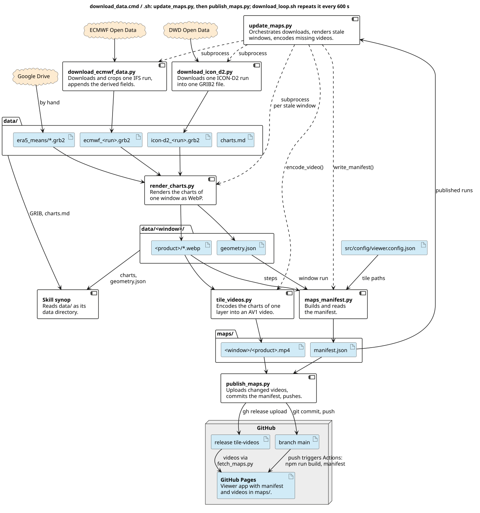
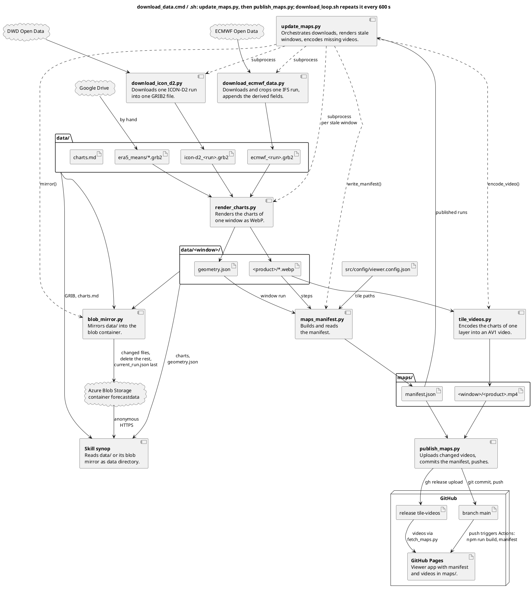
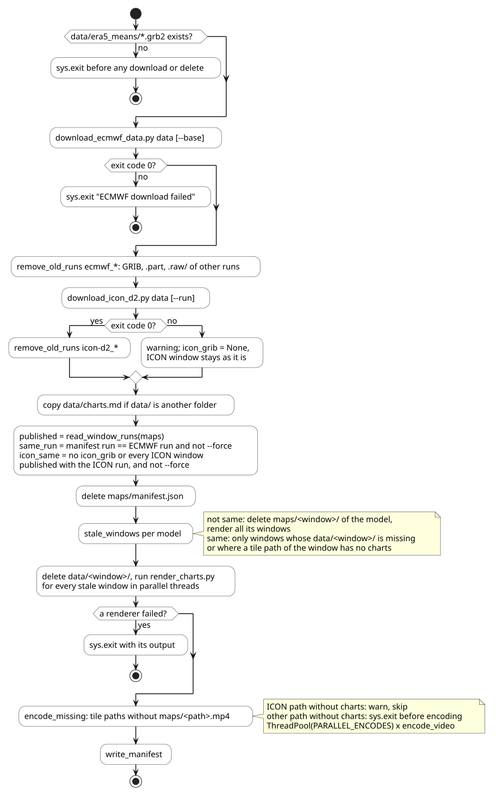
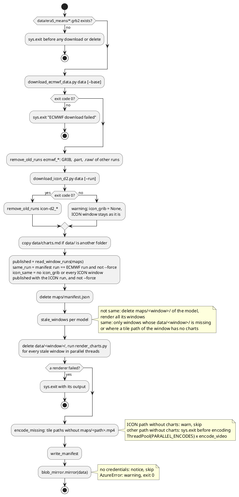
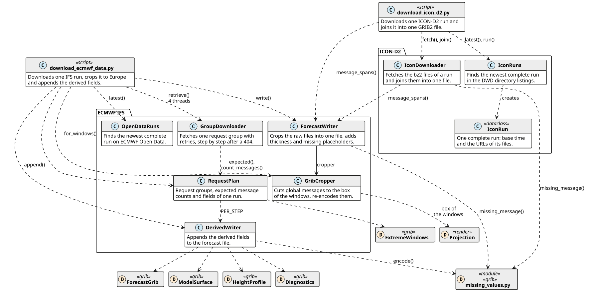
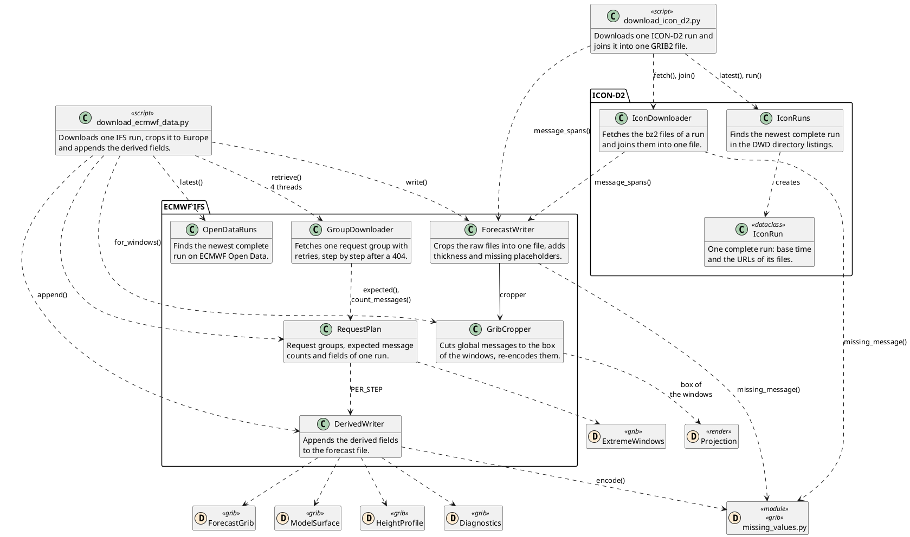
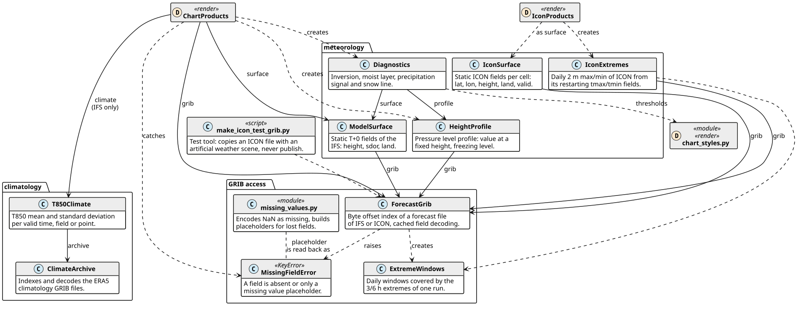
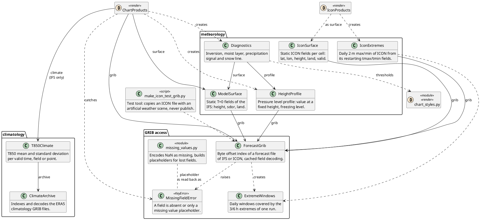
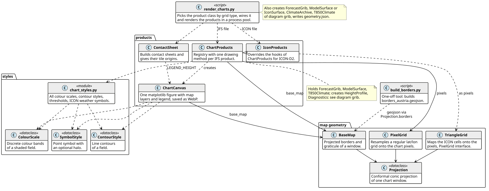
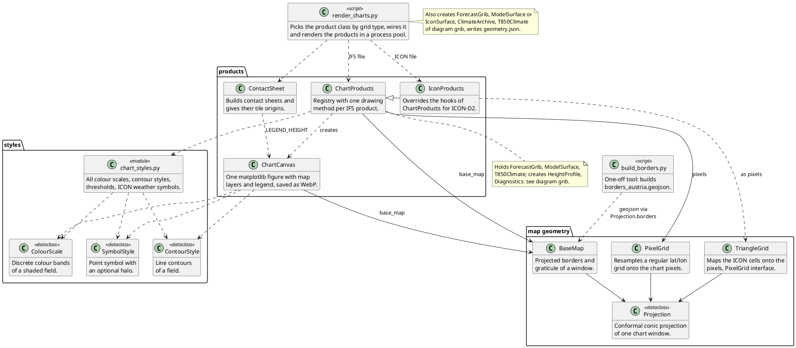

# wetterkartenviewer pipeline — agent reference

Reference for the Python data pipeline in `scripts/` (download, derived fields, charts, videos, publishing), so an agent can extend, debug or refactor it without reading all the code.
The web app that shows the result is described in REFERENCE.webapp.md; both meet only in `maps/manifest.json` and `src/config/viewer.config.json`.
Paths are relative to the repository root. Symbols are named so that a search finds them.
All times are UTC. A *step* is hours after the ECMWF run. Charts, messages, code and comments are English; data/charts.md is German.

Read the diagrams first: they hold the architecture and every dependency.
The API sections follow Javadoc: intro, fields, methods per module or class.

## Purpose

- Download one ECMWF IFS HRES run (0.1°, cropped to Europe, derived fields appended) and one DWD ICON-D2 run (icosahedral grid ≈ 2.2 km, unchanged) into `data/`.
- Render WebP charts for three windows into `data/`, encode each tile layer of the viewer as `maps/<window>/<product>.mp4` (one frame per step), write `maps/manifest.json`.
- Upload the videos to a GitHub release, push a manifest commit; GitHub Actions builds and deploys the app with them.
- IFS updates every 12 h, ICON-D2 every 3 h; `download_loop.sh` runs the whole chain every 10 min on an always-on machine.
- `data/` is also the data directory of the skill synop (source in `skills/synop`, installed to `~/.claude/skills/synop`), see *Contract with the skill synop*; `blob_mirror.py` mirrors it into a public Azure blob container so the skill works without this repository.

## Diagrams

Stereotypes: `<<script>>` command line, `<<module>>` functions and constants only, a `D` spot names the diagram that describes the element.
Class diagrams: solid arrow = holds an instance (constructor injection), dashed = creates or calls, triangle = inherits.
Not drawn: the constant modules `constants.py`, `local_params.py`, `fonts.py`.

### pipeline: data flow between scripts, files and external systems

Solid arrow: data, from writer to file and from file to reader. Dashed: calls.





### update_maps: decisions of one call (`main`, scripts/update_maps.py)





### download: IFS and ICON-D2





### grib: reading the forecast file, meteorology, climatology





### render: the charts of one window





## Contracts and file formats

### maps/manifest.json — the only interface between pipeline and app

Written by `build_manifest` (scripts/maps_manifest.py), typed as `Manifest` (src/model/ChartIndex.ts).

```json
{ "run": "2026103012", "fps": 10,
 "charts": { "opencharts_europe/thickness_mslp":
 { "file": "opencharts_europe/thickness_mslp.mp4", "steps": [0, 3, 6, ..., 240],
 "run": "2026103012", "end": 240 },
 "icon-d2/weather_summary":
 { "file": "icon-d2/weather_summary.mp4", "steps": [22, 23, ..., 69],
 "run": "2026103109", "end": 69 } } }
```

- `run` (top): the ECMWF run. The slider and all `steps`, ICON ones included, count from it.
- `charts` keys: the paths of viewer.config.json (`window/product`, lists flattened), deduplicated in config order (`tile_chart_paths`). A path without a video in `maps/` is left out (warning); the app then says „keine Karten in diesem Lauf“.
- `file`: video relative to `maps/` (`<path>.mp4`).
- `steps[i]`: step of frame `i`, from the chart file names in `data/<path>/` (`file_step`): `YYYYMMDDHH` in hours from the ECMWF run, `YYYYMMDD` (tmax/tmin) from 00 UTC of the day, negatives clamped to 0, other names ignored. Sorted by step = frame order (`chart_frames`).
- `charts[…].run`: run of the model of the video (`window_run` from `data/<window>/geometry.json`, else the ECMWF run). Cache parameter of the video URL, and how update_maps.py recognises the ICON run. Optional in TS.
- `end`: step of the last frame, for a daily chart + 23 h, so a daily chart covers its day. `frame` returns null after `end`.
- `fps`: `FPS` (10), used for encoding too; the app only uses the manifest value.
- Steps are irregular: IFS 3-hourly to +144, then 6-hourly (65 frames; products start differently, `weather_summary` at +3, `dt850_24h` at +24). ICON hourly, 49 frames (48 for `weather_summary`), offset by the gap between the two runs (e.g. +21…+69); tmax/tmin one frame per day.

### data/ layout

| Path | Writer | Content |
| --- | --- | --- |
| `ecmwf_<run>.grb2` | download_ecmwf_data.py | one IFS run, see *Forecast file (IFS)*; 1.5–1.6 GB |
| `icon-d2_<run>.grb2` | download_icon_d2.py | one ICON-D2 run, 1130 messages, ≈ 820 MB |
| `era5_means/*.grb2` | by hand from Google Drive (link in README.md) | ERA5 1991–2020, 422 MB, 13 224 fields; `check_climate` requires it |
| `<window>/<product>/<YYYYMMDDHH>.webp` | render_charts.py | step charts named by valid time; daily products `<YYYYMMDD>.webp` |
| `<window>/orography.webp`, `sheets/<product>.webp`, `geometry.json` | render_charts.py | static chart (no folder), contact sheets, geometry |
| `charts.md` | by hand, committed | German description of files, GRIB fields, products for the skill |

Windows: `opencharts_europe` (all IFS products), `opencharts_central_europe` (IFS defaults), `icon-d2` (all ICON products).
`data/` is ignored by git except `charts.md`; `maps/` except `manifest.json`; `docs/` holds the diagram sources and PNGs.
Sizes (run 2026103000): europe 266 MB, central_europe 125 MB, `maps/` ≈ 67 MB with 14 videos of 2.2–7.3 MB.

### geometry.json

Written by `write_geometry` (scripts/render_charts.py): `window`, `model` (`ChartProducts.MODEL`: `ECMWF IFS` / `ICON-D2`), `run`, `image.width/height` (1200×600, map without legend), `projection.pole_x/pole_y/scale_k/cone/lon0/formula`, `sheets.scale`, `sheets.tiles.<product>` = list of `[x, y]` tile corners.
Entries of other products in an existing file are kept, so single-product runs add instead of overwrite.

### Contract with the skill synop

The skill reads `data/` (docstrings scripts/update_maps.py, scripts/lib/local_params.py), locally or as its mirror `https://wetterkartenviewer.blob.core.windows.net/forecastdata/<path relative to data/>` (container-level public access: blobs and the listing `?restype=container&comp=list` need no credentials; see *blob_mirror.py*). Changing any of these breaks it until the skill is updated:
product names and the folder layout above, `geometry.json` keys, GRIB short names, levels, units and `stepRange` of the daily extremes, the local parameter numbers 0–5 in category 192, `charts.md`.
The skill has its own copies of `ForecastGrib` and `ClimateArchive`.
Its `ChartGeometry` (`skills/synop/scripts/lib/chart_geometry.py`) ignores `cone`/`lon0`: right for `opencharts_*` (cone 1, lon0 0), wrong markers on `icon-d2` until updated.

### Forecast file (IFS)

One GRIB2 file per run, 0.1° regular lat/lon, rows north → south.
Box from `GribCropper.for_windows`: image borders of all windows ± 1°, rounded to whole degrees → 11–76° N, 71° W–77° E, 651 × 1481 points.
Steps `STEPS`: 0…141 every 3 h (48) + 144…240 every 6 h (17) = 65.

| Group (raw file) / writer | Content | Messages |
| --- | --- | --- |
| t, gh, r | each × `PROFILE_LEVELS` 1000/925/850/700/600/500 × 65 | 3 × 390 |
| uvw700 | u, v, w at 700 × 65 | 195 |
| uv_low | u, v at 850/925/1000 × 65 | 390 |
| sfc | msl, 2t, 10u, 10v × 65 | 260 |
| static | z, sdor, lsm, T+0 only | 3 |
| minmax3 / minmax6 | mx2t3, mn2t3 × 3…144 / mx2t6, mn2t6 × 150…240 | 96 / 32 |
| weather | tcc, tp, ptype × 65 | 195 |
| ForecastWriter | `thick` = gh500 − gh1000, GRIB2 0/3/12, isobaricLayer 1000–500 | 65 |
| DerivedWriter per step (`PER_STEP` 21) | t, r, u, v at heightAboveSea 2000/2500/3000; `deg0l` (228024, ecCodes sets isothermal level 273); `inv`, `rhbl`, `psig`, `snowl` (local, surface); `uf`, `vf` at 1000/925 hPa (local) | 1365 |
| DerivedWriter once | `orog` (228002, m) | 1 |
| DerivedWriter per complete day | `mx2t` (201) / `mn2t` (202), `stepRange` = whole window | 10 + 9 |
| **Total** (00z and 12z) | | **3791** |

`RequestPlan.expected_total` computes this total; `output_complete` compares it with the target file.
Local parameters (`LOCAL_NAMES`): discipline 0, category 192, number 0 `inv`, 1 `rhbl`, 2 `psig`, 3 `snowl`, 4 `uf`, 5 `vf`; ecCodes reads them as `unknown`, `ForecastGrib._name` renames them.
Missing values: NaN is written as bitmap missing; it occurs for `inv`/`rhbl`/`uf`/`vf` below the model ground, for heights outside the profile levels (wind at 3000 m where gh700 < 3000 m) and for `deg0l`/`snowl` where 500 hPa is above 0 °C. `snowl` is set everywhere, not only where `psig`.
`tp` accumulates from T+0 in m. `tcc`, `tp`, `ptype` (`WEATHER_PARAMS`) only feed `weather_summary`: a 9 km global model gets fog and its precipitation wrong.
Fields lost on the server get a placeholder: a copy of the same field at another step with every value missing (`missing_message`). The file then has the full message count and counts as complete; `ForecastGrib.field` raises `MissingFieldError`, `has()` stays true.

### ICON-D2 file

Source `https://opendata.dwd.de/weather/nwp/icon-d2/grib/<HH>/<folder>/`, one bz2 file per run, parameter, level and step, no auth.
A run every 3 h, hourly to T+48; each hour folder holds only its newest run, so ≈ 1 day is available.
Fields stay on the icosahedral grid (542 040 cells, 1-D arrays; boundary zone without values = NaN).

| DWD parameter | Index name (`ICON_NAMES` alias) | Content | Steps |
| --- | --- | --- | --- |
| clat, clon | `clat`, `clon` | cell centres (°) | 0 |
| hsurf, fr_land | `hsurf`, `lsm` | model orography (m), land fraction | 0 |
| clct | `tcc` | total cloud in **%** (IFS 0…1) | 0…48 |
| tot_prec | `tp` | precipitation from T+0 in **mm** (IFS m) | 0…48 |
| pmsl | `msl` | pressure (Pa) | 0…48 |
| vmax_10m | `gust` (level 10) | max 10 m gust of the last hour (m/s) | 0…48 |
| ww | `ww` | significant weather, WMO 4677 | 1…48 |
| t_2m, u_10m, v_10m | `2t`, `10u`, `10v` | | 0…48 |
| tmax_2m, tmin_2m | `tmax_2m`, `tmin_2m` | 2 m extreme since the last 6 h restart (K) | 0…48 |
| ceiling | `ceiling` | base of the lowest layer with > 50 % cover, m above sea; ≈ 20 km where none | 0…48 |
| u@1000, v@1000 | `u`, `v` level 1000 | for `t2m_wind1000` | 0…48 |
| t, relhum, fi, u, v @850 and @700 | `t`, `r`, `z`, `u`, `v` | profile for `mountain_2000`; no 925 hPa in ICON-D2 | 0…48 |

Total 4 + 22 × 49 + 48 = 1130 messages. The aliases give ICON fields the IFS names, so `ChartProducts` methods work; units still differ and `IconProducts` handles them.

## Command line

```
update_maps.py <data> <maps> [--base YYYYMMDDHH] [--icon-run YYYYMMDDHH] [--force]
maps_manifest.py <data> <maps> --run YYYYMMDDHH
publish_maps.py <maps> (gh and git run in the repo root)
fetch_maps.py <maps> <target> --repository owner/name
blob_mirror.py <data> (credentials from the environment or .env)
download_ecmwf_data.py <out file|existing dir> [--base YYYYMMDDHH] [--max-step N] [--keep-raw]
download_icon_d2.py <out file|existing dir> [--run YYYYMMDDHH] [--keep-raw]
render_charts.py <grib> <outdir> [--climate DIR] [--projection icon-d2|opencharts_central_europe|opencharts_europe]
 [--products a,b|all] [--workers N]
build_borders.py <VGD_50_generalisiert.shp> [target.geojson]
make_icon_test_grib.py <source.grb2> <target.grb2> [--step N] (default 12)
download_data.cmd | download_data.sh [update_maps options] = update_maps.py data maps, then publish_maps.py maps
download_loop.sh [--yes] every 600 s: git fetch, reset --hard origin/main, download_data.sh,
 then rsync -a --delete data/ to $WETTER_MIRROR_DIR (default ~/Downloads/wetterviewer_data; skipped if the folder is missing)
```

Status on stdout, errors on stderr. Downloaders print the absolute GRIB path as their last stdout line and exit 0 with "already on disk" if the target is complete.
`download_ecmwf_data.py` and `download_icon_d2.py`, `render_charts.py`, `make_icon_test_grib.py` put their own folder on `sys.path` (work with `python -I`); `update_maps.py`, `maps_manifest.py`, `publish_maps.py`, `fetch_maps.py`, `blob_mirror.py` import their sibling modules without `-I`.
Python packages (no requirements file): `ecmwf-opendata`, `eccodes`, `numpy`, `scipy`, `matplotlib` (Agg), `Pillow`, `requests`, `azure-storage-blob` (update_maps.py imports it also without credentials); build_borders.py also `pyshp`, `shapely` ≥ 2.1, `pyproj`. `ffmpeg` with `libaom-av1` must be on PATH.

## API: scripts/ (command line and modules)

### update_maps.py

Orchestrates one update; the flow is diagram *update_maps*.
Destructive by design: deletes other runs' GRIBs, `maps/manifest.json` on every call, `data/<window>/` before rendering and `maps/<window>/` of a model on a new run or `--force`, all before rendering.
"Same run" is decided per model, from the manifest only: the ECMWF run at the top, the ICON run at the `icon-d2` layers. An interrupted call leaves no manifest, so the next one counts as a new run for both models.
An existing video is never checked for freshness. A layer added to the config takes effect without `--force` (its window is re-rendered because the path has no charts).
Without a new run a call takes ≈ 3.5 s.

| Field | Meaning |
| --- | --- |
| `WINDOWS = {'opencharts_europe': 'all', 'opencharts_central_europe': None}` | IFS windows → `--products` (None = defaults) |
| `ICON_WINDOWS = {'icon-d2': None}` | ICON windows; their paths without charts only warn in `encode_missing` |
| `ECMWF_PREFIX, ICON_PREFIX = 'ecmwf_', 'icon-d2_'` | run file prefix; must match `PREFIX` of download_icon_d2.py |
| `PARALLEL_ENCODES = 3` | ffmpeg processes at once (libaom uses several threads each) |
| `CHARTS_DOC` | data/charts.md of the repo |

| Function | Summary |
| --- | --- |
| `check_climate(data)` | exit if `data/era5_means` has no `*.grb2`, before any download or delete |
| `download(script, data, options) -> Path \| None` | run a downloader with live output; last non-empty line = GRIB path; None on exit ≠ 0 |
| `remove_old_runs(data, grib, prefix)` | delete `<prefix>*.grb2*` (file, `.part`, `.raw/`) of other runs |
| `render(grib, data, window) -> str` | run render_charts.py for one window; `sys.exit` with its output if it fails |
| `stale_windows(data, maps, windows, same_run, run) -> list` | windows to render; empties `maps/<window>/` unless same run; same run: window folder missing or a tile path without charts (incomplete product folders are not checked) |
| `encode_missing(data, maps, run)` | encode config paths without video; exits before the first encode if a non-ICON path has no charts |

### blob_mirror.py

`mirror(data)` makes the container `forecastdata` hold exactly the finished files of `data/` (all but paths with a part ending in `.part`/`.raw`); blob name = path relative to `data/`. Called last in update_maps.py, also when nothing was rendered, so a failed upload heals on the next call; without changes it only lists the container.
Changed = blob missing, other size, or metadata `mtime` ≠ local `st_mtime_ns` (no hash). Order when something changed: delete `current_run.json`, upload, batch-delete blobs without a local file, write `current_run.json` (`{"ecmwf": run, "icon-d2": run, "updated": UTC ISO}`, runs from the top-level GRIB names, `Cache-Control: no-cache`). Re-rendered charts change in place, so the container is consistent only while `current_run.json` exists; the skill's `fetch_data.py` reads it before and after downloading and rejects a missing or changed one. A call without changes leaves it alone or writes it if a failed call left none.
Tier hot per blob although the account defaults to cool: cool blobs deleted within 30 days are billed for 30 days, and every run replaces GB. No versioning, soft delete off (per user).
Credentials: `BLOB_STORAGE_ID` (account name or its resource ID, last segment taken) and `BLOB_STORAGE_KEY` (account key); environment before `.env` in the repo root (`KEY=VALUE` lines, ignored by git). Missing → notice on stdout, nothing happens.

| Field | Meaning |
| --- | --- |
| `CONTAINER = 'forecastdata'`, `ENV_FILE` | |
| `RUN_FILE = 'current_run.json'`, `MODELS` | consistency marker; model key → GRIB prefix, **must match** `ECMWF_PREFIX`/`ICON_PREFIX` |
| `UNFINISHED = ('.part', '.raw')` | suffixes of unfinished downloads, never uploaded |
| `CONTENT_TYPES` | grb2 octet-stream, md `text/markdown; charset=utf-8`, json, webp |
| `MTIME = 'mtime'` | metadata key of the local modification time |
| `PARALLEL_UPLOADS = 8`, `BLOCK_UPLOADS = 4` | files at once, blocks at once per large file |
| `DELETE_BATCH = 256` | service limit of one batch request |

| Function | Summary |
| --- | --- |
| `credentials() -> (account, key) \| None` | |
| `local_files(data) -> dict[name, Path]`, `stale_files(files, blobs) -> list[str]` | |
| `upload(container, name, path)`, `delete(container, names)` | |
| `current_runs(files) -> dict`, `write_run_file(container, runs)` | content and upload of `current_run.json` |
| `mirror(data)` | raises `AzureError`; update_maps.py catches it and only warns |

### maps_manifest.py

Builds and reads the manifest (see *maps/manifest.json*). Frame order and manifest steps both come from `chart_frames`; the manifest re-reads the steps from `data/` on every call while a video may be older, so `len(steps)` must equal the video's frame count. This holds as long as only update_maps.py changes `data/`.
ICON steps count from the ECMWF run: with a new ECMWF run and the same ICON run the ICON video stays and only its steps move; charts before the ECMWF run clamp to step 0 (`frame` takes the last of equal steps).

| Field | Meaning |
| --- | --- |
| `CONFIG`, `MANIFEST = 'manifest.json'` | viewer config path, manifest name |
| `FPS = 10` | frame rate of every video and `fps` of the manifest; only a time base, videos are never played |
| `HOURS_PER_DAY = 24` | `end` of a daily chart = its step + 23 |

| Function | Summary |
| --- | --- |
| `tile_chart_paths(config=CONFIG) -> list[str]` | all layer paths, lists flattened, deduplicated, config order; the same list decides what is encoded |
| `file_step(stem, base) -> int \| None` | step of a chart file name (see manifest) |
| `chart_frames(data, path, run) -> list[(step, Path)]` | the frames of a layer's video, sorted by step |
| `video_file(path) -> str` | `<path>.mp4` |
| `window_run(data, window) -> str \| None` | `run` of `data/<window>/geometry.json`; missing → the next call re-renders an ICON window every time |
| `build_manifest(data, maps, run, paths) -> dict` | only paths with a video in `maps/` (else warning) |
| `read_run(maps)`, `read_window_runs(maps)`, `video_files(maps)` | read the manifest; None/empty if unreadable |
| `write_manifest(data, maps, run) -> Path` | write it; prints the path |

### tile_videos.py

`encode_video(frames, target)` — open each chart with Pillow, convert to RGB, pipe `rawvideo rgb24` 1200×690 into ffmpeg (stdin), write `<target>.part`, then replace `target`. ffmpeg runs with `-loglevel error`; its stderr is read after the last frame. Exit ≠ 0 → `RuntimeError` with stderr, `.part` deleted.
Settings come from an encoder comparison on `z500_t850` (per user): libaom CRF 20 with screen tuning ≈ 7 MB at the PSNR of WebP q90 (17 MB). One video ≈ 27 s, all 14 ≈ 1:45 min with 3 in parallel.

| Field | Meaning |
| --- | --- |
| `WIDTH, HEIGHT = 1200, 690` | **must equal the chart size**: ffmpeg splits the byte stream only by this, a mismatch is silent |
| `KEYFRAME_INTERVAL = 8` | `-g`; a seek decodes at most 7 frames |
| `CODEC` | `libaom-av1 -crf 20 -b:v 0 -cpu-used 6`, `tune-content=screen` (palette mode, intra block copy for flat colours) |
| `COLOUR` | yuv420p, BT.709 matrix/primaries/transfer, TV range: the browser converts back exactly; MP4 `+faststart`, no audio |

### publish_maps.py

Uploads first, then pushes, so the deploy of the new manifest finds every video. Asset names carry no run; a deploy of an older manifest during an upload may fetch new videos, the next push redeploys (`cancel-in-progress`).
Pushes `HEAD` without asking, including local code commits; the commit holds only the manifest, other staged changes stay staged. History grows ≈ 20 KB per run. `gh` must be installed and logged in.
Aborts before any upload without manifest, without videos in it, or if one is missing.

| Function | Summary |
| --- | --- |
| `call(*command) -> str` | run in the repo root; `sys.exit` with stderr on failure |
| `ensure_release()` | create release `tile-videos` on first use, `--latest=false` |
| `changed_videos(maps, files) -> list` | asset missing, other size, or `updatedAt` older than the file mtime; no hash, so equal size + older mtime from another machine goes unnoticed |
| `upload_videos(maps, files)` | copies under asset names into a temp dir, `gh release upload --clobber` |
| `prune_assets(files)` | delete assets the manifest does not list: videos of earlier runs exist nowhere afterwards |
| `commit_message(maps, run) -> str` | "Data update <run>z" + ", <window> <run>z" per window of another run |
| `commit_manifest(maps, run)` | `git add` + `git commit -- maps/manifest.json` if it changed |

### fetch_maps.py and maps_release.py

`fetch_maps.main` runs in the deploy workflow: copies `maps/manifest.json` to `<target>`, downloads every listed video anonymously (repo must be public) from `https://github.com/<repo>/releases/download/tile-videos/<asset>`, `TIMEOUT_S = 60`; any failure → `sys.exit` with the URL, the old site stays.
maps_release.py: `TAG = 'tile-videos'`; `asset_name(file)` replaces `/` with `.`; `download_url(repository, file)`.
Workflow `.github/workflows/deploy.yml`: on push to `main` or manually; Node 24, `npm ci`, `npm run build`, `fetch_maps.py maps dist/maps`, deploy Pages; `concurrency: pages`, `cancel-in-progress`.

### download_ecmwf_data.py

`main`: `OpenDataRuns.latest()` (or `--base`, 00/12 only) → `RequestPlan` → "already on disk" if `output_complete` → `GroupDownloader.retrieve` × 4 threads into `<out>.raw/` → `ForecastWriter.write` into `<out>.part` → `DerivedWriter.append` → rename → delete `.raw/` unless `--keep-raw`.
stderr is redirected to devnull during the group downloads (the client's progress bars cannot be switched off), so warnings go to stdout there.
`out` is treated as a folder only if it exists. `--max-step` with a folder target still writes `ecmwf_<run>.grb2`; a later full call sees another count and downloads again.

| Field | Meaning |
| --- | --- |
| `STEPS` | 0…141 every 3 h + 144…240 every 6 h |
| `PARALLEL_REQUESTS = 4` | groups at once |

### download_icon_d2.py

`main`: `IconRuns.latest()` (or `run(--run)`, only runs DWD still holds) → "already on disk" if the target has one message per URL (the listings are always queried, no offline mode) → `IconDownloader.fetch` × 8 threads → `join` into `<out>.part` → exit 1 if messages ≠ URLs (`.part`, `.raw/` stay) → rename → delete `.raw/`.
Measured: 1130 files, 820 MB, 43–138 s depending on the network.

| Field | Meaning |
| --- | --- |
| `PROFILE_LEVELS = (850, 700)` | enclose 2000 m everywhere; separate from `constants.PROFILE_LEVELS` |
| `FORECAST_PARAMS`, `STATIC_PARAMS` | 23 DWD folder names, `<folder>@<hPa>` on pressure levels; `clat`, `clon`, `hsurf`, `fr_land` |
| `PARALLEL_REQUESTS = 8`, `PREFIX = 'icon-d2_'` | |

### render_charts.py

`main`: `parse_args` picks the class by `is_icon` and the default window (`icon-d2` or `opencharts_europe`) and products (`DEFAULTS[window]` of the class; `KeyError` if the window has no entry and no `--products`). `build_products` once in the main process (for `keys`, sheets, geometry), then a process pool (`init_worker` builds the products per process, chunksize 2) renders every `(product, key)`; then `write_sheets` (reads the written WebPs, so it must run after the workers) and `write_geometry`.
Measured ICON, all products: 199 charts + 6 sheets ≈ 43 s with a warm file cache, ≈ 148 s right after the download.
On Windows the pool uses spawn; worker state lives in the module global `_products`.

| Function | Summary |
| --- | --- |
| `is_icon(grib_path) -> bool` | `gridType` of the first message is `unstructured_grid` |
| `build_products(grib_path, projection, climate_dir) -> ChartProducts` | ICON: `ForecastGrib(path, ICON_NAMES)`, `IconSurface`, `BaseMap`, `TriangleGrid` → `IconProducts`. IFS: `ForecastGrib`, `ModelSurface`, `BaseMap`, `PixelGrid`, plus `ClimateArchive`/`T850Climate`/`PixelGrid(archive.grid)` only if a `CLIMATE` product is requested |
| `render(task) -> Path` | worker: `products.draw(...).save(path)` |
| `write_sheets(products, names, out_dir, sheet) -> dict` | one sheet per product: charts at `SHEET_HOURS`, every day for DAY products, none for orography |
| `write_geometry(projection, products, sheet, sheets, out_dir)` | see *geometry.json* |

### build_borders.py and make_icon_test_grib.py

build_borders.py (one-off, by hand): BEV VGD 1:50 000 cadastral communities (EPSG:31287) dissolved to states, slivers < `MIN_PART_KM2` (0.5) removed, simplified as one coverage (`SIMPLIFY_M` 150 m ≈ 0.2 px, shared borders stay identical), to WGS84; countries of world_countries.geojson within `KEEP_BOX` (71° W–77° E, 11–76° N); Austria's neighbours cut along the exact border, gaps given to the neighbour with the longest shared edge; properties `COUNTRY`, `ISO`, `LEVEL` (`country`/`state`), `NAME` for states; 5 decimals (`DECIMALS`).
make_icon_test_grib.py: copies an ICON file and from `--step` places a scene: thunderstorm line west of Munich (ww 95, 8–25 mm/h, gusts 90–125 km/h), hail core at its east end (ww 96, 45 mm/h), fog near Linz and in the Vienna basin (ww 45). Precipitation is added to `tp` at `--step` and all later steps. `CELLS`, `FOG`. Never write the output into `data/`, or update_maps.py renders and publishes it.

## API: scripts/lib/ — download

### OpenDataRuns (open_data_runs.py)

Two `ecmwf.opendata.Client(source="ecmwf")`, `resol="0p1"` and `"0p25"`.
`MAX_STEP = 240` (asking for T+240 of t850 excludes 06z/18z, which end at +144); `LISTING_URL` (`https://data.ecmwf.int/forecasts/{YYYYMMDD}/{HH}z/ifs/`), `RUN_INTERVAL = 12 h`.

| Method | Summary |
| --- | --- |
| `latest(client=None) -> datetime` | newest run with T+240 |
| `pending_notice(run) -> str \| None` | notice if a newer run is only out at 0.25°; time stamp of `0p1/` + 12 h = expected arrival; any error → None |
| `folder_time(run)` (static) | time stamp of the run's `0p1/` folder (`requests`, timeout 30 s) |

### RequestPlan (request_plan.py)

Every request is a cartesian product param × levelist × step; `expected` relies on that because Open Data drops missing params silently. Groups without steps are dropped (`groups`).

| Method | Summary |
| --- | --- |
| `__init__(steps, base_time)` | groups t, gh, r, uvw700, uv_low, sfc, static, minmax3, minmax6, weather (:24-37) |
| `expected(request) -> int` (static) | messages a request must yield |
| `fields() -> set[(param, level, step)]` | every expected raw message, for placeholders |
| `expected_total() -> int` | groups + per step thickness and `PER_STEP` + `orog` + one extreme per complete day (via `ExtremeWindows`) |
| `output_complete(path) -> bool` | message count equals `expected_total` |
| `count_messages(path) -> int` (module) | 0 if missing |

### GroupDownloader (group_downloader.py)

`RETRIES = 3`, `RETRY_DELAY = 30` s × attempt.
A complete raw file is kept (resumable). A group with the wrong count stays with a warning; `ForecastWriter` fills the gaps.

| Method | Summary |
| --- | --- |
| `__init__(client, run, raw_dir)` | |
| `retrieve(name, request) -> Path` | whole group; on 404 step by step without the missing steps; all steps 404 → `RuntimeError` ("not published") |
| `_fetch`, `_fetch_steps` | one request with retries (404 raised at once) / group step by step |
| `not_found(error)` (module) | client error is a 404 |

### GribCropper (grib_cropper.py)

Computes rows/columns from the first message (`fit`) and reuses them; `grid` exists only after `fit`. `BOX_MARGIN_DEG = 1.0` for smoothing and interpolation up to the image border.
The cone apex lies above every image, so the extremes of `border_latlon` bound the box; `for_windows` gets all `PROJECTIONS` (icon-d2 lies inside Europe and changes nothing).

| Method | Summary |
| --- | --- |
| `for_windows(projections, margin)` (classmethod) | box covering every window, whole degrees |
| `fit(gid) -> (rows, cols)` | indices in the global grid, columns west → east across 0° |
| `crop(gid) -> (handle, values)` | caller releases the handle |
| `encode(template, values, keys=None) -> handle` | clone onto the box grid |

### ForecastWriter (forecast_writer.py)

Only the main process writes, in `pool.map` order, so the file is byte-identical to a run without pool; switching to `imap_unordered`/`as_completed` breaks this.
`thick` is written right after the second of gh500/gh1000 of a step. Placeholders of lost fields and missing `thick` go at the end; readers index by key.
`_fit` runs before the pool on the first decodable message so workers get a fitted cropper and the caller can read `cropper.grid`.
Memory: each worker decodes a global field (≈ 100 MB).

| Field | Meaning |
| --- | --- |
| `THICKNESS_KEYS` | 0/3/12, layer 100000/50000 Pa; also for missing `thick` |
| `INDICATOR_LENGTH = 16` | GRIB2 section 0; message length in bytes 8–15 big endian |
| `CHUNK_SIZE = 8` | messages per pool task |
| `MAX_WORKERS = 8` | 15.8 ms/message with 8, 14.3 with 20, 79.5 with 1: beyond 8 the writing main process limits |
| `SHOWN_FIELDS = 12` | lost fields named in the warning |

| Function / method | Summary |
| --- | --- |
| `message_spans(path) -> list[(path, offset, length)]` | intact edition 2 messages ending in "7777"; damaged bytes skipped to the next "GRIB". Damage inside the data section with intact header goes unnoticed |
| `read_message(span)`, `crop_message(span)` | worker reads and crops itself; None if ecCodes cannot decode it |
| `write(raw_files, target, expected) -> int` | crop all into `target`, thickness, then a placeholder per expected field without message (template = first message of that field); fields without template are left out with a warning (the file is then incomplete and rebuilt next time) |

### DerivedWriter (derived_writer.py)

Runs on the finished `.part` file: re-indexes it and needs every model field. Each derived field is computed through `or_missing`: if an input raises `MissingFieldError`, all its values are missing. Order of appended messages: all steps, then `orog`, then `mx2t` per day, then `mn2t` per day. Holds all derived messages in the main process before appending.
The same `Diagnostics`/`HeightProfile` code computes the GRIB fields and the charts (charts recompute, they do not read the derived fields).

| Field | Meaning |
| --- | --- |
| `MOUNTAIN_HEIGHTS = (2000, 2500, 3000)` | heightAboveSea; never a value equal to a pressure level number (500…1000): the index has no level type and would overwrite it |
| `PER_STEP` | 21; **must match the `jobs` of `step_messages` by hand**, else `output_complete` is never true; imported by `RequestPlan` |
| `PARAM_IDS` | deg0l 228024, orog 228002, max 201, min 202 |
| `MAX_WORKERS = 8` | processes, each up to ≈ 250 MB cache |

| Function / method | Summary |
| --- | --- |
| `step_messages(step) -> list[bytes]` | worker: the 21 messages of one step, templates via `grib.message` |
| `append(path) -> int` | compute in a pool, append, return the count |
| `_extremes(grib)` | daily max/min as one message over the whole window |

### IconRuns, IconRun (icon_runs.py, icon_run.py)

Hour folder time stamps never change, the parameter folders inside change with every run; their newest time stamp orders the hour folders by age (`_folder_time`, error → `datetime.min`).
A folder is complete if every parameter listing shows exactly one run and every forecast parameter has step 48 (DWD writes steps in order); else `latest` takes the next older folder.
Parameters are DWD folder names, `<folder>@<hPa>` on pressure levels; each folder is listed once per hour folder and its files filtered by the level token. A run costs 8 hour-folder listings + 20 parameter listings per checked folder.
`IconRun` (frozen dataclass): `run: str`, `urls: tuple[str, ...]` — static fields first, then by (step, parameter order).

| Field | Meaning |
| --- | --- |
| `BASE_URL`, `RUN_HOURS` (`00`…`21`), `MAX_STEP = 48`, `TIMEOUT_S = 30` | |
| `FOLDER`, `FILE` | regexes on the nginx listing and on `…_icosahedral_…_<run>_<step>_<level>_….grib2.bz2`; a changed listing format means no run is found |
| `SINGLE_LEVEL, TIME_INVARIANT = '2d', '0'` | level token without `@` |

| Method | Summary |
| --- | --- |
| `latest() -> IconRun` | newest complete run |
| `run(run) -> IconRun` | given run if its folder still holds it complete, else `RuntimeError` |
| `complete_run(hour) -> IconRun \| None` | |
| `_every_step(run, listed)` | every step from the first listed to 48, also those missing in the listing (they end as 404 and placeholders) |
| `_split(param)`, `_files(hour, folder)` | `t@850` → (`t`, `850`); HTTP error of a listing is not caught (traceback) |

### IconDownloader (icon_downloader.py)

Keeps only messages on whole hours (`endStep` in minutes divisible by 60): `tot_prec` files also hold quarter-hour sums that `ForecastGrib` could not tell apart in hours. After that every file yields exactly one message.
An existing raw file counts as complete (resume, not re-checked; `join` checks it).

| Field | Meaning |
| --- | --- |
| `RETRIES = 3`, `RETRY_DELAY = 10` s × attempt, `TIMEOUT_S = 60` | then placeholder |
| `STEP` | regex `_<run>_<SSS>_`: step of a placeholder; the name without it identifies the field |

| Method | Summary |
| --- | --- |
| `fetch(url) -> Path \| None` | download, bz2 decompress, filter, write via `.part`; None after 404, network, bz2 or GRIB errors on the last attempt |
| `join(urls, raw_files, target) -> int` | concatenate in URL order; a None or damaged file becomes a placeholder from the same field at another step; without template it is left out (count mismatch → exit 1) |

## API: scripts/lib/ — GRIB access and meteorology

### ForecastGrib (forecast_grib.py)

Index key `(name, level, endStep)` → `(startStep, byte offset)`, **without typeOfLevel**: `t` at 850 hPa and at 2000 m differ only by level. Name = local name (category 192), else `aliases.get(shortName, shortName)`. `stepUnits` is set to hours (ICON gives static fields as "0m").
Base time and grid come from the first message; `grid` is None unless `regular_ll`, fields are then 1-D.
Arrays are float32 and **read-only** (shared via `lru_cache`); never modify them in place. `CACHED_FIELDS = 64` per instance ≈ 250 MB, per process.
`level=None` returns the first match in file order (safe for single-level parameters only).

| Field | Meaning |
| --- | --- |
| `path`, `base_time` | |
| `grid` | `lat0, lon0 (-180…180), dlat, dlon, ni, nj`, shared with `ClimateArchive.grid`; None on unstructured grids |

| Method | Summary |
| --- | --- |
| `__init__(path, aliases=None)` | index the file |
| `parameters()`, `steps(name)` | (shortName, level, typeOfLevel) in file order / end steps ascending |
| `has(name, step, level=None) -> bool` | true for placeholders too |
| `field(name, step, level=None) -> ndarray` | `MissingFieldError` if absent or all values NaN (placeholder, remembered in `_empty`) |
| `message(name, step, level=None) -> bytes` | encoded message, e.g. as template |
| `valid_time(step)` | |
| `daily_extreme(kind, day)`, `extreme_days(kind)` | IFS daily max/min from `mx2t*`/`mn2t*`; useless for ICON |
| `extreme_windows` (property) | `ExtremeWindows` of the file's intervals |

### ExtremeWindows (extreme_windows.py)

`EXTREME_WINDOWS = {'max': (6, 18), 'min': (-6, 6)}`: max 06–18 UTC, min 18 UTC previous day – 06 UTC (also used for ICON). `EXTREME_PARAMS`.
A day counts only if its 3/6 h intervals exactly tile the window. Days are UTC calendar days; the `endStep` of the `mx2t`/`mn2t` message lies on the day itself. Serves `ForecastGrib` (existing file) and `RequestPlan` (counting before download).

| Method | Summary |
| --- | --- |
| `parts(kind, day) -> list[(name, end)] \| None` | intervals tiling the window |
| `days(kind, last_step) -> list[date]` | complete days |
| `window(kind, day) -> (start, end)` | in steps |

### MissingFieldError (missing_field_error.py) and missing_values.py

`MissingFieldError(KeyError)`: field absent, or only a placeholder. `ChartProducts.draw` turns it into a "No data available" chart; code that tests for presence with `has()` must still catch it.
missing_values.py: `encode(template, values, keys) -> bytes` (NaN → bitmap missing); `step_keys(template, end_step)` (instantaneous `step`, accumulation `stepRange 0-N`, fixed interval same length); `missing_message(template, end_step, keys=None)` (placeholder).
A file with placeholders is complete: the next call says "already on disk" and never fetches a file the server delivers later; only the next run or deleting the GRIB does. The skill reads placeholders as NaN.

### ModelSurface, IconSurface (model_surface.py, icon_surface.py)

`ModelSurface(grib)`: `height` = z/g (m), `sdor`, `land` (lsm), T+0 on the model grid.
`IconSurface(grib)`: `lat` (clat), `lon` (clon), `height` (hsurf), `sdor = None` (no rough-terrain hatching), `land` (fraction), `valid` (height not NaN).
Lost static fields raise `MissingFieldError` while the products are built: rendering fails, every chart needs them.

### HeightProfile (height_profile.py)

`LEVELS` = `constants.PROFILE_LEVELS` descending; an ICON level not in this list is ignored, so keep both profile lists in sync.

| Method | Summary |
| --- | --- |
| `__init__(grib, step, height='gh', height_factor=1.0)` | IFS `gh` in gpm; ICON `z` × 1/g |
| `_stack(name)` | levels holding the parameter **and** the height field |
| `at_height(name, height) -> ndarray` | linear in height between neighbour levels; NaN outside |
| `freezing_level(ground) -> ndarray` | 0 °C crossing searched from the top (top of a warm layer above a cold pool); all frozen or crossing below ground → ground height; 500 hPa > 0 °C → NaN |

### Diagnostics (diagnostics.py)

Pressure levels only; a level counts where its geopotential is more than `ABOVE_GROUND_MARGIN = 20` gpm above the model ground, else NaN. `OMEGA_SIGMA = 4` grid points smoothing of w700 (noisy over mountains). Thresholds `PRECIP_RH`, `SNOW_LINE_BELOW_FREEZING_M` live in chart_styles.py and act on charts and GRIB at once.

| Method | Definition |
| --- | --- |
| `above_ground(level)`, `free(name, level)` | mask / masked field |
| `inversion()` | `fmax(t925 − t1000, t850 − t925)`, lower levels masked; > 0 = inversion (`inv`) |
| `moist_boundary_layer()` | `fmax(r925, r1000)`, masked (`rhbl`) |
| `precipitation_signal()` | `max(r850, r700) ≥ PRECIP_RH` (90) and smoothed `w700 < 0`; unmasked (`psig`) |
| `freezing_level()` | `HeightProfile.freezing_level` (`deg0l`) |
| `snow_line()` | `max(freezing_level − 350 m, ground)` (`snowl`) |

### IconExtremes (icon_extremes.py)

ICON's `max_2t`/`min_2t` restart every `RESTART_HOURS = 6` h from the run start although the header says `stepRange 0-N` (checked on data). `field` reduces every step in `(start, end]` of the window with `fmax`/`fmin`: `tmax_2m`/`tmin_2m` where the last restart before the step is ≥ window start, else hourly `2t`.
00/06/12/18z runs: restarts fall on window borders (exact). 03/09/15/21z: the first 3 h use hourly values and miss peaks between full hours. Typically 1 maximum and 2 minima per run. Rebuilt on every call.

| Method | Summary |
| --- | --- |
| `days(kind) -> list[date]` | days whose window lies within 0…last `2t` step |
| `field(kind, day) -> ndarray \| None` | K per cell; None outside the run |
| `_restart(step)` | last restart before a step |

### ClimateArchive, T850Climate (climate_archive.py, t850_climate.py)

`ClimateArchive(directory, period=PERIOD)` indexes **every** `<dir>/*.grb2` on first access without ecCodes, from the bytes of each header (`_headers`, `_key`): section 1 month/day/hour (year ignored), template 4.8 first surface (type 100 Pa → hPa, 103 m), number of time ranges (1 = term, 2 = `daily`, 3 = `monthly`) and statistic of the **outermost** range (0 mean, 6 std). ecCodes needs ≈ 4.8 s for the 13 224 headers, the bytes ≈ 0.09 s, and every render worker builds its own archive. Do not use shortName: ecCodes calls the std `avg_t` too. Another template or a header beyond `HEADER_BYTES = 512` → `ValueError`. No archive → `FileNotFoundError`.
Keys `(kind, statistic, level, month, day)`: kind `HHz` (term hours present), `daily`, `monthly`; statistic `mean`/`std`; level 850 (T850) or 2 (T2m); day None for monthly; values in K. Fields are decoded on demand, cache unbounded. `PERIOD = '1991–2020'` (label only), `DIRECTORY = 'era5_means'`.
`T850Climate(archive)`: needs an `HHz` kind for **every** hour of the valid times, else `ValueError` from `term_kind`. Only `t850_anomaly` uses it (`period` in its title).

| Method | Summary |
| --- | --- |
| `ClimateArchive.kinds`, `term_hours`, `term_kind(hour)` | |
| `ClimateArchive.keys(kind)` | (statistic, level, month, day), used by the skill |
| `ClimateArchive.field(kind, statistic, level, month, day) -> ndarray` | flat float32 in K, rows north → south |
| `ClimateArchive.grid`, `nearest(lat, lng)` | grid as `ForecastGrib.grid` plus `lat`/`lon` arrays |
| `T850Climate.at_point(valid_times, lat, lng)`, `field(valid)` | (mean °C, std K) |

## API: scripts/lib/ — rendering

### ChartProducts (chart_products.py)

Product registry: a product is a method with its name, `(self, step)` for STEP products, `(self)` for STATIC; DAY maps a name to `"max"`/`"min"` and draws `daily_extreme`.
`draw` turns a `MissingFieldError` into a "No data available" chart (title = product, time line from `key_label`, note = the field from the error).
Hooks for subclasses (data sources only): `profile`, `summit_cloud`, `extreme_days`, `daily_extreme_field`, `cloud_cover`, `precipitation`, `precipitation_type`.
Empirical literals in the product methods (per user): Z500/Z700/Z850 centres L window 121 px, H 181 px, `min_depth` 2 dam, 60 km pre-smoothing; MSLP centres (`isobars`) 81/161 px, 2 hPa, 60 km; arrows `rh700_wind700` 30 px, 1.2 px per m/s, reference 20 m/s; `t2m_wind1000` 30 px, 2.5, 10 m/s; `mountain_2000` 30 px, 1.5, 20 m/s.

| Field | Meaning |
| --- | --- |
| `STEP` | `z500_t850`, `z700_t700`, `z850_rh700`, `thickness_mslp`, `t850_mslp`, `t850_anomaly`, `rh700_wind700`, `vt_rh700`, `dt850_24h`, `t2m_wind1000`, `wind10m`, `inversion`, `mountain_2000`, `freezing_level`, `snow_line`, `weather_summary` |
| `DAY = {'tmax': 'max', 'tmin': 'min'}`, `STATIC = ('orography',)`, `ALL` | |
| `CLIMATE = ('t850_anomaly',)` | products that need `climate` |
| `MODEL = 'ECMWF IFS'` | legend and `geometry.json` |
| `PRECIP_HOURS = 6` | interval of `weather_summary` (3 h at T+3) |
| `SHEET_HOURS = (12,)` | valid hours on contact sheets |
| `DEFAULTS` | europe: `z500_t850`, `z700_t700`, `z850_rh700`, `thickness_mslp`, `dt850_24h`; central_europe: `t850_mslp`, `t850_anomaly`, `rh700_wind700`, `vt_rh700`, `t2m_wind1000`, `wind10m`, `inversion`, `mountain_2000`, `freezing_level`, `snow_line`, `tmax`, `tmin`, `orography`, `weather_summary`; no `icon-d2` entry |
| `CHANGE_HOURS = 24`, `TCC_PERCENT = 100.0` | `dt850_24h`; tcc 0–1 → % |
| `detail` (instance) | `km_per_px(50)` smaller than Europe (central_europe, icon-d2): denser isobars, printed values |
| `height`, `land` (instance) | model height and land ≥ 0.5 on the pixels |

| Method | Summary |
| --- | --- |
| `__init__(grib, surface, base_map, pixels, climate=None, climate_pixels=None)` | |
| `keys(product) -> list` | STEP: `t` steps; `weather_summary`: `tp` steps > 0; `dt850_24h`: steps with `step − 24`; DAY: `extreme_days`; STATIC: `[None]` |
| `path(out_dir, product, key) -> Path` | `<window>/<product>/<YYYYMMDDHH>.webp`, `<YYYYMMDD>.webp`, `orography.webp` |
| `draw(product, key) -> ChartCanvas` | |
| `field(name, step, level=None, smooth_km=0, offset=0, factor=1)` | `(value + offset) * factor` on the pixels |
| `wind_arrows`, `speed`, `profile(step)`, `diagnostics(step)` | |
| `key_label`, `day_label`, `step_label`, `_run` | legend lines; "<MODEL> run DD.MM.YYYY HH UTC" |
| `print_values` | only on `detail` windows, default over land |
| `isobars(canvas, step, isobars=None)` | `MSLP_DETAIL` (2 hPa) on detail windows, else `MSLP` (5 hPa) |
| `mountain_2000(step)` | hatches `summit_cloud(profile, step, height)` after 10 km smoothing; IFS: RH at height ≥ `SUMMIT_CLOUD_RH` |
| `weather_summary(step)` | precipitation = `tp(step) − tp(step − min(PRECIP_HOURS, step))`, ≥ 0, mm; ptype symbols where ptype fits and ≥ 0.2 mm |
| `cloud_cover`, `precipitation`, `precipitation_type`, `extreme_days`, `daily_extreme_field` | hooks |
| `orography()` | rough terrain hatched only if `surface.sdor` |
| other products | one method each, see `STEP` |

### IconProducts (icon_products.py)

Wired with `IconSurface` and `TriangleGrid`. Only data sources and `draw` are overridden; drawing is `ChartProducts`'. Other IFS products need fields the ICON file lacks (gh, 925 hPa, w, ptype).
A run gives 3 × 49 + 48 step charts, usually 1 `tmax` and 2 `tmin`, `orography` = 199 charts and 6 sheets.
`summit_cloud` uses the cloud base because RH at 2000 m is interpolated over ≈ 1500 m between 850 and 700 hPa and reports cloud where the base is higher. Area share and 90 % because the 2 km model's clouds are patchy: the former variant (RH, 0 above the base, smoothed, 95 %) hatched nothing on 01.11.2026 12 UTC while the northern Alps were overcast with a base near 1300 m. `relhum` is over water; ice-saturated cloud has ≈ 95 % at −5 °C, ≈ 91 % at −10 °C. `clcl`/`clcm` do not help (border at 800 hPa near 2000 m; fog leaves summits free); `clc` exists only on model levels.

| Field | Meaning |
| --- | --- |
| `STEP = ('t2m_wind1000', 'wind10m', 'mountain_2000', 'weather_summary')`, `DAY`, `STATIC`, `CLIMATE = ()` | |
| `MODEL = 'ICON-D2'`, `PRECIP_HOURS = 1` | |
| `SHEET_HOURS = (3, 9, 15, 21)` | 15 UTC for afternoon storms, 03/09 for fog |
| `DEFAULTS = {'icon-d2': ALL}` | |

| Method | Difference from IFS |
| --- | --- |
| `draw` | product, then `canvas.uncovered(pixels.covered, OUTSIDE_RGB, …)`: grey outside the model domain on every chart |
| `profile` | `HeightProfile(grib, step, "z", 1/GRAVITY)`, 850/700 hPa only |
| `summit_cloud` | cell in cloud (100) where `ceiling` ≤ height and RH ≥ `ICON_SUMMIT_CLOUD_RH` (90), else 0; hatched where the smoothed share ≥ `SUMMIT_CLOUD_AREA` (50 %) |
| `extreme_days`, `daily_extreme_field` | `IconExtremes` |
| `weather_summary` | plus `WW_SYMBOLS` (95 thunderstorm, 96 with hail, 45/48 fog) on a 20 px lattice regardless of precipitation, and gusts ≥ `STORM_GUST_KMH` (75 km/h) as km/h numbers on a 60 px lattice |
| `cloud_cover` | tcc already in %, NaN → 0 |
| `precipitation` | `tp` difference of the last hour, no ×1000 |
| `precipitation_type` | ww via `nearest`, mapped by `WW_PTYPE` to IFS ptype codes, so legend and symbols match IFS |

### ChartCanvas (chart_canvas.py)

One matplotlib figure: map 1200×600 plus a legend strip of 90 px → 1200×690. Layers are drawn in call order within their zorder band (`Z_*`); `save` must come last because it lays out the notes column and the symbol row. Single charts lossless WebP, contact sheets quality 90. matplotlib uses Agg (forced at).

| Field | Meaning |
| --- | --- |
| `LEGEND_HEIGHT = 90` | |
| `BAR = (8, 760)`, `NOTES_X = 800` | colour bar x/width; notes column, one note per 13 px row |
| `NO_DATA_RGB = (225, 225, 225)`, `WEBP_QUALITY = 90` | |
| `EXTREMA_BORDER_PX = 20`, `STREAMLINE_GRID_PX = 4` | no L/H closer to the border; streamlines on every 4th pixel |

| Method | Summary |
| --- | --- |
| `__init__(base_map, title, time_label)` | |
| `background`, `shade(values, scale, mask=None, …)` | mask and NaN pixels get `mask_colour` |
| `uncovered(covered, colour, label)` | grey over every shading |
| `no_data(note)` | "No data available" chart |
| `outlines()` | coasts and borders (0.6 px black), states dashed `#303030` 0.4 px below them, graticule labels |
| `contours(values, style, …)`, `isolines`, `extrema`, `hatch` | |
| `arrows`, `streamlines`, `values`, `symbols` | |
| `save(path)` | |

### ContactSheet (contact_sheet.py)

2 columns × 580 px (scale 0.4833), tile height 290, header 26 px, below the legend of the first chart without its first 26 px (62 px). Height = 26 + rows × 290 + 62: IFS 10 tiles → 1538 px, 11 (12z, T+0…T+240) → 1828 px; ICON 8 → 1248 px.
`COLUMNS`, `TILE_WIDTH` keep 10 tiles below 1568 px, the size beyond which models shrink images; a 3-hourly ICON sheet (16 tiles, 2408 px) would be shrunk.
Methods: `build(tiles, title, out)`, `origins(count)` (tile corners for `geometry.json`).

### Projection (projection.py)

Frozen dataclass of one window, same model as `ChartProjection` in TS: conformal conic on the sphere, central meridian `lon0` vertical through the cone apex (`pole_x`, `pole_y` = north pole), origin top left, y down, map 1200×600. `cone` 1 = polar stereographic (opencharts windows), 0 < cone < 1 Lambert.
`rho = scale_k * tan(45° − lat/2) ** cone; x = pole_x + rho·sin(cone·(lon − lon0)); y = pole_y + rho·cos(cone·(lon − lon0))`, `lon − lon0` brought to −180…180.

| Window | pole_x | pole_y | scale_k | cone | lon0 | graticule / labels (lon, lat) | borders |
| --- | --- | --- | --- | --- | --- | --- | --- |
| `EUROPE` `opencharts_europe` | 481.0 | −180.8 | 1320.8 | 1 | 0 | 10° / 0°, 40° | world_countries |
| `CENTRAL_EUROPE` `opencharts_central_europe` | 435.35 | −1021.0 | 3493.4 | 1 | 0 | 5° / 0°, 40° | world_countries |
| `ICON_D2` `icon-d2` | 733.24… | −7464.41… | 15611.89… | 0.73736… | 13.333… | 2° / 7°, 46° | borders_austria |

Opencharts values are least-squares fits to ECMWF opencharts control points (RMS 0.45/0.4 px) and will not change (per user). `icon-d2` comes from `lambert`: parallels 46°/49°, lon0 13° 20′ as Austria Lambert (EPSG:31287), centre 47.6° N 12.0° E, 0.75 km/px ≈ 8 px per model cell; west of Austria's centre because the model ends at ≈ 18.3° E; spans 5.72–18.19° E, 45.36–49.63° N, all inside ICON-D2.
Fields: `IMAGE_WIDTH = 1200`, `IMAGE_HEIGHT = 600`, `EARTH_RADIUS_KM = 6371`, `WORLD_COUNTRIES`, `AUSTRIA_BORDERS`, `PROJECTIONS`.

| Method | Summary |
| --- | --- |
| `lambert(name, parallels, lon0, centre, km_per_px, graticule_step, borders=, label_lon=, label_lat=)` | label positions must lie in the image |
| `latlon_to_pixel(lat, lon)`, `pixel_to_latlon(x, y)` | the app has no inverse |
| `km_per_px(lat)` | 6371 · cos(lat) / (cone · rho) |
| `north_east()` | unit vectors north/east per pixel, shape (2, h, w), used to rotate u/v |
| `border_latlon()` | for the crop box |

### PixelGrid, TriangleGrid (pixel_grid.py, triangle_grid.py)

`PixelGrid(grid, projection)`: `row = (lat0 − lat)/dlat`, `col = ((lon − lon0) % 360)/dlon`; bilinear (`map_coordinates` order 1, `mode="nearest"`), optional Gaussian smoothing in km (zonally exact at `SMOOTH_REF_LAT = 50`).
`TriangleGrid(lat, lon, projection, valid)`: cells within `MARGIN_PX = 20` of the image are triangulated in pixel space (Delaunay), barycentric weights once per process (also in the main process). `covered` = pixel inside a triangle with three valid corners, else NaN. Smoothing is a pixel-space Gaussian normalised by covered weight (the domain border does not pull values to 0), σ = smooth_km / km_per_px at the centre.

| Method (both) | Summary |
| --- | --- |
| `resample(values, smooth_km=0) -> (h, w)` | / |
| `nearest(values)` | /: codes that must not be blended (ptype, ww) |
| `wind_vectors(u, v) -> (dx, dy)` | /: rotated with `north_east()` |

### BaseMap (base_map.py)

`BaseMap(projection, borders=None)` reads `projection.borders` (GeoJSON EPSG:4326, Polygon/MultiPolygon). `LEVEL == "state"` → `state_rings`, others → `rings`. Rings without a point within `MARGIN_PX = 50` of the image are dropped. Also `parallels`, `meridians`; labels along `label_lon`/`label_lat`. GeoJSON 8.7 MB (world) / 3.5 MB (Austria) per process.

### chart_styles.py, ColourScale, ContourStyle, SymbolStyle

Frozen dataclasses: `ColourScale(title, bands, legend_range=None, transparent_below=None)` with `bounds`; `ContourStyle(interval, bold_every, bold_base, label_every, smooth_km, colour='black', width=1.0)`; `SymbolStyle(label, marker, size, colour, fill=None, width=1.0, halo=None)`, marker may be vertices or a matplotlib `Path`.
chart_styles.py holds every scale and threshold:

| Constant | Meaning |
| --- | --- |
| `T850`, `T700`, `THICKNESS`, `RH700` | copied from ECMWF opencharts legends |
| `T2M`, `MOUNTAIN_T` | bands of T850: one colour = one temperature on every chart |
| `T850_ANOMALY` | σ bands; ≥ 1 notable, ≥ 2 unusual |
| `ROUGH_TERRAIN_SDOR = 200` | real valley/summit heights differ by several 100 m |
| `HIGH_GROUND_M = 700`, `ABOVE_1000HPA_M = 500`, `ABOVE_850HPA_M = 1300` | inversion chart grey, no 1000 hPa arrows, T850 areas masked or dashed line in `t850_mslp`/`z850_rh700`; `z500_t850`, `dt850_24h` colour T850 everywhere |
| `PRECIPITATION`, `CLOUD_COVER` | after ogimet surface charts; uncoloured below 0.2 mm / 40 %; "6 h" in the title is replaced with the real interval |
| `PRECIP_TYPES` | ptype 5 snow; 6/7 wet snow, sleet; 3/8/12 freezing rain, ice pellets; rain without symbol |
| `OUTSIDE_RGB = (190, 190, 190)` | outside a limited area model |
| `WW_PTYPE` | 5 ← 70–75, 77, 85, 86; 7 ← 68, 69, 83, 84; 3 ← 56, 57, 66, 67; 8 ← 79 |
| `WW_SYMBOLS`, `WW_SYMBOL_SPACING_PX = 20` | lightning (yellow, dark red edge), hail triangle, fog three lines with halo |
| `STORM_GUST_KMH = 75`, `GUST_SPACING_PX = 60` | Bft 9, DWD "Sturmböen" |
| `WIND10M` | km/h, bands = Beaufort limits |
| `STREAMLINE_SMOOTH_KM = 15`, `STREAMLINE_DENSITY = 3` | streamlines only; chosen by eye |
| `Z500`, `Z700`, `Z850`, `MSLP`, `MSLP_DETAIL`, `MSLP_SUMMARY` | 4 dam (bold 528/552/576); 5 dam; 4 dam; 5 hPa; 2 hPa (weak gradients decide inversion/foehn); 4 hPa |
| `ISOTHERM_850` | 4 K isotherms at band borders |
| `MOIST_LAYER_RH = 90`, `WIND925_CALM = 5` | fog/stratus layer; below 5 m/s an inversion hardly clears |
| `ASCENT_LINES`, `SUBSIDENCE_LINES` | ω700 −0.6/−0.2 and +0.2 Pa/s |
| `PRECIP_RH = 90`, `SNOW_LINE_BELOW_FREEZING_M = 350` | also Diagnostics (`psig`, `snowl`) |
| `MOUNTAIN_HEIGHT_M = 2000`, `SUMMIT_CLOUD_RH = 95` | chart height (defined apart from `MOUNTAIN_HEIGHTS`), IFS in cloud |
| `ICON_SUMMIT_CLOUD_RH = 90`, `SUMMIT_CLOUD_AREA = 50` | ICON cell in cloud, hatched share |
| `VALUE_SPACING_PX = 80` | printed values, detail windows only |

## Errors

| Situation | Behaviour |
| --- | --- |
| IFS run not published (404) | every group whole, then step by step, all 404 → `RuntimeError`, exit 1, `.raw/` stays |
| IFS step file missing or message damaged | step left out / skipped; placeholder, warning; derived fields of the step missing; exit 0 |
| other download error | 3 attempts, then the original exception → traceback (only `RuntimeError` is caught) |
| aborted download | rerun skips complete raw groups / raw files |
| ICON: no complete run, `--run` too old, listing HTTP error | `RuntimeError`/`HTTPError`, exit 1; in update_maps only a warning, the ICON window keeps its charts and video (steps recomputed) |
| ICON file lost after retries or damaged | placeholder, warning, exit 0; network down entirely → all placeholders or no templates (exit 1) |
| first ICON download ever failed | `encode_missing` warns and skips; layer missing in the manifest; the next call renders ICON |
| renderer fails | `sys.exit` with its output; no manifest; on a new run `maps/<window>/` is already empty (published videos stay in the release) |
| tile path whose product the window does not render (non-default on central_europe) | window re-rendered on every call, then `encode_missing` exits ("no charts in data for …"); ICON windows only warn |
| ffmpeg missing or without libaom-av1 | traceback after rendering (no pre-check); other layers still finish; no manifest |
| chart unreadable while encoding | traceback; `<layer>.mp4.part` stays; the next call counts as a new run |
| field lost or placeholder in a product | "No data available" chart, everything else as usual (stress test 31.10.2026: exit 0, 33 "No data" charts) |
| climatology missing | update_maps: exit 1 before anything; render_charts directly with a CLIMATE product: `FileNotFoundError` |
| ICON file with `--products` outside `IconProducts.ALL` | argparse error, exit 2 |
| upload breaks off | `sys.exit`; some assets replaced, manifest not committed; the next call uploads what `changed_videos` detects |
| blob upload fails (network, key) | update_maps.py: warning on stderr, exit 0, publish still runs; uploaded files stay, `current_run.json` stays missing (readers refuse the container), the next call sends the rest and writes it |
| push rejected | `sys.exit`; local manifest commit stays (download_loop.sh discards it on its next reset) |

No logging framework, no tests, no cleanup of `.part` files after an exception. The stress test (fake ECMWF server, ICON 404, random bytes) existed only in a session scratchpad.

## Pitfalls

- **Values that must stay in sync**: projection parameters (Python, TS); image size 1200×690 (chart_canvas.py, tile_videos.py, TS, CSS); `MOUNTAIN_HEIGHT_M` vs `MOUNTAIN_HEIGHTS`; `PER_STEP` vs `step_messages`; product names in the classes vs render_charts.py docstring (`--help`) and data/charts.md; window names in `PROJECTIONS`, `WINDOWS`/`ICON_WINDOWS`, `DEFAULTS`, TS `PROJECTIONS`; `PREFIX` vs `ICON_PREFIX` vs `blob_mirror.MODELS` (also the keys of `current_run.json` the skill reads); layer format TS vs Python; two profile level lists (IFS `constants.PROFILE_LEVELS`, ICON `PROFILE_LEVELS`).
- **Video and steps can drift**: whoever changes `data/<window>/<product>/` outside update_maps.py must delete the video.
- **Fallback chains switch videos**; an ICON daily product in a chain covers only its day until 23 UTC.
- **ICON steps hang on the ECMWF run**; relating steps to the ICON run means changing `chart_frames`, `ChartIndex` and `currentStep` together.
- **download_loop.sh resets to origin/main every round**: unpushed commits and changes to tracked files are lost (`data/`, videos are ignored and stay). A failed push heals itself. Only on branch `main`. The script restarts itself with `exec … --yes` if the reset changed it.
- **download_loop.sh mirrors `data/` with `--delete`** after every pass, also a failed one: files in the mirror folder that are not in `data/` are deleted. Copying is decided by size and mtime; a re-rendered window is copied again in full.
- **Executable bit** of `.sh` files lives only in the git index: add new ones with `git add --chmod=+x`.
- **Removing a layer**: it leaves the manifest at once but its video stays in `maps/` until a new run or `--force` empties the window.
- **Changing encoding settings**: same-run videos are not re-encoded; delete the MP4s or use `--force`.
- **Network and time**: every call queries both servers; IFS downloads 2211 global raw messages before cropping; rendering takes minutes on all CPUs; up to three windows render in parallel, each with CPU-count workers holding their own `ForecastGrib` cache, `BaseMap` and grids.
- **Model fields below ground** are extrapolated by the model; Diagnostics masks per grid point, the charts mask by fixed model heights.
- Branch `legacy` holds the old app, archive only.

## Extension recipes

- **Layer or tile**: edit `tiles[].layers` in viewer.config.json; on `opencharts_europe` any IFS product, on `icon-d2` any ICON product, on `opencharts_central_europe` defaults only (else extend `WINDOWS`/`DEFAULTS`). Effective with the next download_data call, no code change. In a chain put the shorter-range model first. `orography` and `sheets` are no layers.
- **Non-default product on central Europe**: `WINDOWS['opencharts_central_europe']` = comma list or `"all"`, or extend `DEFAULTS`; update data/charts.md.
- **New IFS product**: method named like the product in `ChartProducts`, name in `STEP`/`STATIC` (`DAY` maps to max/min), in `DEFAULTS` and in `CLIMATE` if it uses `climate`; new fields → extend the group in `RequestPlan.__init__` (`expected_total` follows, existing files are re-downloaded); other steps than the `t` steps → extend `keys`; scales in chart_styles.py; update render_charts.py docstring and data/charts.md.
- **New ICON product**: existing product → add its name to `IconProducts.STEP`/`DAY`/`STATIC` if the ICON file has all fields; differing data source → add a hook in `ChartProducts` and override it; ICON-only → method in `IconProducts`. `ALL`/`DEFAULTS` follow. Update render_charts.py docstring, data/charts.md, and put it first in a chain.
- **New ICON parameter**: DWD folder in `FORECAST_PARAMS`/`STATIC_PARAMS` (`<folder>@<hPa>`, no 925 hPa), alias in `ICON_NAMES` if needed. It must reach step 48 and yield one message per file after the hour filter. Multi-level parameters need unique levels.
- **New GRIB parameter (IFS)**: group in `RequestPlan.__init__`, a complete cartesian product of what Open Data publishes.
- **New derived field**: entry in `jobs` of `step_messages`, adjust `PER_STEP` by hand; without WMO/ECMWF id the next free number in `LOCAL_NAMES` (never reuse numbers); one-off fields also in the `+ 1` of `expected_total` (request_plan.py).
- **New pressure level**: IFS `constants.PROFILE_LEVELS` (only published levels, no 800 hPa) and the wind groups `uvw700`/`uv_low`; ICON both lists.
- **New chart window**: `Projection` in `PROJECTIONS` (Lambert via `lambert`); IFS: `ChartProducts.DEFAULTS` and `WINDOWS`; ICON: `IconProducts.DEFAULTS`, `ICON_WINDOWS`, window inside the ICON domain (render_charts.py defaults to `icon-d2` for ICON files); always TS `PROJECTIONS`. The IFS crop box grows automatically; old files keep the old box. Another image size touches `IMAGE_*`, `WIDTH`/`HEIGHT`, both CSS files and `ContactSheet`.
- **Other climatology**: `PERIOD`/`DIRECTORY` or `--climate`; GRIB2 template 4.8, one message per field, `HHz` for every hour 00…21, T850 in K, regular grid north → south. Remove `check_climate` if no CLIMATE product remains. Update the README link.
- **Rare weather test**: `make_icon_test_grib.py data/icon-d2_<run>.grb2 <dir>/icon-d2_<run>.grb2 --step N`, then `render_charts.py <copy> <dir>`.
