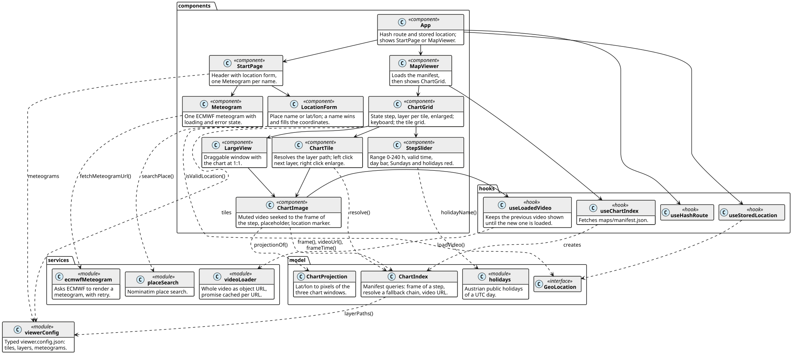
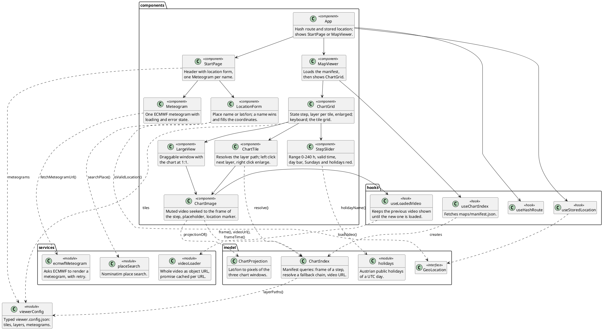

# wetterkartenviewer web app — agent reference

Reference for the React app in `src/`, so an agent can extend, debug or refactor it without reading all the code.
The charts it shows come from the Python pipeline described in REFERENCE.scripts.md; both meet only in `maps/manifest.json` and `src/config/viewer.config.json`.
Paths are relative to the repository root. Symbols are named so that a search finds them.
Steps are hours after the ECMWF run, all times UTC. UI texts are German, code and comments English.

Read the diagram first: it holds the architecture and every dependency.
The API sections follow Javadoc: intro, fields, methods per module.

## Purpose

- Static single-page app (React 19, Vite, TypeScript) on GitHub Pages: https://schletz.github.io/wetterkartenviewer/
- Start page: ECMWF ENS meteograms for a location the user sets, queried live by the browser.
- Map page (`#/maps`): a grid of tiles with the charts of one ECMWF IFS run (to +240 h) and one ICON-D2 run (Austria, to +48 h), and a step slider 0–240 h.
  Every chart path is an AV1 video with one frame per step; the app seeks the frame with `currentTime`.
  A tile layer can be a fallback chain of paths (ICON-D2 within its 48 h, ECMWF otherwise).
- npm: runtime `react`, `react-dom`; dev `vite`, `@vitejs/plugin-react`, `typescript ~7.0`, `oxlint`; scripts `dev`, `build` (`tsc -b && vite build`), `lint` (oxlint with hooks rules), `preview`.
- Deploy (`.github/workflows/deploy.yml`, on push to `main`): `npm run build`, then `scripts/fetch_maps.py` copies the manifest and downloads its videos from the release into `dist/maps`.

## Diagram

Stereotypes: `<<script>>` command line, `<<module>>` functions and constants only, a `D` spot names the diagram that describes the element.
Class diagrams: solid arrow = holds an instance (constructor injection), dashed = creates or calls, triangle = inherits.

### app: React components, hooks, model, services

Solid arrow: renders or calls the hook, dashed: uses.





## Contracts

### maps/manifest.json as the app reads it

Written by the pipeline (`build_manifest` in scripts/maps_manifest.py), typed as `Manifest` in src/model/ChartIndex.ts.
The JSON is trusted, not validated.

```json
{ "run": "2026103012", "fps": 10,
  "charts": { "opencharts_europe/thickness_mslp":
                { "file": "opencharts_europe/thickness_mslp.mp4", "steps": [0, 3, 6, ..., 240],
                  "run": "2026103012", "end": 240 },
              "icon-d2/weather_summary":
                { "file": "icon-d2/weather_summary.mp4", "steps": [22, 23, ..., 69],
                  "run": "2026103109", "end": 69 } } }
```

- `run` (top): the ECMWF run; the slider and every `steps`, ICON ones included, count from it.
- `charts[path]`: one video per chart path of viewer.config.json; a path without entry shows „keine Karten in diesem Lauf“.
- `steps[i]`: step of frame `i`, irregular: IFS 3-hourly to +144 then 6-hourly, ICON hourly, daily products one frame per day; products start at different steps.
- `end`: last step the video covers (a daily chart covers its whole day); later steps have no frame.
- `charts[…].run`: run of the video's model, the cache parameter of its URL; optional.
- `fps`: frame `i` covers `[i / fps, (i + 1) / fps)`.

### viewer.config.json

`src/config/viewer.config.json`, edited by hand, read by the app (bundled) and by `tile_chart_paths`.
`meteograms`: epsgram names (`classical_10d`, `classical_15d_with_climate`, `classical_plume`).
`tiles[].layers[]`: a layer is a path or a list of paths in order of preference (fallback chain, e.g. `["icon-d2/wind10m", "opencharts_central_europe/wind10m"]`).
Currently 6 tiles; ICON is first in the chains of t2m_wind10m, mountain_2000, weather_summary and wind10m.

## API: src/ (app)

No router, no state management, no UI library, no tests. Every path goes through `import.meta.env.BASE_URL` (`base: './'` for the Pages subpath). Vite does not watch `data/` and `maps/` (vite.config.ts); the dev server serves `maps/` from the repo root, a new manifest needs a reload. StrictMode runs effects twice in dev (meteogram requests abort and restart).

### ChartIndex (src/model/ChartIndex.ts)

Types: `ChartVideo {file, steps, run?, end?}`, `ChartFrame {index, step}`, `Manifest {run, fps, charts}`. The JSON is trusted, not validated.

| Member | Summary |
| --- | --- |
| `run`, `fps`, `runTime` | `runTime` = Date of `run` |
| `frame(path, step) -> ChartFrame \| null` | last frame with `step <= slider` (linear search); null before the first frame, after `end`, or without video |
| `firstStep`, `lastStep` | |
| `steps(layers) -> number[]` | every step of every path of the layers (arrow keys) |
| `resolve(layer, step) -> ChartPath` | first path with a frame, else last path with a video, else last path (its placeholder explains); only checks frames, not whether the video loads |
| `videoUrl(path)` | `<BASE_URL>maps/<file>?run=<charts.run ?? run>`: every run reuses file names; a new ECMWF run keeps the URL of an unchanged ICON video |
| `frameTime(frame)` | `(index + 0.5) / fps`: the frame centre, so browser rounding never lands on the neighbour |

### ChartProjection (src/model/ChartProjection.ts)

Same formula as `Projection`. `IMAGE_WIDTH = 1200`, `IMAGE_HEIGHT = 690`, `MAP_HEIGHT = 600`. `PROJECTIONS` holds the Python values; for `icon-d2` as literals computed by Python (`print(ICON_D2)`): change both sides together.
`toPixel(location)` → null outside 1200×600. `projectionOf(chartPath)` → null for an unknown window (no marker).

### Other model, config and services

| Item | Summary |
| --- | --- |
| `GeoLocation {lat, lon}`, `DEFAULT_LOCATION` (48 N, 16.4 E), `isValidLocation` (src/model/GeoLocation.ts) | |
| `holidayName(date)` (src/model/holidays.ts) | Austrian holidays of a UTC day; `FIXED_HOLIDAYS`, `EASTER_HOLIDAYS`, ported from the skill's calendar_days.py, checked for 2026–2027 |
| `ChartPath`, `LayerConfig`, `TileConfig`, `ViewerConfig`, `layerPaths`, `viewerConfig` (src/config/viewerConfig.ts) | layer format must match `tile_chart_paths` in Python |
| `searchPlace(query) -> Place` (src/services/placeSearch.ts) | Nominatim `GET` (`format=jsonv2`, `limit=1`, `accept-language=de`), first hit with a name; HTTP error or no hit → `Error` with a German message. Max 1 request/s: only on button click |
| `fetchMeteogramUrl(name, location, signal)` (src/services/ecmwfMeteogram.ts) | `POST` to `EPSGRAM_API` with `{"location":{"type":"latlon","lat","lon","station_name":""},"axis":{},"epsgrams":name}`; `result.url` is the image, which exists only after this request; no `result` → retry `ATTEMPTS = 5` × `RETRY_MS = 3000` |
| `loadVideo(url) -> Promise<string \| null>` (src/services/videoLoader.ts) | whole file by `fetch` → Blob → object URL, so every seek decodes locally; only `video/*` counts; promise cached per URL for the page lifetime (failures too), object URLs never released (≈ 67 MB for all videos) |

### Hooks

| Hook | Summary |
| --- | --- |
| `useHashRoute()` (src/hooks/useHashRoute.ts) | only `#/maps` is the map page |
| `useStoredLocation()` (src/hooks/useStoredLocation.ts) | localStorage `wetterkartenviewer.location`; blocked or invalid → default; write errors ignored; `load` runs stored objects through `isValidLocation` |
| `useChartIndex()` (src/hooks/useChartIndex.ts) | fetch manifest with `cache: 'no-cache'`; error state shown as text by MapViewer, no retry |
| `useLoadedVideo(url)` (src/hooks/useLoadedVideo.ts) | `{shown: {url, objectUrl}, failed}`: the previous video stays until the new one loaded |

### Components

| Component | Summary |
| --- | --- |
| `App` (src/App.tsx) | start or maps page |
| `StartPage`, `LocationForm`, `Meteogram` | form: a typed name wins and fills the coordinates (`DECIMALS = 4`; number inputs `step="any"`); meteogram: `AbortController` on location change, stale answers dropped by request key, retry button increments `attempt` |
| `MapViewer` (src/components/MapViewer.tsx) | |
| `ChartGrid` (src/components/ChartGrid.tsx) | state step, layer per tile, enlarged; start step `currentStep` = hours since run, floored, clamped 0…240; arrow keys jump to the next/previous step any path of a *visible* layer has (native 1 h on a focused slider input); Escape closes the large view |
| `StepSlider` (src/components/StepSlider.tsx) | `MAX_STEP = 240`; label „So, 1. 00Z“ (`WEEKDAYS`, no month), `+N h` tooltip, day bar at 00 UTC (`midnightSteps`), Sundays and holidays red |
| `ChartTile` (src/components/ChartTile.tsx) | path = `index.resolve(layer, step)` every step |
| `ChartImage` (src/components/ChartImage.tsx) | `time = frameTime(frame)` only when `shown.url === url`; `<video muted playsInline preload="auto">`, `currentTime` set once metadata are there; placeholders (`placeholderText`): „ab +N h“, „bis +N h“, „keine Karten in diesem Lauf“, „<path> konnte nicht geladen werden“ (also on `onError`, e.g. no AV1 decoder); marker in % of 1200×690, fixed 10 px |
| `LargeView` (src/components/LargeView.tsx) | draggable, chart 1200 px wide; same URL, so the same cached video |

While a new layer loads, the previous video stays on its last frame and the slider does not move it; the same happens when a fallback chain switches path (e.g. ICON → ECMWF after `end`). Only displayed layers load, no prefetch.
CSS that must match the image size: `aspect-ratio: 1200 / 690` in ChartImage.module.css, `.chart { width: 1200px }` in LargeView.module.css. Tiles three per row (min 480, max 1200 px), meteograms three per row (min 420 px).

## Pitfalls

- **Values shared with the pipeline**: projection parameters (`PROJECTIONS` in ChartProjection.ts vs scripts/lib/projection.py; `icon-d2` as literals computed by Python); image size 1200×690 (`IMAGE_*`, the two CSS files, chart_canvas.py, tile_videos.py); window names; the layer format (`LayerConfig`/`layerPaths` vs `tile_chart_paths`).
- **Browser memory and AV1**: every shown video stays as a blob until reload (all 14 ≈ 67 MB); without an AV1 decoder the tiles stay empty.
- **Fallback chains switch videos**: before the first and after the last ICON frame the tile shows the ECMWF video, loaded only at that moment; `resolve` does not check that a video loads.
- **Steps hang on the ECMWF run**: relating steps to the ICON run means changing `ChartIndex`, `currentStep` and the pipeline's `chart_frames` together.
- **Time zones**: run, steps and file names are UTC; the slider and chart legends show UTC.
- **Meteograms** are queried again on every location change, no cache except the browser image cache.

## Extension recipes

- **Layer or tile**: edit `tiles[].layers` in viewer.config.json; which products exist per window is in REFERENCE.scripts.md. Effective with the next pipeline run, no code change. In a chain put the shorter-range model first. `orography` and `sheets` are no layers.
- **New page**: `Route` and `currentRoute`/`navigate` in useHashRoute.ts, a branch in App.tsx.
- **Slider range**: `MAX_STEP` in StepSlider.tsx; `currentStep` in ChartGrid clamps with the same value.
- **Keyboard shortcut**: `onKey` in ChartGrid.tsx; arrow keys in `<input>` are ignored on purpose.
- **Location fields** (e.g. name, altitude): `GeoLocation` and `isValidLocation`; stored old objects pass `isValidLocation` in `load`.
- **Meteogram**: a name in `meteograms`; layout in Meteogram.module.css.
- **New chart window**: its values in `PROJECTIONS` of ChartProjection.ts, besides the pipeline changes.
