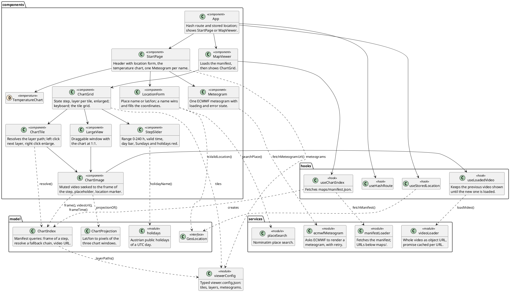
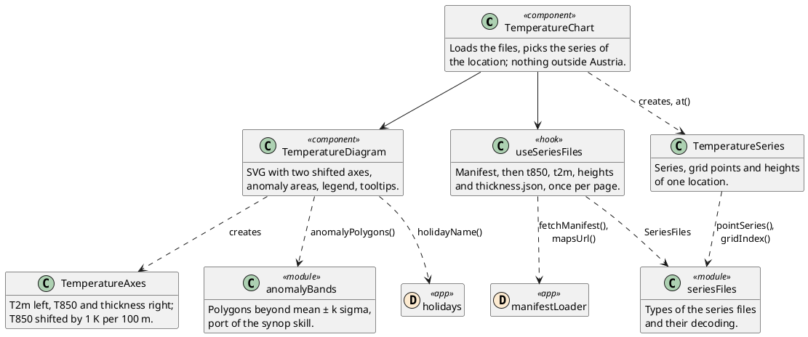

# wetterkartenviewer web app — agent reference

Reference for the React app in `src/`, so an agent can extend, debug or refactor it without reading all the code.
The charts it shows come from the Python pipeline described in REFERENCE.scripts.md; both meet only in `maps/manifest.json`, `maps/austria/*.json` and `src/config/viewer.config.json`.
Paths are relative to the repository root. Symbols are named so that a search finds them.
Steps are hours after the ECMWF run, all times UTC. UI texts are German, code and comments English.

Read the diagram first: it holds the architecture and every dependency.
The API sections follow Javadoc: intro, fields, methods per module.

## Purpose

- Static single-page app (React 19, Vite, TypeScript) on GitHub Pages: https://schletz.github.io/wetterkartenviewer/
- Start page: for a location in Austria a temperature diagram (T850 of ECMWF with its anomaly against ERA5, T2m of ECMWF and ICON-D2, 1000–500 hPa thickness of ECMWF) from the pipeline's series files; below it ECMWF ENS meteograms for the location, queried live by the browser.
- Map page (`#/maps`): a grid of tiles with the charts of one ECMWF IFS run (to +240 h) and one ICON-D2 run (Austria, to +48 h), and a step slider 0–240 h.
  Every chart path is an AV1 video with one frame per step; the app seeks the frame with `currentTime`.
  A tile layer can be a fallback chain of paths (ICON-D2 within its 48 h, ECMWF otherwise).
- npm: runtime `react`, `react-dom`; dev `vite`, `@vitejs/plugin-react`, `typescript ~7.0`, `oxlint`; scripts `dev`, `build` (`tsc -b && vite build`), `lint` (oxlint with hooks rules), `preview`.
- Deploy (`.github/workflows/deploy.yml`, on push to `main`): `npm run build`, then `scripts/fetch_maps.py` copies the manifest and downloads its videos from the release into `dist/maps`.

## Diagrams

Stereotypes: `<<script>>` command line, `<<module>>` functions and constants only, a `D` spot names the diagram that describes the element.
Class diagrams: solid arrow = holds an instance (constructor injection), dashed = creates or calls, triangle = inherits.

### app: React components, hooks, model, services

Solid arrow: renders or calls the hook, dashed: uses.




### temperature: the temperature diagram of the start page

Solid arrow: renders or calls the hook, dashed: uses.




## Contracts

### maps/manifest.json as the app reads it

Written by the pipeline (`build_manifest` in scripts/maps_manifest.py), typed as `Manifest` in src/model/ChartIndex.ts.
The JSON is trusted, not validated.

```json
{ "run": "2026103012", "fps": 10,
  "charts": { "opencharts_europe/thickness_mslp":
                { "file": "opencharts_europe/thickness_mslp.mp4", "steps": [0, 3, 6, ..., 240],
                  "run": "2026103012", "end": 240 },
              "icon-d2/weather_summary":
                { "file": "icon-d2/weather_summary.mp4", "steps": [22, 23, ..., 69],
                  "run": "2026103109", "end": 69 } },
  "series": { "t850": { "file": "austria/t850.json", "version": "2026110112" },
              "t2m": { "file": "austria/t2m.json", "version": "2026110112-2026110206" },
              "heights": { "file": "austria/heights.json", "version": "2026110206-25344" },
              "thickness": { "file": "austria/thickness.json", "version": "2026110112" } } }
```

- `run` (top): the ECMWF run; the slider and every `steps`, ICON ones included, count from it.
- `charts[path]`: one video per chart path of viewer.config.json; a path without entry shows „keine Karten in diesem Lauf“.
- `steps[i]`: step of frame `i`, irregular: IFS 3-hourly to +144 then 6-hourly, ICON hourly, daily products one frame per day; products start at different steps.
- `end`: last step the video covers (a daily chart covers its whole day); later steps have no frame.
- `charts[…].run`: run of the video's model, the cache parameter of its URL; optional.
- `fps`: frame `i` covers `[i / fps, (i + 1) / fps)`.
- `series[name]`: a series file of the temperature diagram, `version` = cache parameter `?v=`; optional; without t850, t2m and heights the start page shows no diagram, without thickness no thickness line.

### maps/austria/*.json (temperature series)

Written by scripts/point_series.py; format, sizes and box in REFERENCE.scripts.md (*maps/austria/*.json*), typed in src/model/seriesFiles.ts. Trusted, not validated.
Every series: flat list of whole multiples of `scale` (0.1), **time-major** (all points of time 0, then time 1 …), **deltas along time** (time 0 absolute); `pointSeries(deltas, points, index, scale)` undoes it for one point.
Regular grids: row j at `lat0 − j·dlat`, column i at `lon0 + i·dlon`, index `j·ni + i`. `steps` count from each block's own `run` (ECMWF and ICON differ).
t850.json and t2m.json: `ecmwf {run, steps, grid, orog, t850|t2m}`, `climate {period, grid, first_day, days, hours, months, term, daily, monthly}` with `{mean °C, std K}`; t2m.json also `icon {run, steps, cells, t2m}`. thickness.json: `ecmwf` with `thickness` (dam), no `climate`. heights.json: `cells`, `lat`/`lon` (cumulative deltas × `coord_scale`), `hsurf` (m), one entry per ICON cell in the order of `icon.t2m`.

### viewer.config.json

`src/config/viewer.config.json`, edited by hand, read by the app (bundled) and by `tile_chart_paths`.
`meteograms`: epsgram names (`classical_10d`, `classical_15d_with_climate`, `classical_plume`).
`tiles[].layers[]`: a layer is a path or a list of paths in order of preference (fallback chain, e.g. `["icon-d2/wind10m", "opencharts_central_europe/wind10m"]`).
Currently 6 tiles; ICON is first in the chains of t2m_wind10m, mountain_2000, weather_summary and wind10m.

## API: src/ (app)

No router, no state management, no UI library, no tests. Every path goes through `import.meta.env.BASE_URL` (`base: './'` for the Pages subpath). Vite does not watch `data/` and `maps/` (vite.config.ts); the dev server serves `maps/` from the repo root, a new manifest needs a reload. StrictMode runs effects twice in dev (meteogram requests abort and restart).

### ChartIndex (src/model/ChartIndex.ts)

Types: `ChartVideo {file, steps, run?, end?}`, `ChartFrame {index, step}`, `SeriesEntry {file, version}`, `Manifest {run, fps, charts, series?}`. The JSON is trusted, not validated.

| Member | Summary |
| --- | --- |
| `run`, `fps`, `runTime` | `runTime` = Date of `run` |
| `frame(path, step) -> ChartFrame \| null` | last frame with `step <= slider` (linear search); null before the first frame, after `end`, or without video |
| `firstStep`, `lastStep` | |
| `steps(layers) -> number[]` | every step of every path of the layers (arrow keys) |
| `resolve(layer, step) -> ChartPath` | first path with a frame, else last path with a video, else last path (its placeholder explains); only checks frames, not whether the video loads |
| `videoUrl(path)` | `<BASE_URL>maps/<file>?run=<charts.run ?? run>`: every run reuses file names; a new ECMWF run keeps the URL of an unchanged ICON video |
| `frameTime(frame)` | `(index + 0.5) / fps`: the frame centre, so browser rounding never lands on the neighbour |

### ChartProjection (src/model/ChartProjection.ts)

Same formula as `Projection`. `IMAGE_WIDTH = 1200`, `IMAGE_HEIGHT = 690`, `MAP_HEIGHT = 600`. `PROJECTIONS` holds the Python values; for `icon-d2` as literals computed by Python (`print(ICON_D2)`): change both sides together.
`toPixel(location)` → null outside 1200×600. `projectionOf(chartPath)` → null for an unknown window (no marker).

### Temperature diagram (src/components/TemperatureChart.tsx, TemperatureDiagram.tsx, src/model/TemperatureSeries.ts, TemperatureAxes.ts, anomalyBands.ts, seriesFiles.ts)

`TemperatureChart` sits above the meteograms; it renders nothing while loading, without series in the manifest, or when `TemperatureSeries.at` returns null; only a failed download shows a text. `TemperatureSeries` decodes the ICON cell coordinates once per file set (`useMemo` on the state), `at(location)` runs on every location change (linear search over 25 344 cells).
`at` → null outside `box` or when no ICON cell lies within `MAX_CELL_DISTANCE = 0.03°` (cells are ≈ 2.2 km apart; the files hold cells up to 0.15° beyond the border), so the diagram shows in Austria and its margin only. The ICON part is dropped if `icon.cells` ≠ `heights.cells`.
Nearest point everywhere, no interpolation: ECMWF 0.1° (its `orog`), ERA5 0.25° (no height in the climatology), ICON cell (its `hsurf`). The legend names every point with position and height; the ICON `hsurf` is the height of the location.
Climate per T850 valid time: the `term` value of its day and hour (null if the hour is no analysis hour); `daily`/`monthly` are in the files but unused.

`TemperatureAxes(t2m, t850, thickness, height, top, bottom)`: one pixel scale; T2m left, T850 right, shifted by `offset = (HEIGHT_850 − height) · LAPSE_RATE` K (`HEIGHT_850 = 1457` m, ICAO standard atmosphere; `LAPSE_RATE = 0.01` K/m, dry adiabatic per user), so dry adiabatic mixing puts both lines on top of each other. Thickness axis coupled to T850 as in the synop skill (coupled_axes.py): `THICKNESS_AT_ZERO = 544` dam + `THICKNESS_PER_KELVIN = 1.6` dam/K · T850, so both lines coincide for typical central European air masses; labels every 4/8/16/32 dam (first with ≤ 12 intervals). Range: all T2m, T850 (forecast and climate mean) and thickness (as T850 equivalent) values ± 1 K, rounded to `step` 2/5/10 K by span (≤ 16/≤ 40/more); the right ticks are round T850 values.

`TemperatureDiagram`: SVG viewBox 1000×340, plot 52…900 × 24…296, right of it the T850 labels and at `THICKNESS_LABEL_X` the thickness labels (orange); time axis from the first to the last ECMWF step (ICON points outside are dropped); day lines at 00 UTC, labels „Mo 2.11.“ (Sundays and holidays red), ticks every 3 h. Layers from bottom: anomaly polygons (`anomalyPolygons` for `SIGMA_STEPS = [0, 1, 2, 3]`, `fill-opacity 0.2` each, red warm, blue cold), climate mean, T2m ECMWF (green), T2m ICON-D2 (violet, dashed), thickness (orange, dash-dot), T850 (text colour), then hover columns with a native `<title>` per ECMWF step (T850, Ø, σ, both T2m, thickness). Legend in HTML below the SVG.

`anomalyBands.ts` is a port of `AnomalyBands` (skills/synop/scripts/lib/anomaly_bands.py): crossings are inserted so areas end exactly at the threshold; a null point breaks lines and areas.

### Other model, config and services

| Item | Summary |
| --- | --- |
| `GeoLocation {lat, lon}`, `DEFAULT_LOCATION` (48 N, 16.4 E), `isValidLocation` (src/model/GeoLocation.ts) | |
| `holidayName(date)` (src/model/holidays.ts) | Austrian holidays of a UTC day; `FIXED_HOLIDAYS`, `EASTER_HOLIDAYS`, ported from the skill's calendar_days.py, checked for 2026–2027 |
| `ChartPath`, `LayerConfig`, `TileConfig`, `ViewerConfig`, `layerPaths`, `viewerConfig` (src/config/viewerConfig.ts) | layer format must match `tile_chart_paths` in Python |
| `searchPlace(query) -> Place` (src/services/placeSearch.ts) | Nominatim `GET` (`format=jsonv2`, `limit=1`, `accept-language=de`), first hit with a name; HTTP error or no hit → `Error` with a German message. Max 1 request/s: only on button click |
| `fetchMeteogramUrl(name, location, signal)` (src/services/ecmwfMeteogram.ts) | `POST` to `EPSGRAM_API` with `{"location":{"type":"latlon","lat","lon","station_name":""},"axis":{},"epsgrams":name}`; `result.url` is the image, which exists only after this request; no `result` → retry `ATTEMPTS = 5` × `RETRY_MS = 3000` |
| `fetchManifest(signal)`, `mapsUrl(file, version?)` (src/services/manifestLoader.ts) | manifest with `cache: 'no-cache'` (every run replaces it under the same name); `<BASE_URL>maps/<file>?v=<version>` |
| `loadVideo(url) -> Promise<string \| null>` (src/services/videoLoader.ts) | whole file by `fetch` → Blob → object URL, so every seek decodes locally; only `video/*` counts; promise cached per URL for the page lifetime (failures too), object URLs never released (≈ 67 MB for all videos) |

### Hooks

| Hook | Summary |
| --- | --- |
| `useHashRoute()` (src/hooks/useHashRoute.ts) | only `#/maps` is the map page |
| `useStoredLocation()` (src/hooks/useStoredLocation.ts) | localStorage `wetterkartenviewer.location`; blocked or invalid → default; write errors ignored; `load` runs stored objects through `isValidLocation` |
| `useChartIndex()` (src/hooks/useChartIndex.ts) | `fetchManifest`; error state shown as text by MapViewer, no retry |
| `useSeriesFiles()` (src/hooks/useSeriesFiles.ts) | manifest, then the files of `REQUIRED` (t850, t2m, heights) and those of `OPTIONAL` (thickness) the manifest lists, in parallel with default caching (`?v=` changes per run), once per page; `loading`, `missing` (a required one absent), `error`, `ready` |
| `useLoadedVideo(url)` (src/hooks/useLoadedVideo.ts) | `{shown: {url, objectUrl}, failed}`: the previous video stays until the new one loaded |

### Components

| Component | Summary |
| --- | --- |
| `App` (src/App.tsx) | start or maps page |
| `TemperatureChart`, `TemperatureDiagram` | see *Temperature diagram* |
| `StartPage`, `LocationForm`, `Meteogram` | form: a typed name wins and fills the coordinates (`DECIMALS = 4`; number inputs `step="any"`); meteogram: `AbortController` on location change, stale answers dropped by request key, retry button increments `attempt` |
| `MapViewer` (src/components/MapViewer.tsx) | |
| `ChartGrid` (src/components/ChartGrid.tsx) | state step, layer per tile, enlarged; start step `currentStep` = hours since run, floored, clamped 0…240; arrow keys jump to the next/previous step any path of a *visible* layer has (native 1 h on a focused slider input); Escape closes the large view |
| `StepSlider` (src/components/StepSlider.tsx) | `MAX_STEP = 240`; label „So, 1. 00Z“ (`WEEKDAYS`, no month), `+N h` tooltip, day bar at 00 UTC (`midnightSteps`), Sundays and holidays red |
| `ChartTile` (src/components/ChartTile.tsx) | path = `index.resolve(layer, step)` every step |
| `ChartImage` (src/components/ChartImage.tsx) | `time = frameTime(frame)` only when `shown.url === url`; `<video muted playsInline preload="auto">`, `currentTime` set once metadata are there; placeholders (`placeholderText`): „ab +N h“, „bis +N h“, „keine Karten in diesem Lauf“, „<path> konnte nicht geladen werden“ (also on `onError`, e.g. no AV1 decoder); marker in % of 1200×690, fixed 10 px |
| `LargeView` (src/components/LargeView.tsx) | draggable, chart 1200 px wide; same URL, so the same cached video |

While a new layer loads, the previous video stays on its last frame and the slider does not move it; the same happens when a fallback chain switches path (e.g. ICON → ECMWF after `end`). Only displayed layers load, no prefetch.
CSS that must match the image size: `aspect-ratio: 1200 / 690` in ChartImage.module.css, `.chart { width: 1200px }` in LargeView.module.css. Tiles three per row (min 480, max 1200 px), meteograms three per row (min 420 px).

## Pitfalls

- **Values shared with the pipeline**: projection parameters (`PROJECTIONS` in ChartProjection.ts vs scripts/lib/projection.py; `icon-d2` as literals computed by Python); image size 1200×690 (`IMAGE_*`, the two CSS files, chart_canvas.py, tile_videos.py); window names; the layer format (`LayerConfig`/`layerPaths` vs `tile_chart_paths`).
- **Browser memory and AV1**: every shown video stays as a blob until reload (all 14 ≈ 67 MB); without an AV1 decoder the tiles stay empty.
- **Fallback chains switch videos**: before the first and after the last ICON frame the tile shows the ECMWF video, loaded only at that moment; `resolve` does not check that a video loads.
- **Steps hang on the ECMWF run**: relating steps to the ICON run means changing `ChartIndex`, `currentStep` and the pipeline's `chart_frames` together.
- **Time zones**: run, steps and file names are UTC; the slider and chart legends show UTC.
- **Meteograms** are queried again on every location change, no cache except the browser image cache.
- **Series format** shared with scripts/point_series.py (keys, encoding, grid convention, `NAMES` vs `SERIES_FILES`); the anomaly shading (`SIGMA_STEPS`, opacity, colours) and the thickness coupling (544 dam, 1.6 dam/K) follow the synop skill's diagram (`SIGMA_STEPS` in generate_diagram.py, `LAYER_OPACITY`, coupled_axes.py).
- **Start page loads ≈ 1 MB (gzip)** of series on every visit, also outside Austria: availability is known only after heights.json is loaded.
- **T850 climate in the Alps**: ERA5 0.25° places the ground of many Alpine points above 850 hPa, so the climate mean there is extrapolated and can look warm.

## Extension recipes

- **Layer or tile**: edit `tiles[].layers` in viewer.config.json; which products exist per window is in REFERENCE.scripts.md. Effective with the next pipeline run, no code change. In a chain put the shorter-range model first. `orography` and `sheets` are no layers.
- **New page**: `Route` and `currentRoute`/`navigate` in useHashRoute.ts, a branch in App.tsx.
- **Slider range**: `MAX_STEP` in StepSlider.tsx; `currentStep` in ChartGrid clamps with the same value.
- **Keyboard shortcut**: `onKey` in ChartGrid.tsx; arrow keys in `<input>` are ignored on purpose.
- **Location fields** (e.g. name, altitude): `GeoLocation` and `isValidLocation`; stored old objects pass `isValidLocation` in `load`.
- **Meteogram**: a name in `meteograms`; layout in Meteogram.module.css.
- **New chart window**: its values in `PROJECTIONS` of ChartProjection.ts, besides the pipeline changes.
- **Another line in the temperature diagram**: field in point_series.py (REFERENCE.scripts.md), type in seriesFiles.ts, a new file also in `OPTIONAL` of useSeriesFiles.ts (or `REQUIRED`), series in `LocationTemperatures`/`TemperatureSeries.at`, path, legend entry and tooltip in TemperatureDiagram.tsx, colour in TemperatureDiagram.module.css; include its values in `TemperatureAxes`.
