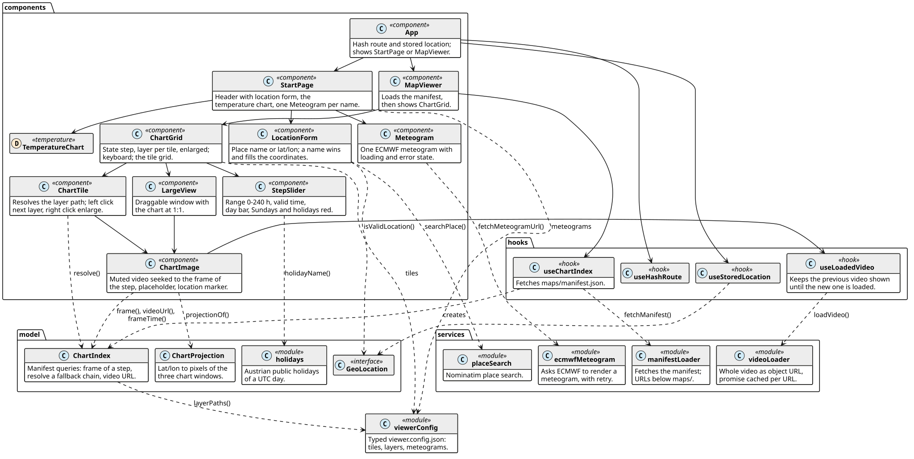
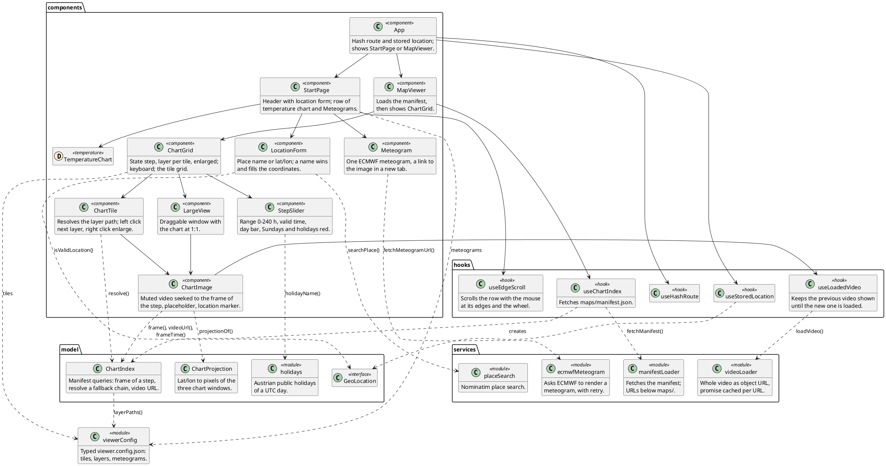
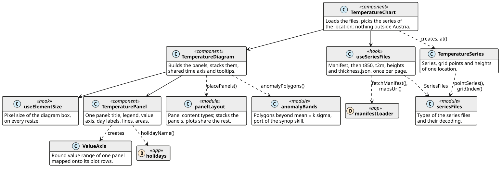
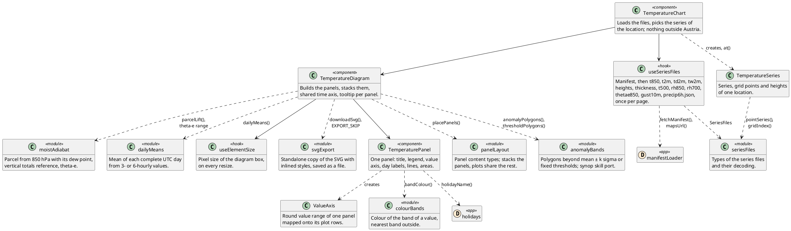

# wetterkartenviewer web app — agent reference

Reference for the React app in `src/`, so an agent can extend, debug or refactor it without reading all the code.
The charts it shows come from the Python pipeline described in REFERENCE.scripts.md; both meet only in `maps/manifest.json`, `maps/austria/*.json` and `src/config/viewer.config.json`.
Paths are relative to the repository root. Symbols are named so that a search finds them.
Steps are hours after the ECMWF run, all times UTC. UI texts are German, code and comments English.

Read the diagram first: it holds the architecture and every dependency.
The API sections follow Javadoc: intro, fields, methods per module.

## Purpose

- Static single-page app (React 19, Vite, TypeScript) on GitHub Pages: https://schletz.github.io/wetterkartenviewer/
- Start page: for a location in Austria a temperature diagram (T850 of ECMWF with its anomaly against ERA5, θe850 as a green line and the ECMWF 6 h precipitation as a colour bar above its time axis, T2m of ECMWF (with bars of the anomaly of its daily mean against the ERA5 daily mean) and ICON-D2, the ECMWF 2 m dew point (blue) and wet-bulb temperature (green), ECMWF 10 m gusts as a colour bar above the time axis of the T2m panel, 1000–500 hPa thickness of ECMWF with the Showalter index of a parcel lifted from 850 hPa with its dew point from RH850 as layered blue/red areas and RH700 as a grey line) from the pipeline's series files, beside it ECMWF ENS meteograms for the location, queried live by the browser; a button saves the temperature diagram as a standalone SVG; on wide screens all in one row of the window height that scrolls with the mouse at its edges; each opens in a new tab.
- Map page (`#/maps`): a grid of tiles with the charts of one ECMWF IFS run (to +240 h) and one ICON-D2 run (Austria, to +48 h), and a step slider 0–240 h.
  Every chart path is an AV1 video with one frame per step; the app seeks the frame with `currentTime`.
  A tile layer can be a fallback chain of paths (ICON-D2 within its 48 h, ECMWF otherwise).
- npm: runtime `react`, `react-dom`; dev `vite`, `@vitejs/plugin-react`, `typescript ~7.0`, `oxlint`; scripts `dev`, `build` (`tsc -b && vite build`), `lint` (oxlint with hooks rules), `preview`.
- Deploy (`.github/workflows/deploy.yml`, on push to `main`): `npm run build`, then `scripts/fetch_maps.py` copies the manifest and downloads its videos from the release into `dist/maps`.

## Diagrams

Stereotypes: `<<script>>` command line, `<<module>>` functions and constants only, a `D` spot names the diagram that describes the element.
Class diagrams: solid arrow = holds an instance (constructor injection), dashed = creates or calls, triangle = inherits.

### app: React components, hooks, model, services

Solid arrow: renders or calls the hook, dashed: uses.





### temperature: the temperature diagram of the start page

Solid arrow: renders or calls the hook, dashed: uses.





## Contracts

### maps/manifest.json as the app reads it

Written by the pipeline (`build_manifest` in scripts/maps_manifest.py), typed as `Manifest` in src/model/ChartIndex.ts.
The JSON is trusted, not validated.

```json
{ "run": "2026103012", "fps": 10,
  "charts": { "opencharts_europe/thickness_mslp":
                { "file": "opencharts_europe/thickness_mslp.mp4", "steps": [0, 3, 6, ..., 240],
                  "run": "2026103012", "end": 240 },
              "icon-d2/weather_summary":
                { "file": "icon-d2/weather_summary.mp4", "steps": [22, 23, ..., 69],
                  "run": "2026103109", "end": 69 } },
  "series": { "t850": { "file": "austria/t850.json", "version": "2026110112" },
              "t2m": { "file": "austria/t2m.json", "version": "2026110112-2026110206" },
              "td2m": { "file": "austria/td2m.json", "version": "2026110112" },
              "tw2m": { "file": "austria/tw2m.json", "version": "2026110112" },
              "heights": { "file": "austria/heights.json", "version": "2026110206-25344" },
              "thickness": { "file": "austria/thickness.json", "version": "2026110112" },
              "t500": { "file": "austria/t500.json", "version": "2026110112" },
              "rh850": { "file": "austria/rh850.json", "version": "2026110112" },
              "rh700": { "file": "austria/rh700.json", "version": "2026110112" },
              "thetae850": { "file": "austria/thetae850.json", "version": "2026110112" },
              "gust10m": { "file": "austria/gust10m.json", "version": "2026110112" },
              "precip6h": { "file": "austria/precip6h.json", "version": "2026110112" } } }
```

- `run` (top): the ECMWF run; the slider and every `steps`, ICON ones included, count from it.
- `charts[path]`: one video per chart path of viewer.config.json; a path without entry shows „keine Karten in diesem Lauf“.
- `steps[i]`: step of frame `i`, irregular: IFS 3-hourly to +144 then 6-hourly, ICON hourly, daily products one frame per day; products start at different steps.
- `end`: last step the video covers (a daily chart covers its whole day); later steps have no frame.
- `charts[…].run`: run of the video's model, the cache parameter of its URL; optional.
- `fps`: frame `i` covers `[i / fps, (i + 1) / fps)`.
- `series[name]`: a series file of the temperature diagram, `version` = cache parameter `?v=`; optional; without t850, t2m and heights the start page shows no diagram, without td2m or tw2m no dew point or wet-bulb lines, without thickness no thickness panel, without t500 or rh850 no Showalter areas in it, without rh700 no RH700 line, without thetae850 no θe line, without gust10m no gust bar, without precip6h no precipitation bar.

### maps/austria/*.json (temperature series)

Written by scripts/point_series.py; format, sizes and box in REFERENCE.scripts.md (*maps/austria/*.json*), typed in src/model/seriesFiles.ts. Trusted, not validated.
Every series: flat list of whole multiples of `scale` (0.1; 1 for rh850, rh700 and gust10m; 0.1 mm for precip6h), **time-major** (all points of time 0, then time 1 …), **deltas along time** (time 0 absolute); `pointSeries(deltas, points, index, scale)` undoes it for one point.
Regular grids: row j at `lat0 − j·dlat`, column i at `lon0 + i·dlon`, index `j·ni + i`. `steps` count from each block's own `run` (ECMWF and ICON differ).
t850.json and t2m.json: `ecmwf {run, steps, grid, orog, t850|t2m}`, `climate {period, grid, first_day, days, orog}` (`orog` ERA5 m, optional; `ClimateBlock`) plus in t850.json `hours`, `term` (`TermClimateBlock`), in t2m.json `daily` (`DailyClimateBlock`), each `{mean °C, std K}`; t2m.json also `icon {run, steps, cells, t2m}`. td2m.json and tw2m.json: `ecmwf` with `td2m`/`tw2m` (°C; dew point over water, wet-bulb temperature = derived GRIB field `wbt`), no `icon` (the ICON file has both fields, the diagram shows ECMWF only per user, which keeps the files small), no `climate`. thickness.json: `ecmwf` with `thickness` (dam), t500.json `ecmwf` with `t500` (°C), rh850.json `ecmwf` with `rh850` (% as the IFS defines it, raw, may exceed 100), rh700.json `ecmwf` with `rh700` (same encoding), thetae850.json `ecmwf` with `thetae850` (K, not °C; the derived GRIB field `papt`), gust10m.json `ecmwf` with `gust10m` (maximum gust in km/h, steps from 3), `hours` (interval before each step it covers: 1 h to +90, 3 h to +144, then 6 h) and `colours` (`ColourBand[]` = `[lower, upper, "#rrggbb"]`, the bands of the wind10m chart), precip6h.json `ecmwf` with `precip6h` (mm over the 6 h before each step, 3 h at T+3, exactly the window of the weather_summary chart; overlapping windows up to T+144), `hours`, `colours` (the precipitation bands of weather_summary), `transparent_below` (0.2 mm) and `ptype` (class per window, scale 1: 0 none, 1 snow, 2 wet snow or rain and snow, 3 freezing rain or drizzle, ice pellets; the symbol groups of weather_summary in the order of `PRECIP_TYPES` in chart_styles.py; optional, files of older pipelines lack it and get no symbols), all without `climate`. Every `ecmwf` block carries `orog`; only the legends of T2m, T850 and thickness show it (ERA5 `orog` only decides whether the T2m climate is drawn). heights.json: `cells`, `lat`/`lon` (cumulative deltas × `coord_scale`), `hsurf` (m), one entry per ICON cell in the order of `icon.t2m`.

### viewer.config.json

`src/config/viewer.config.json`, edited by hand, read by the app (bundled) and by `tile_chart_paths`.
`meteograms`: epsgram names in display order (`classical_15d_with_climate`, `classical_plume`, `classical_10d`), after the temperature diagram.
`tiles[].layers[]`: a layer is a path or a list of paths in order of preference (fallback chain, e.g. `["icon-d2/wind10m", "opencharts_central_europe/wind10m"]`).
Currently 6 tiles (tile 3: `z850_thetae850`, `z850_rh700`, `z700_t700` on opencharts_europe); ICON is first in the chains of t2m_wind10m, mountain_2000, weather_summary and wind10m.

## API: src/ (app)

No router, no state management, no UI library, no tests. Every path goes through `import.meta.env.BASE_URL` (`base: './'` for the Pages subpath). Vite does not watch `data/` and `maps/` (vite.config.ts); the dev server serves `maps/` from the repo root, a new manifest needs a reload. StrictMode runs effects twice in dev (meteogram requests abort and restart).

### ChartIndex (src/model/ChartIndex.ts)

Types: `ChartVideo {file, steps, run?, end?}`, `ChartFrame {index, step}`, `SeriesEntry {file, version}`, `Manifest {run, fps, charts, series?}`. The JSON is trusted, not validated.

| Member | Summary |
| --- | --- |
| `run`, `fps`, `runTime` | `runTime` = Date of `run` |
| `frame(path, step) -> ChartFrame \| null` | last frame with `step <= slider` (linear search); null before the first frame, after `end`, or without video |
| `firstStep`, `lastStep` | |
| `steps(layers) -> number[]` | every step of every path of the layers (arrow keys) |
| `resolve(layer, step) -> ChartPath` | first path with a frame, else last path with a video, else last path (its placeholder explains); only checks frames, not whether the video loads |
| `videoUrl(path)` | `<BASE_URL>maps/<file>?run=<charts.run ?? run>`: every run reuses file names; a new ECMWF run keeps the URL of an unchanged ICON video |
| `frameTime(frame)` | `(index + 0.5) / fps`: the frame centre, so browser rounding never lands on the neighbour |

### ChartProjection (src/model/ChartProjection.ts)

Same formula as `Projection`. `IMAGE_WIDTH = 1200`, `IMAGE_HEIGHT = 690`, `MAP_HEIGHT = 600`. `PROJECTIONS` holds the Python values; for `icon-d2` and `opencharts_central_europe` (lon0 10) as literals computed by Python (`print(ICON_D2)`, `print(CENTRAL_EUROPE)`): change both sides together.
`toPixel(location)` → null outside 1200×600. `projectionOf(chartPath)` → null for an unknown window (no marker).

### Temperature diagram (src/components/TemperatureChart.tsx, TemperatureDiagram.tsx, src/model/TemperaturePanel.tsx, src/model/TemperatureSeries.ts, panelLayout.ts, ValueAxis.ts, anomalyBands.ts, moistAdiabat.ts, dailyMeans.ts, seriesFiles.ts)

`TemperatureChart` is the first cell of the meteogram grid (StartPage), shaped like an ENS meteogram (`aspect-ratio: 650 / 800`). It renders nothing while loading, without series in the manifest, or when `TemperatureSeries.at` returns null; only a failed download shows a text. `TemperatureSeries` decodes the ICON cell coordinates once per file set (`useMemo` on the state), `at(location)` runs on every location change (linear search over 25 344 cells).
`at` → null outside `box` or when no ICON cell lies within `MAX_CELL_DISTANCE = 0.03°` (cells are ≈ 2.2 km apart; the files hold cells up to 0.15° beyond the border), so the diagram shows in Austria and its margin only. The ICON part is dropped if `icon.cells` ≠ `heights.cells`.
Nearest point everywhere, no interpolation: ECMWF 0.1° (its `orog`), ERA5 0.25° (its `orog`), ICON cell (its `hsurf`). The legends name the ECMWF and ICON points with position and height; no legend names the ERA5 point (per user: the legends are kept short so the plots keep their height on a phone). `LocationTemperatures.height` (ICON `hsurf`) is no longer drawn.
T850 climate per valid time (`climate850`, from t850.json): the `term` value of its day and hour (null if the hour is no analysis hour; the analysis hours are 3-hourly, so every ECMWF step has one). T2m climate per UTC day (`climate2m: DailyClimate[]`, from t2m.json `daily`): one `{day, mean, std}` for every day of the block from `first_day`, independent of the steps; the daily cycle of T2m makes a term anomaly mostly a cycle anomaly. `at` returns null if either climate has no ERA5 point at the location. `climate2mHeight` is the ERA5 `orog` of the T2m point (undefined for files without `orog`).

`TemperatureDiagram` is laid out like the ENS plume meteogram: panels one below the other, each with title, legend lines, its own value axis and day labels („Mo 2“, Sundays and holidays red) under the plot: T2m (ECMWF and ICON-D2 in the text colour, ICON-D2 dashed; ICON points outside the ECMWF range dropped; with td2m/tw2m file the ECMWF dew point (`.dewPoint`, blue #1f5fbf, darker than the blue bars) and wet-bulb temperature (`.wetBulb`, green #2f8a57 like θe) of the T2m grid point as axis lines below the T2m lines, 1.5 px, title suffixes „, Taupunkt“, „, Feuchtkugel“, with both files one legend row with stacked swatches „ECMWF Taupunkt (blau), Feuchtkugeltemperatur (grün)“ (else one row each); they widen the axis range (Td is its bottom in dry air); the ERA5 climate of the daily mean as a grey step line (`.climate`, constant per UTC day, vertical at 00 UTC, over every day of the block, clipped to the plot) and below all lines bars from it to the ECMWF daily mean (`dailyMeans`), layered by `SIGMA_STEPS` with the daily σ like the T850 areas (`anomalyPolygons` with two points per day and null between days), no legend entry; only if the ERA5 height lies within `MAX_CLIMATE_HEIGHT_DIFFERENCE` 100 m of the ECMWF `orog`, else (or without ERA5 `orog`) no climate line or bars, silently; lines drawn climate mean, Td, Tw, T2m ECMWF, T2m ICON; title „Temperatur in 2 m (°C)“; with gust10m file the ECMWF 10 m gust of the same grid point as `colourBar`, title suffix „, Böen in 10 m“, no legend and no tooltip value (per user: the exact speed does not matter)), T850 (anomaly polygons for `SIGMA_STEPS = [0, 1, 2, 3]`, `fill-opacity 0.2` each, red warm, blue cold, then climate mean, then T850 in the text colour; T850 uses `anomaly()` (line and polygons per step), T2m `dailyAnomaly()` (step line and bars per day); no climate legend entry or tooltip value; with thetae850 file θe850 as a `scaledLines` entry below the T850 line (`.thetaE`, green #2f8a57, 1.5 px) with `THETA_E_RANGE`: the axis bottom stands for θ of dry air at the lowest axis temperature (`potentialTemperature850(min)`), the top for θe of saturated air at the highest (`equivalentPotentialTemperature850(max, 100)`), linear between (per user). These are the lowest and highest θe air within the axis range can have, so the line stays on the plot while T850 does, the axis range comes from T850 and its climate alone, and the θe scale changes only with the axis (≈ 3–4 K of θe per K of axis, e.g. 284…336 K on −2…14 °C). Title suffix „, θe“, legend „ECMWF θe 850 hPa, Achse unten mit 0 %, oben mit 100 % RH“; with precip6h file the ECMWF precipitation of the T850 grid point as `colourBar` with `transparentBelow` (values below 0.2 mm leave the strip empty), the value at each step being the sum over the 6 h before it like the map at that slider step (up to +144 the bar draws it over the last 3 h of its window, since the windows of neighbouring steps overlap), so a colour means the same amount in the diagram and on the weather_summary chart (per user: 6 h windows as on the chart rather than 3 h amounts), title suffix „, Niederschlag 6 h“, no legend and no tooltip value, like the gusts; the `ptype` class of a window as a symbol (`marks`) centred over its block, just above the bar inside the plot and on top of the lines, which seldom reach the bottom of the axis (per user: both visible at once): `PRECIP_TYPE_MARKS` 1 white asterisk with dark blue halo (`.snow`, `.snowHalo`), 2 orange asterisk with dark brown halo (`.wetSnow`, `.wetSnowHalo`), 3 red diamond with white edge (`.freezing`), the colours of the chart; `MARK_RADIUS` 3.5 px, so the symbols of neighbouring 3 h blocks (≈ 5–6 px wide) touch), thickness (text colour; panel only with thickness file) with, only with t500 and rh850 file (`hasTotals`), the Showalter areas: SI = `parcelLift(T850, RH850).totals` − VT (VT = T850 − T500) as `centred` bands (`CentredBands` in panelLayout.ts) without an axis of their own. The grey zero line (`.parcel`) lies in the middle of the thickness axis, the areas reach from it to SI and are layered by class like the σ layers of T850 (`thresholdPolygons`, `.warm`/`.cold` with `fill-opacity 0.2` each): blue above, one more layer beyond each of `SHOWALTER_STABLE = [0, 1, 3]` (+1…+3 showers possible, > +3 no convection from 850 hPa); red below, one more layer beyond each of `SHOWALTER_UNSTABLE = [0, -3, -6]` (< 0 thunderstorms possible, −3…−6 strong ones, < −6 severe weather potential; −2…−3 counts to the first class). Below zero the parcel from 850 hPa is warmer than T500. Only the class counts, not the height: 1 K spans at most `THICKNESS_PER_KELVIN` 1.6 dam (the synop skill's T850 scale), less when the largest |SI| of the run would leave the plot (`CENTRED_FILL` 0.9 of the half height, TemperaturePanel.tsx); the axis range comes from the thickness alone. VT and parcel are paired (`pairs`): at a valid time without T500 or RH850 the areas have a gap; without either file there are no areas, no zero line and the title and legend of a thickness-only panel. Unlike a fixed VT threshold (28 K in data/charts.md) the parcel follows the air mass and its moisture; dry 850 hPa air (e.g. above a stratus inversion) raises its totals, never below the saturated value (table under `parcelLift`). Title „…, Showalter-Index“, no legend entry. RH700 (only with rh700 file) is a `scaledLines` entry of the thickness panel (`.rh700`, grey #6f6e69, darker than the grey zero line, 1 px, drawn below the thickness line) with `PERCENT_RANGE`: 0 % at the lowest, 100 % at the highest axis value, clamped, without influence on the axis range; title suffix „, RH 700 hPa“, legend „ECMWF RH 700 hPa, Achse unten 0 %, oben 100 %“. A `colourBar` (panelLayout.ts) is a strip of `COLOUR_BAR_HEIGHT` 10 px at the bottom of the plot, above the time axis; the value axis ends above it, so no line crosses it. Every value covers an interval before its step (gust maximum, precipitation sum), so its block ends at the step and reaches back to the previous one, the first to the start of the axis (T+0); the gust windows of 1 h up to +90 are stretched over the 3 h between steps (per user: blocks end at their step, not centred on it). The block colour is `bandColour(colours, value)` (first band whose `upper` exceeds the value, else the last); a value below the optional `transparentBelow` leaves its block empty; optional `marks` (`BarMark`: valid time, `shape` asterisk of three spokes, one upright, or diamond, class, optional halo class drawn below) sit centred over the block of the same valid time; a thin axis line on top; the colours come from the file, the app holds no copy of the scale. All panels share the time axis (first to last ECMWF step, ticks every 6 h, day lines at 00 UTC); hover columns span the plots (`.hit`, the cross shows in every panel), each panel with its own native `<title>` per ECMWF step that holds only its series (`tooltipParts`, per user: the full list was too long): T2m „Mi 11.11. 12 UTC · T2m ECMWF 6,6 °C · T2m ICON-D2 … · Feuchtkugel 3,8 °C · Taupunkt 0,4 °C“, T850 „… · T850 1,9 °C · θe 293,3 K“, thickness „… · Z1000–500 546,8 dam · RH700 9 %“; a series without value at the step is left out. Climate, daily mean, gust, precipitation, T500, VT, Td850, LCL and Showalter have no tooltip. `useElementSize` measures the whole diagram box and the SVG is drawn in its pixels (viewBox = box size, absolutely positioned so it never sizes the box): text stays 11/12 px at any cell size, nothing is drawn before the first measurement.
A button „SVG ↓“ (`.download`, top right over the first panel title; on a phone it covers the end of that title, which is cut off there anyway) saves the diagram as `temperaturverlauf_<lat>N_<lon>E_<YYYYMMDDHH>.svg` (T850 point with 2 decimals, first valid time = ECMWF run) via `downloadSvg` with the `--surface` colour as background; the hover columns carry `EXPORT_SKIP` and are left out.

`placePanels(panels, top, height, gap)` (panelLayout.ts): every panel gets title (16 px), 14 px per legend line, 6 px and 24 px of day labels; the plots share the rest by `weight` (all 1). A `PanelSpec` holds lines, optional `bands` (in axis values) and optional `centred` bands (signed values around the middle of the axis, scaled by the panel, with their own area and zero-line classes) and optional `scaledLines` (`ScaledLine`: a line without an axis of its own whose `range(min, max)` gives the values of the series at the bottom and top of the axis; linear between, clamped to the plot, not part of the axis range). Legend entries (`LegendEntry`, one row each) are a line `{line}` or several line swatches stacked `STACKED_SWATCH_GAP` 4 px apart in one row `{lines}` (related series sharing one text). Every legend row costs the plots 14 px, which matters in portrait on a phone. `ValueAxis(values, top, bottom, steps)`: range of all values of the panel ± 0.5, rounded outward to the smallest step of `TEMPERATURE_STEPS` (1, 2, 5, 10 … K) or `THICKNESS_STEPS` (1, 2, 4, 8 … dam) that keeps labels ≥ 22 px apart; if none does (plot below ≈ 44 px, e.g. a T2m panel in portrait on a phone), the step with the fewest intervals, the smallest on a tie: a range across 0 needs two intervals with any step, so −1.5…15 gives −20…20, not −50…50; zero line dashed black (`.zero`; only the temperature panels reach 0).

`parcelLift(t850, rh850) -> {totals, dewPoint, lclPressure}` (moistAdiabat.ts): T850 in °C, RH850 in %; totals = T850 − T_parcel(500) in K.
1. Dew point: RH clamped to 1…100 %; e = RH/100 · e_sat,IFS(T) with the IFS mixed phase (`IFS_WATER` 273.16 K, `IFS_ICE` 250.16 K; e_w = 6.1121·exp(17.502·(T−273.16)/(T−32.19)), e_i = 6.1121·exp(22.587·(T−273.16)/(T+0.7)), weight α = ((T−Ti)/(Tw−Ti))² between, 1 above, 0 below); Td = inverse of Bolton over water (243.5·ln/(17.67−ln), ln = log(e/6.112)), consistent with `saturationMixingRatio`.
2. LCL after Bolton (1980) eq. 15: T_LCL = 1/(1/(Td−56) + ln(T/Td)/800) + 56; p_LCL = 850·(T_LCL/T)^(1/κ), κ = RD/CP (no moisture correction, < 1 hPa).
3. p_LCL ≤ 500: dry only, T·(500/850)^κ; else `liftMoist(T_LCL, p_LCL, 500)`: pseudo-adiabat (lapse formula of MetPy's `moist_lapse`, saturation over water after Bolton) by RK4 in `ceil(Δp/10)` steps of ≤ 10 hPa; error < 0.01 K against 10× the steps.

Checked values (Python recomputation, ±0.05 K / ±1 hPa; „saturated“ = the parcel at RH 100 % over water, for comparison):

| T850 °C | RH % | Td °C | p_LCL hPa | totals K | saturated K |
| ---: | ---: | ---: | ---: | ---: | ---: |
| −10 | 100 | −10.9 | 838 | 33.03 | 32.75 |
| −10 | 50 | −19.3 | 732 | 35.09 | 32.75 |
| 0 | 100 | 0.0 | 850 | 29.78 | 29.77 |
| 0 | 70 | −4.8 | 788 | 32.44 | 29.77 |
| 0 | 50 | −9.2 | 736 | 34.26 | 29.77 |
| 5 | 90 | 3.5 | 830 | 28.59 | 27.42 |
| 5 | 50 | −4.6 | 733 | 33.45 | 27.42 |
| 15 | 70 | 9.6 | 783 | 27.11 | 21.89 |
| 15 | 20 | −7.8 | 600 | 37.55 | 21.89 |

`potentialTemperature850(t850)` and `equivalentPotentialTemperature850(t850, rh850)` (K; °C and % in): θ of dry air and θe after Bolton (1980) eq. 43 with the vapour pressure, dew point and LCL temperature of `parcelLift`; **the formulas of scripts/lib/moist_air.py**, which writes the GRIB field the θe line shows (equal to 4 decimals). They only give the ends of the θe axis.

Totals ≥ saturated for every RH. Below 0 °C RH 100 % in the IFS partly means over ice, so the parcel at 100 % is slightly drier than saturated over water (≈ 0.3 K more at −10 °C).

`dailyMeans(values)` (dailyMeans.ts): mean per UTC day of the values at the first complete set of `SAMPLE_HOURS` (00…21 3-hourly, else 00/06/12/18), `valid` = 00 UTC; equal spacing, so the day of the change to 6-hourly steps does not overweight its 3-hourly part. Days without a complete set (first day of a 12 UTC run, the last day with only 00 UTC, lost steps) get no mean and no bar.

`anomalyBands.ts` is a port of `AnomalyBands` (skills/synop/scripts/lib/anomaly_bands.py): crossings are inserted so areas end exactly at the threshold; a null point breaks lines and areas. `thresholdPolygons(points, above, below)` does the same for fixed thresholds (the Showalter classes).

### Other model, config and services

| Item | Summary |
| --- | --- |
| `GeoLocation {lat, lon}`, `DEFAULT_LOCATION` (48 N, 16.4 E), `isValidLocation` (src/model/GeoLocation.ts) | |
| `holidayName(date)` (src/model/holidays.ts) | Austrian holidays of a UTC day; `FIXED_HOLIDAYS`, `EASTER_HOLIDAYS`, ported from the skill's calendar_days.py, checked for 2026–2027 |
| `ChartPath`, `LayerConfig`, `TileConfig`, `ViewerConfig`, `layerPaths`, `viewerConfig` (src/config/viewerConfig.ts) | layer format must match `tile_chart_paths` in Python |
| `searchPlace(query) -> Place` (src/services/placeSearch.ts) | Nominatim `GET` (`format=jsonv2`, `limit=1`, `accept-language=de`), first hit with a name; HTTP error or no hit → `Error` with a German message. Max 1 request/s: only on button click |
| `fetchMeteogramUrl(name, location, signal)` (src/services/ecmwfMeteogram.ts) | `POST` to `EPSGRAM_API` with `{"location":{"type":"latlon","lat","lon","station_name":""},"axis":{},"epsgrams":name}`; `result.url` is the image, which exists only after this request; no `result` → retry `ATTEMPTS = 5` × `RETRY_MS = 3000` |
| `fetchManifest(signal)`, `mapsUrl(file, version?)` (src/services/manifestLoader.ts) | manifest with `cache: 'no-cache'` (every run replaces it under the same name); `<BASE_URL>maps/<file>?v=<version>` |
| `standaloneSvg(svg, background)`, `downloadSvg(svg, fileName, background)`, `EXPORT_SKIP` (src/services/svgExport.ts) | clone of a rendered SVG with the computed styles of `STYLE_DEFAULTS` (only values differing from their initial value; text also font size and weight) and the page font inlined, classes and `[data-export-skip]` elements removed, `width`/`height` from the viewBox, a background rect; styles are read from the original, whose descendants match the clone's in order, so nothing may be removed before. Saved through a Blob URL and a temporary `<a download>`, released after 1 s. A new CSS property in a diagram stylesheet (e.g. `stroke-dashoffset`) shows in the file only once it is in `STYLE_DEFAULTS` |
| `loadVideo(url) -> Promise<string \| null>` (src/services/videoLoader.ts) | whole file by `fetch` → Blob → object URL, so every seek decodes locally; only `video/*` counts; promise cached per URL for the page lifetime (failures too), object URLs never released (≈ 67 MB for all videos) |

### Hooks

| Hook | Summary |
| --- | --- |
| `useHashRoute()` (src/hooks/useHashRoute.ts) | only `#/maps` is the map page |
| `useStoredLocation()` (src/hooks/useStoredLocation.ts) | localStorage `wetterkartenviewer.location`; blocked or invalid → default; write errors ignored; `load` runs stored objects through `isValidLocation` |
| `useChartIndex()` (src/hooks/useChartIndex.ts) | `fetchManifest`; error state shown as text by MapViewer, no retry |
| `useSeriesFiles()` (src/hooks/useSeriesFiles.ts) | manifest, then the files of `REQUIRED` (t850, t2m, heights) and those of `OPTIONAL` (td2m, tw2m, thickness, t500, rh850, rh700, thetae850, gust10m, precip6h) the manifest lists, in parallel with default caching (`?v=` changes per run), once per page; `loading`, `missing` (a required one absent), `error`, `ready` |
| `useElementSize(ref)` (src/hooks/useElementSize.ts) | content box in whole pixels via `ResizeObserver`, 0 × 0 before the first measurement; same size keeps the same object (no render) |
| `useEdgeScroll(ref)` (src/hooks/useEdgeScroll.ts) | while the mouse is within `EDGE_ZONE` 140 px (at most `EDGE_ZONE_SHARE` 15 % of the width) of the element's left or right edge it scrolls, speed `MAX_SPEED` 1600 px/s × depth²; the zones reach to the window border (pointer events on `document`, only within the element's height), so a mouse at the screen edge keeps scrolling; leaving the window or blur stops; a vertical wheel scrolls horizontally (`preventDefault`, not with Ctrl); only `pointerType` mouse, nothing while the element does not overflow; the position is kept as float because `scrollLeft` may round |
| `useLoadedVideo(url)` (src/hooks/useLoadedVideo.ts) | `{shown: {url, objectUrl}, failed}`: the previous video stays until the new one loaded |

### Components

| Component | Summary |
| --- | --- |
| `App` (src/App.tsx) | start or maps page |
| `TemperatureChart`, `TemperatureDiagram` | see *Temperature diagram* |
| `StartPage`, `LocationForm`, `Meteogram` | form: a typed name wins and fills the coordinates (`DECIMALS = 4`; number inputs `step="any"`); meteogram: `AbortController` on location change, stale answers dropped by request key, retry button increments `attempt`; the image is a link to itself (`target="_blank"`) |
| `MapViewer` (src/components/MapViewer.tsx) | |
| `ChartGrid` (src/components/ChartGrid.tsx) | state step, layer per tile, enlarged; start step `currentStep` = hours since run, floored, clamped 0…240; arrow keys jump to the next/previous step any path of a *visible* layer has (native 1 h on a focused slider input); Escape closes the large view |
| `StepSlider` (src/components/StepSlider.tsx) | `MAX_STEP = 240`; label „So, 1. 00Z“ (`WEEKDAYS`, no month), `+N h` tooltip, day bar at 00 UTC (`midnightSteps`), Sundays and holidays red |
| `ChartTile` (src/components/ChartTile.tsx) | path = `index.resolve(layer, step)` every step |
| `ChartImage` (src/components/ChartImage.tsx) | `time = frameTime(frame)` only when `shown.url === url`; `<video muted playsInline preload="auto">`, `currentTime` set once metadata are there; placeholders (`placeholderText`): „ab +N h“, „bis +N h“, „keine Karten in diesem Lauf“, „<path> konnte nicht geladen werden“ (also on `onError`, e.g. no AV1 decoder); marker in % of 1200×690, fixed 10 px |
| `LargeView` (src/components/LargeView.tsx) | draggable, chart 1200 px wide; same URL, so the same cached video |

While a new layer loads, the previous video stays on its last frame and the slider does not move it; the same happens when a fallback chain switches path (e.g. ICON → ECMWF after `end`). Only displayed layers load, no prefetch.
CSS that must match the image size: `aspect-ratio: 1200 / 690` in ChartImage.module.css, `.chart { width: 1200px }` in LargeView.module.css. Tiles three per row (min 480, max 1200 px). Start page (`.meteograms` in StartPage.module.css): below 844 px viewport width one column of at most 650 px (natural meteogram width), the page scrolls; from 844 px the page is 100dvh high (flex column, it never scrolls), the cells (`.meteograms > *`: `height: 100%`, `flex: none`, `max-height` = 652 · 800 / 650 px so the 1 px border leaves the image at 650 × 800 and never scales it up) fill the rest in one row, top-aligned with `overflow-x: auto`, driven by `useEdgeScroll` (1900 × 930 viewport: four cells of 689 × 848 px, 924 px to scroll). Meteogram and TemperatureChart cells both have `aspect-ratio: 650 / 800`, which sets their width from the height, also before the images load; a fifth cell needs no CSS change.

## Pitfalls

- **Values shared with the pipeline**: projection parameters (`PROJECTIONS` in ChartProjection.ts vs scripts/lib/projection.py; `icon-d2` and `opencharts_central_europe` as literals computed by Python); image size 1200×690 (`IMAGE_*`, the two CSS files, chart_canvas.py, tile_videos.py); window names; the layer format (`LayerConfig`/`layerPaths` vs `tile_chart_paths`).
- **Browser memory and AV1**: every shown video stays as a blob until reload (all 14 ≈ 67 MB); without an AV1 decoder the tiles stay empty.
- **Fallback chains switch videos**: before the first and after the last ICON frame the tile shows the ECMWF video, loaded only at that moment; `resolve` does not check that a video loads.
- **Steps hang on the ECMWF run**: relating steps to the ICON run means changing `ChartIndex`, `currentStep` and the pipeline's `chart_frames` together.
- **Time zones**: run, steps and file names are UTC; the slider and chart legends show UTC.
- **Meteograms** are queried again on every location change, no cache except the browser image cache.
- **Series format** shared with scripts/point_series.py (keys, encoding, grid convention, `NAMES` vs `SERIES_FILES`); the anomaly shading (`SIGMA_STEPS`, opacity, colours) follows the synop skill's diagram (`SIGMA_STEPS` in generate_diagram.py, `LAYER_OPACITY`).
- **Start page loads ≈ 1.9 MB (gzip)** of series on every visit (run 2026110612; t2m.json 875 KB of it, td2m.json 105 KB, tw2m.json 120 KB), also outside Austria: availability is known only after heights.json is loaded.
- **T850 climate in the Alps**: ERA5 0.25° places the ground of many Alpine points above 850 hPa, so the climate mean there is extrapolated and can look warm.
- **T2m climate in the Alps**: no height correction; the ECMWF point (0.1°, its `orog`) and the ERA5 point (0.25°, smoother orography) can differ by hundreds of metres (Innsbruck 1313 vs 1626 m), which would bias the anomaly by the lapse rate. Hence the 100 m limit: about 87 % of the box points below 500 m and half of those above get the T2m anomaly.

## Extension recipes

- **Layer or tile**: edit `tiles[].layers` in viewer.config.json; which products exist per window is in REFERENCE.scripts.md. Effective with the next pipeline run, no code change. In a chain put the shorter-range model first. `orography` and `sheets` are no layers.
- **New page**: `Route` and `currentRoute`/`navigate` in useHashRoute.ts, a branch in App.tsx.
- **Slider range**: `MAX_STEP` in StepSlider.tsx; `currentStep` in ChartGrid clamps with the same value.
- **Keyboard shortcut**: `onKey` in ChartGrid.tsx; arrow keys in `<input>` are ignored on purpose.
- **Location fields** (e.g. name, altitude): `GeoLocation` and `isValidLocation`; stored old objects pass `isValidLocation` in `load`.
- **Meteogram**: a name in `meteograms`; the row takes any number of cells.
- **New chart window**: its values in `PROJECTIONS` of ChartProjection.ts, besides the pipeline changes.
- **Another line in the temperature diagram**: field in point_series.py (REFERENCE.scripts.md), type in seriesFiles.ts, a new file also in `OPTIONAL` of useSeriesFiles.ts (or `REQUIRED`), series in `LocationTemperatures`/`TemperatureSeries.at`, a `PanelLine` (and legend entry) in an existing `PanelSpec` (`scaledLines` for a series without axis, with its `range` from the axis range, `colourBar` for a series shown in the colours of a chart scale, whose bands the file carries via `colour_bands`) or a new panel in `panels` of TemperatureDiagram.tsx, its tooltip text in `tooltipParts` under the panel key, colour in TemperatureDiagram.module.css.
